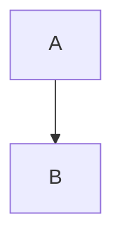

# MDViewer Implementation Plan

> **For agentic workers:** REQUIRED SUB-SKILL: Use superpowers:subagent-driven-development (recommended) or superpowers:executing-plans to implement this plan task-by-task. Steps use checkbox (`- [ ]`) syntax for tracking.

**Goal:** Build MDViewer, a free, open-source, read-only Markdown viewer for macOS, Windows, Linux, iOS and Android, from one Flutter codebase.

**Architecture:** Flutter owns the app chrome and file access (workspace, sidebar, TOC, search, settings, platform integration). Documents render inside a WebView (`flutter_inappwebview`) by an offline JavaScript renderer (markdown-it + highlight.js + KaTeX + Mermaid + DOMPurify) bundled with esbuild into `assets/renderer/`. Dart and JS talk only through a small bridge: Dart calls `window.mdv.*` via `evaluateJavascript`; JS calls Dart handlers via `window.flutter_inappwebview.callHandler`.

**Tech Stack:** Flutter 3.47 / Dart 3.13; `flutter_inappwebview` 6.2.0-beta.3; `file_selector`, `url_launcher`, `shared_preferences`, `desktop_drop`, `path`, `watcher`; Node 25 + esbuild for the renderer, tested with `node --test` + jsdom; Swift (macOS/iOS) and Kotlin (Android) method channels; GitHub Actions.

**Spec:** `docs/superpowers/specs/2026-09-27-mdviewer-design.md`

## Global Constraints

- App display name `MDViewer`; Dart package name `mdviewer`; bundle/application ID `io.github.djbuys.mdviewer`; licence MIT, copyright holder "Dana Buys".
- Target platforms: macOS, Windows, Linux, iOS, Android. **No web target.**
- Strictly read-only: the app never writes to, renames or deletes user files. (It may write its own caches/preferences.)
- Recognized Markdown extensions (case-insensitive): `.md`, `.markdown`, `.mdown`, `.mkd`.
- `flutter_inappwebview` pinned to exactly `6.2.0-beta.3` (the line that endorses `flutter_inappwebview_linux`).
- `flutter_markdown` is discontinued and must not be used.
- KaTeX npm dependency pinned to `~0.16.47` so it dedupes with `@vscode/markdown-it-katex` and `mermaid` (two KaTeX versions produce incompatible class names).
- DOMPurify must NOT forbid the `style` attribute (KaTeX layout depends on inline styles).
- The built renderer in `assets/renderer/` is committed; Flutter builds never require Node.
- Size thresholds: files > 5 MB (5 × 1024 × 1024 bytes) render with `heavyFeatures: false`; files > 50 MB show the plain-text fallback. Folder search skips files > 5 MB and caps at 1000 results.
- Folder tree and search exclude directories whose name starts with `.` and directories named `node_modules`.
- Recents: max 10 entries, newest first.
- Live-reload debounce: 200 ms. Renderer readiness timeout: 15 s.
- Wide layout breakpoint: 900 logical px. TOC shows heading levels 1–4.
- macOS runs **unsandboxed** (`com.apple.security.app-sandbox` = false). Reason: non-store distribution; WKWebView silently fails to load in a sandbox without extra entitlements, and a sandbox would block relative images and live reload. Consequence: security-scoped bookmarks are iOS-only (refines spec §2.1).
- WebView navigation policy: allow only the renderer page itself (URL path ending `assets/renderer/index.html`); cancel everything else. (On macOS the initial page load also goes through `shouldOverrideUrlLoading`.)
- Fire-and-forget `evaluateJavascript` calls must end in `; null` so they never return a Promise (macOS logs "unsupported type" otherwise); use `jsCall()` (Task 13). Numbers come back as `double` on some platforms — always read them as `num`.
- Widget tests create their harness/controllers **inside** the `testWidgets` body, never in `setUp`: subscriptions made outside the test's fake-async zone never settle under `pumpAndSettle`.
- Every platform's `DocumentAccess.openIncoming` accepts both file and folder paths (checks `FileSystemEntity.isDirectory`).
- Commit messages end with the trailer line `Co-Authored-By: Claude Opus 5.5 <noreply@anthropic.com>`.

## Verified facts (checked while writing this plan)

These were verified against real package sources and a real macOS WebView run on 2026-09-27; do not re-litigate them:

- `addJavaScriptHandler(handlerName:, callback:)` — callback type is `JavaScriptHandlerFunction`, i.e. `dynamic Function(JavaScriptHandlerFunctionData data)`; arguments are in `data.args`. Return value is JSON-encoded back to the JS promise.
- `printCurrentPage()` is implemented on Android, iOS and macOS only. Windows supports `window.print()` from JS (WebView2). Linux: no print → action hidden.
- On macOS the whole pipeline works: CSP with `script-src 'self' file:` loads the bundle from the Flutter asset directory, headings/resolveResource/linkClicked round-trip, Mermaid produces SVG, KaTeX fonts load.
- `@vscode/markdown-it-katex` is CommonJS with a `default` export: import as `katexModule.default ?? katexModule`.
- `flutter_inappwebview_linux` **fails the Linux build** if WPE WebKit dev packages are missing, and the built binary needs WPE WebKit at runtime.
- Node 25: run tests with `node --test "test/**/*.test.js"` (a bare directory argument fails).
- iOS template uses the UIScene lifecycle (`SceneDelegate: FlutterSceneDelegate`, `AppDelegate: FlutterAppDelegate, FlutterImplicitEngineDelegate`). `FlutterSceneDelegate`'s URL methods are not visible to Swift, so "Open in" is received by a plugin registered with `registrar.addSceneDelegate(_:)` (Task 20). macOS template: `MainFlutterWindow` creates the `FlutterViewController`; `FlutterAppDelegate.application(_:open:)` **must** be declared `override`.
- The complete plan code was executed while writing this plan: all 140 Dart tests and 21 renderer tests pass with `flutter analyze` clean; the end-to-end test (Task 22) passes on macOS, the iOS 26 simulator (iPhone 17) and an Android API 35 emulator; `flutter build macos|ios --simulator|apk --debug|apk --release` succeed; Finder "open with" delivered files and folders on cold and warm launch. **Not verified locally:** Windows and Linux builds (CI, Task 23).

## Deliberate refinements of the spec

- macOS runs unsandboxed, so security-scoped bookmarks are iOS-only (spec §2.1 said iOS/macOS).
- The JS API has no separate `setTheme`; Dart re-renders with the new theme and restores the scroll position (same user-visible behaviour, one code path).
- Link classification lives only in Dart (`LinkRouter`); the renderer forwards every click. JS tests therefore cover rendering, sanitizing, find and images, not link classes.
- The integration test writes its fixture folder to a temp directory at runtime instead of a committed `test_fixtures/` folder (app sandboxes on iOS/Android cannot read the repo).
- Android single files are copied into the app cache and read with `dart:io`; only folders use SAF. Relative images next to a single Android file therefore do not resolve unless the folder is opened.

## File Structure

```
MDViewer/
├─ lib/
│  ├─ main.dart                         entry point; builds AppServices, runs app
│  ├─ app.dart                          MdViewerApp (MaterialApp, themes)
│  ├─ app_services.dart                 AppServices container + AppScope InheritedWidget
│  ├─ open_actions.dart                 OpenActions: pick/restore/incoming → workspace + recents
│  ├─ workspace/
│  │  ├─ file_source.dart               FileSource interface + value types
│  │  ├─ io_file_source.dart            dart:io implementation (desktop, iOS, Android cache copies)
│  │  ├─ saf_file_source.dart           Android Storage Access Framework implementation
│  │  └─ workspace.dart                 Workspace (root, resolve, containment, tree), isMarkdownPath
│  ├─ document/
│  │  ├─ text_decoding.dart             decodeText (BOM, UTF-16, lossy UTF-8)
│  │  ├─ link_router.dart               LinkRouter + LinkTarget sealed hierarchy
│  │  ├─ external_launcher.dart         ExternalLauncher interface + url_launcher impl
│  │  └─ document_controller.dart       DocumentController (load, history, links, reload)
│  ├─ renderer/
│  │  ├─ renderer_controller.dart       RendererController interface + Heading/FindResult/RenderOptions
│  │  ├─ webview_renderer.dart          WebViewRendererController (flutter_inappwebview)
│  │  ├─ renderer_bridge.dart           pure helpers: jsCall, isRendererPage, PrintMode
│  │  └─ plain_text_fallback.dart       PlainTextFallback widget
│  ├─ search/
│  │  ├─ folder_search.dart             FolderSearch + searchInText
│  │  ├─ find_bar.dart                  FindBar widget
│  │  └─ folder_search_dialog.dart      FolderSearchDialog widget
│  ├─ platform/
│  │  ├─ document_access.dart           DocumentAccess interface, OpenRequest, factory
│  │  ├─ desktop_document_access.dart   file_selector-based implementation
│  │  ├─ ios_document_access.dart       iOS channel implementation
│  │  ├─ android_document_access.dart   Android channel implementation
│  │  └─ incoming_files.dart            IncomingFiles (argv + native channel)
│  ├─ settings/
│  │  ├─ settings.dart                  Settings (theme mode, font scale)
│  │  └─ recents.dart                   Recents + RecentEntry
│  └─ ui/
│     ├─ app_shell.dart                 responsive layout, app bar, shortcuts, menus
│     ├─ document_pane.dart             renderer host + status overlays + banners
│     ├─ empty_state.dart               nothing-open view
│     ├─ error_view.dart                error view
│     ├─ file_sidebar.dart              folder tree
│     └─ toc_panel.dart                 heading list
├─ renderer/                            npm project for the JS renderer
│  ├─ package.json, package-lock.json, build.mjs
│  ├─ src/markdown.js, src/find.js, src/images.js, src/main.js
│  ├─ static/index.html, static/app.css
│  └─ test/markdown.test.js, test/find.test.js, test/images.test.js
├─ assets/renderer/                     built renderer (committed)
├─ test/
│  ├─ support/memory_file_source.dart, fake_renderer.dart, fakes.dart, test_app.dart
│  └─ (unit + widget tests mirroring lib/)
├─ integration_test/renderer_test.dart   end-to-end in the real WebView
├─ macos/Runner/AppDelegate.swift        + IncomingFilesChannel; MainFlutterWindow.swift, Info.plist edits
├─ ios/Runner/AppDelegate.swift          + DocumentAccessPlugin; Info.plist edits
├─ android/app/src/main/kotlin/io/github/djbuys/mdviewer/{MainActivity.kt,DocumentsChannel.kt}
├─ android/app/build.gradle.kts, src/main/AndroidManifest.xml edits
├─ scripts/install-linux-deps.sh
├─ .github/workflows/ci.yml, release.yml
└─ LICENSE, README.md
```

---

## Milestone 1 — Scaffold and JS renderer

### Task 1: Flutter project scaffold

**Files:**
- Create: Flutter project in repo root (`flutter create`), `LICENSE`, `README.md`
- Modify: `pubspec.yaml`, `.gitignore`, `lib/main.dart`, `test/widget_test.dart` (replace), `macos/Runner/DebugProfile.entitlements`, `macos/Runner/Release.entitlements`, `macos/Runner/Configs/AppInfo.xcconfig`, `ios/Runner/Info.plist`, `android/app/src/main/AndroidManifest.xml`, `windows/runner/main.cpp`, `linux/runner/my_application.cc`

**Interfaces:**
- Produces: a buildable Flutter app named `mdviewer` with all dependencies resolved; later tasks replace `lib/main.dart`.

- [ ] **Step 1: Create the Flutter project in the existing repo**

```bash
cd /Users/djbuys/Developer/MDViewer
flutter create --platforms=macos,windows,linux,ios,android --org io.github.djbuys --project-name mdviewer --description "A free, cross-platform Markdown viewer." .
```

Expected: "All done!" and the platform folders exist. `docs/` is untouched.

- [ ] **Step 2: Add dependencies**

```bash
flutter pub add flutter_inappwebview:6.2.0-beta.3 file_selector url_launcher shared_preferences desktop_drop path watcher
flutter pub add 'dev:integration_test:{"sdk":"flutter"}'
```

Then open `pubspec.yaml` and confirm the line reads exactly `flutter_inappwebview: 6.2.0-beta.3` (no caret). Run `flutter pub deps | grep inappwebview_linux` — expected: `flutter_inappwebview_linux 0.1.0-beta.1` is listed.

- [ ] **Step 3: Set the display name on every platform**

- `macos/Runner/Configs/AppInfo.xcconfig`: `PRODUCT_NAME = mdviewer` → `PRODUCT_NAME = MDViewer`
- `ios/Runner/Info.plist`: the `<string>` after `CFBundleDisplayName` → `<string>MDViewer</string>`
- `android/app/src/main/AndroidManifest.xml`: `android:label="mdviewer"` → `android:label="MDViewer"`
- `windows/runner/main.cpp`: `window.Create(L"mdviewer", origin, size)` → `window.Create(L"MDViewer", origin, size)`
- `linux/runner/my_application.cc`: both `"mdviewer"` title strings (`gtk_header_bar_set_title` and `gtk_window_set_title`) → `"MDViewer"`

- [ ] **Step 4: Turn off the macOS App Sandbox**

Replace `macos/Runner/DebugProfile.entitlements` with:

```xml
<?xml version="1.0" encoding="UTF-8"?>
<!DOCTYPE plist PUBLIC "-//Apple//DTD PLIST 1.0//EN" "http://www.apple.com/DTDs/PropertyList-1.0.dtd">
<plist version="1.0">
<dict>
	<key>com.apple.security.app-sandbox</key>
	<false/>
	<key>com.apple.security.cs.allow-jit</key>
	<true/>
	<key>com.apple.security.network.server</key>
	<true/>
</dict>
</plist>
```

Replace `macos/Runner/Release.entitlements` with:

```xml
<?xml version="1.0" encoding="UTF-8"?>
<!DOCTYPE plist PUBLIC "-//Apple//DTD PLIST 1.0//EN" "http://www.apple.com/DTDs/PropertyList-1.0.dtd">
<plist version="1.0">
<dict>
	<key>com.apple.security.app-sandbox</key>
	<false/>
</dict>
</plist>
```

- [ ] **Step 5: Replace the counter app with a placeholder and a smoke test**

`lib/main.dart`:

```dart
import 'package:flutter/material.dart';

void main() {
  runApp(const MaterialApp(
    title: 'MDViewer',
    home: Scaffold(body: Center(child: Text('MDViewer'))),
  ));
}
```

`test/widget_test.dart`:

```dart
import 'package:flutter/material.dart';
import 'package:flutter_test/flutter_test.dart';

void main() {
  testWidgets('placeholder app shows its name', (tester) async {
    await tester.pumpWidget(const MaterialApp(
      home: Scaffold(body: Center(child: Text('MDViewer'))),
    ));
    expect(find.text('MDViewer'), findsOneWidget);
  });
}
```

- [ ] **Step 6: Licence, readme stub, gitignore**

`LICENSE`:

```text
MIT License

Copyright (c) 2026 Dana Buys

Permission is hereby granted, free of charge, to any person obtaining a copy
of this software and associated documentation files (the "Software"), to deal
in the Software without restriction, including without limitation the rights
to use, copy, modify, merge, publish, distribute, sublicense, and/or sell
copies of the Software, and to permit persons to whom the Software is
furnished to do so, subject to the following conditions:

The above copyright notice and this permission notice shall be included in all
copies or substantial portions of the Software.

THE SOFTWARE IS PROVIDED "AS IS", WITHOUT WARRANTY OF ANY KIND, EXPRESS OR
IMPLIED, INCLUDING BUT NOT LIMITED TO THE WARRANTIES OF MERCHANTABILITY,
FITNESS FOR A PARTICULAR PURPOSE AND NONINFRINGEMENT. IN NO EVENT SHALL THE
AUTHORS OR COPYRIGHT HOLDERS BE LIABLE FOR ANY CLAIM, DAMAGES OR OTHER
LIABILITY, WHETHER IN AN ACTION OF CONTRACT, TORT OR OTHERWISE, ARISING FROM,
OUT OF OR IN CONNECTION WITH THE SOFTWARE OR THE USE OR OTHER DEALINGS IN THE
SOFTWARE.
```

`README.md` (replace the generated one; Task 22 expands it):

```markdown
# MDViewer

A free, open-source, read-only Markdown viewer for macOS, Windows, Linux, iOS and Android.

Status: under construction.
```

Append to `.gitignore`:

```text

# Renderer (npm) project
renderer/node_modules/
```

- [ ] **Step 7: Verify**

Run: `flutter analyze && flutter test && flutter build macos --debug`
Expected: "No issues found!", "All tests passed!", and `✓ Built build/macos/Build/Products/Debug/MDViewer.app`.

- [ ] **Step 8: Commit**

```bash
git add -A
git commit -m "chore: scaffold Flutter project for MDViewer

Co-Authored-By: Claude Opus 5.5 <noreply@anthropic.com>"
```

---

### Task 2: Renderer — Markdown to sanitized HTML

**Files:**
- Create: `renderer/package.json`, `renderer/src/markdown.js`, `renderer/test/markdown.test.js`

**Interfaces:**
- Produces (ES module `renderer/src/markdown.js`):
  - `stripFrontMatter(text: string): string`
  - `createMarkdown({heavyFeatures?: boolean}): MarkdownIt`
  - `PURIFY_CONFIG` (DOMPurify config object)
  - `renderMarkdown(text: string, {purify, heavyFeatures?: boolean}): {html: string, headings: {id, text, level}[]}` — `purify` is a DOMPurify instance.

- [ ] **Step 1: Create the npm project**

```bash
mkdir -p renderer/src renderer/test renderer/static
cd renderer
npm init -y
npm pkg set name=mdviewer-renderer private=true type=module
npm pkg delete main
npm pkg set scripts.test='node --test "test/**/*.test.js"'
npm pkg set scripts.build='node build.mjs'
npm i markdown-it markdown-it-footnote markdown-it-task-lists @vscode/markdown-it-katex katex@~0.16.47 highlight.js dompurify mermaid github-markdown-css github-slugger
npm i -D esbuild jsdom
npm ls katex
cd ..
```

Expected from `npm ls katex`: every `katex` line shows `0.16.x` and the nested ones say `deduped`.

- [ ] **Step 2: Write the failing tests**

`renderer/test/markdown.test.js`:

```js
import { test } from 'node:test';
import assert from 'node:assert/strict';
import { JSDOM } from 'jsdom';
import createDOMPurify from 'dompurify';
import { renderMarkdown, stripFrontMatter } from '../src/markdown.js';

const purify = createDOMPurify(new JSDOM('').window);
const render = (text, options = {}) => renderMarkdown(text, { purify, ...options });

test('strips YAML front matter only at the start', () => {
  assert.equal(stripFrontMatter('---\ntitle: x\n---\n# Hi\n'), '# Hi\n');
  assert.equal(stripFrontMatter('# Hi\n---\na: b\n---\n'), '# Hi\n---\na: b\n---\n');
  assert.equal(stripFrontMatter('---\na: 1\n...\nbody'), 'body');
});

test('front matter is not rendered', () => {
  const { html } = render('---\ntitle: Secret\n---\n# Visible\n');
  assert.ok(!html.includes('Secret'));
  assert.ok(html.includes('Visible'));
});

test('headings get GitHub-style unique ids and are reported', () => {
  const { html, headings } = render('# Hello World\n## Hello World\n### `code` & More!\n');
  assert.deepEqual(headings, [
    { id: 'hello-world', text: 'Hello World', level: 1 },
    { id: 'hello-world-1', text: 'Hello World', level: 2 },
    { id: 'code--more', text: 'code & More!', level: 3 },
  ]);
  assert.ok(html.includes('<h1 id="hello-world">'));
  assert.ok(html.includes('<h2 id="hello-world-1">'));
});

test('renders GFM tables, strikethrough and autolinks', () => {
  const { html } = render('| a | b |\n|---|---|\n| 1 | 2 |\n\n~~gone~~ https://example.com\n');
  assert.ok(html.includes('<table>'));
  assert.ok(html.includes('<td>1</td>'));
  assert.ok(html.includes('<s>gone</s>'));
  assert.ok(html.includes('<a href="https://example.com">https://example.com</a>'));
});

test('renders task lists as disabled checkboxes', () => {
  const { html } = render('- [x] done\n- [ ] todo\n');
  assert.match(html, /<input class="task-list-item-checkbox" checked="" disabled="" type="checkbox">/);
  assert.match(html, /<input class="task-list-item-checkbox" disabled="" type="checkbox">/);
});

test('renders footnotes', () => {
  const { html } = render('Text[^1]\n\n[^1]: The note\n');
  assert.ok(html.includes('class="footnote-ref"'));
  assert.ok(html.includes('The note'));
});

test('renders inline, block and fenced maths with KaTeX (keeping inline styles)', () => {
  const { html } = render('$E=mc^2$\n\n$$\\frac{1}{2}$$\n\n```math\nx^2\n```\n');
  assert.equal((html.match(/class="katex"/g) || []).length, 3);
  assert.ok(html.includes('class="math-block"'));
  assert.match(html, /style="height:/);
});

test('KaTeX errors render in the error colour instead of throwing', () => {
  const { html } = render('$\\notacommand{x}$');
  assert.ok(html.includes('#cc0000'));
});

test('mermaid fences become pre.mermaid with escaped source', () => {
  const { html } = render('```mermaid\ngraph TD; A-->B\n```\n');
  assert.ok(html.includes('<pre class="mermaid">graph TD; A--&gt;B\n</pre>'));
});

test('code fences are syntax highlighted', () => {
  const { html } = render('```js\nconst a = 1;\n```\n');
  assert.ok(html.includes('<span class="hljs-keyword">const</span>'));
});

test('heavyFeatures=false disables highlighting, maths and mermaid', () => {
  const { html } = render('$x$\n\n```mermaid\ngraph TD; A-->B\n```\n\n```js\nconst a = 1;\n```\n', {
    heavyFeatures: false,
  });
  assert.ok(!html.includes('katex'));
  assert.ok(!html.includes('class="mermaid"'));
  assert.ok(!html.includes('hljs-keyword'));
  assert.ok(html.includes('language-mermaid'));
});

test('sanitizes scripts, event handlers, javascript: URLs and frames', () => {
  const { html } = render(
    '<script>alert(1)</script>\n\n\n\n' +
      '<a href="javascript:alert(1)">bad</a>\n\n<iframe src="https://evil.example"></iframe>\n\n' +
      '[md-bad](javascript:alert(1))\n\n<style>body{display:none}</style>\n',
  );
  assert.ok(!html.includes('<script'));
  assert.ok(!html.includes('onerror'));
  // markdown-it leaves `[x](javascript:...)` as literal text; what matters is no such href.
  assert.ok(!/href="javascript:/i.test(html));
  assert.ok(!html.includes('<iframe'));
  assert.ok(!html.includes('<style'));
});

test('keeps relative image and link URLs for the host to resolve', () => {
  const { html } = render('\n\n[next](other.md#part)\n');
  assert.ok(html.includes(''));
  assert.ok(html.includes('<a href="other.md#part">next</a>'));
});
```

- [ ] **Step 3: Run the tests to verify they fail**

Run: `cd renderer && npm test; cd ..`
Expected: FAIL — `Cannot find module '.../src/markdown.js'`.

- [ ] **Step 4: Implement `renderer/src/markdown.js`**

```js
import MarkdownIt from 'markdown-it';
import footnote from 'markdown-it-footnote';
import taskLists from 'markdown-it-task-lists';
import katexModule from '@vscode/markdown-it-katex';
import katex from 'katex';
import hljs from 'highlight.js/lib/common';
import GithubSlugger from 'github-slugger';

// @vscode/markdown-it-katex is CommonJS with a `default` export.
const katexPlugin = katexModule.default ?? katexModule;

const FRONT_MATTER = /^?---\r?\n[\s\S]*?\r?\n(?:---|\.\.\.)[ \t]*(?:\r?\n|$)/;
const KATEX_OPTIONS = { throwOnError: false, errorColor: '#cc0000' };

export function stripFrontMatter(text) {
  return text.replace(FRONT_MATTER, '');
}

function escapeHtml(s) {
  return s.replace(/&/g, '&amp;').replace(/</g, '&lt;').replace(/>/g, '&gt;').replace(/"/g, '&quot;');
}

// Assigns GitHub-compatible ids to headings and records them in env.headings.
function headingIds(md) {
  md.core.ruler.push('mdv_heading_ids', (state) => {
    const slugger = new GithubSlugger();
    const headings = [];
    const tokens = state.tokens;
    for (let i = 0; i < tokens.length; i++) {
      const token = tokens[i];
      if (token.type !== 'heading_open') continue;
      const inline = tokens[i + 1];
      const text = (inline.children || [])
        .filter((c) => c.type === 'text' || c.type === 'code_inline')
        .map((c) => c.content)
        .join('');
      const id = slugger.slug(text);
      token.attrSet('id', id);
      headings.push({ id, text, level: Number(token.tag.slice(1)) });
    }
    state.env.headings = headings;
  });
}

export function createMarkdown({ heavyFeatures = true } = {}) {
  const md = new MarkdownIt({
    html: true,
    linkify: true,
    typographer: false,
    highlight: heavyFeatures
      ? (code, lang) => {
          if (lang && hljs.getLanguage(lang)) {
            try {
              return hljs.highlight(code, { language: lang, ignoreIllegals: true }).value;
            } catch (_) {
              // fall through to markdown-it's default escaping
            }
          }
          return '';
        }
      : null,
  });
  md.use(footnote).use(taskLists, { enabled: false }).use(headingIds);
  if (heavyFeatures) md.use(katexPlugin, KATEX_OPTIONS);

  const defaultFence = md.renderer.rules.fence;
  md.renderer.rules.fence = (tokens, idx, options, env, self) => {
    const token = tokens[idx];
    const lang = token.info.trim().split(/\s+/)[0];
    if (heavyFeatures && lang === 'mermaid') {
      return `<pre class="mermaid">${escapeHtml(token.content)}</pre>\n`;
    }
    if (heavyFeatures && lang === 'math') {
      const math = katex.renderToString(token.content, { ...KATEX_OPTIONS, displayMode: true });
      return `<div class="math-block">${math}</div>\n`;
    }
    return defaultFence(tokens, idx, options, env, self);
  };
  return md;
}

// `style` attributes are intentionally allowed: KaTeX layout depends on them.
export const PURIFY_CONFIG = {
  FORBID_TAGS: ['style', 'iframe', 'object', 'embed', 'form', 'base', 'meta', 'link'],
};

export function renderMarkdown(text, { purify, heavyFeatures = true }) {
  const md = createMarkdown({ heavyFeatures });
  const env = {};
  const raw = md.render(stripFrontMatter(text), env);
  const html = purify.sanitize(raw, PURIFY_CONFIG);
  return { html, headings: env.headings || [] };
}
```

- [ ] **Step 5: Run the tests to verify they pass**

Run: `cd renderer && npm test; cd ..`
Expected: all 13 tests pass. If the `code--more` slug assertion fails, print `headings` and check `github-slugger`'s output — GitHub strips `&` and `!` and keeps the double hyphen; adjust the expected value only if github-slugger differs, since github-slugger is the source of truth for GitHub compatibility.

- [ ] **Step 6: Commit**

```bash
git add renderer/package.json renderer/package-lock.json renderer/src/markdown.js renderer/test/markdown.test.js
git commit -m "feat(renderer): markdown to sanitized HTML with headings, maths, mermaid blocks

Co-Authored-By: Claude Opus 5.5 <noreply@anthropic.com>"
```

---

### Task 3: Renderer — find-in-page and relative images

**Files:**
- Create: `renderer/src/find.js`, `renderer/src/images.js`, `renderer/test/find.test.js`, `renderer/test/images.test.js`

**Interfaces:**
- Produces:
  - `class Finder(root: Element)` with `find(query): {total, current}`, `next()`, `prev()`, `clear()`, `result()`. `current` is 1-based; `0` when no match.
  - `isRelativeResource(src: string): boolean`
  - `detachRelativeImages(root: ParentNode): HTMLImageElement[]` — moves relative `src` into `data-mdv-src`.
  - `resolveImages(images, resolve: (path) => Promise<string|null>): Promise<void>` — sets `src` to the data URI, or adds class `mdv-broken-image` and a `title`.

- [ ] **Step 1: Write the failing tests**

`renderer/test/find.test.js`:

```js
import { test } from 'node:test';
import assert from 'node:assert/strict';
import { JSDOM } from 'jsdom';
import { Finder } from '../src/find.js';

function setup(html) {
  const { document } = new JSDOM(`<div id="c">${html}</div>`).window;
  const root = document.getElementById('c');
  return { root, finder: new Finder(root) };
}

test('finds case-insensitive matches across elements and cycles', () => {
  const { root, finder } = setup('<p>Foo bar foo</p><p>FOO<b>x</b></p>');
  assert.deepEqual(finder.find('foo'), { total: 3, current: 1 });
  assert.equal(root.querySelectorAll('mark.mdv-find').length, 3);
  assert.equal(root.querySelectorAll('mark.mdv-find-current').length, 1);
  assert.deepEqual(finder.next(), { total: 3, current: 2 });
  assert.deepEqual(finder.next(), { total: 3, current: 3 });
  assert.deepEqual(finder.next(), { total: 3, current: 1 });
  assert.deepEqual(finder.prev(), { total: 3, current: 3 });
});

test('clear restores the original DOM', () => {
  const { root, finder } = setup('<p>Foo bar foo</p><p>FOO<b>x</b></p>');
  finder.find('foo');
  finder.clear();
  assert.equal(root.innerHTML, '<p>Foo bar foo</p><p>FOO<b>x</b></p>');
  assert.deepEqual(finder.result(), { total: 0, current: 0 });
});

test('empty query and no matches report zero', () => {
  const { finder } = setup('<p>abc</p>');
  assert.deepEqual(finder.find(''), { total: 0, current: 0 });
  assert.deepEqual(finder.find('zzz'), { total: 0, current: 0 });
  assert.deepEqual(finder.next(), { total: 0, current: 0 });
});

test('skips text inside svg and KaTeX MathML', () => {
  const { finder } = setup(
    '<p>node</p><svg><text>node</text></svg><span class="katex-mathml">node</span>',
  );
  assert.deepEqual(finder.find('node'), { total: 1, current: 1 });
});

test('a new search replaces the previous highlights', () => {
  const { root, finder } = setup('<p>alpha beta alpha</p>');
  finder.find('alpha');
  finder.find('beta');
  assert.equal(root.querySelectorAll('mark.mdv-find').length, 1);
});
```

`renderer/test/images.test.js`:

```js
import { test } from 'node:test';
import assert from 'node:assert/strict';
import { JSDOM } from 'jsdom';
import { isRelativeResource, detachRelativeImages, resolveImages } from '../src/images.js';

test('classifies relative resources', () => {
  assert.equal(isRelativeResource('a.png'), true);
  assert.equal(isRelativeResource('../img/a.png'), true);
  assert.equal(isRelativeResource('/root.png'), true);
  assert.equal(isRelativeResource('https://x/y.png'), false);
  assert.equal(isRelativeResource('data:image/png;base64,AA=='), false);
  assert.equal(isRelativeResource('//cdn.example/a.png'), false);
  assert.equal(isRelativeResource(''), false);
});

test('detaches only relative images and resolves them', async () => {
  const { document } = new JSDOM(
    '<div id="c"></div>',
  ).window;
  const root = document.getElementById('c');
  const images = detachRelativeImages(root);
  assert.equal(images.length, 2);
  assert.equal(images[0].hasAttribute('src'), false);
  assert.equal(images[0].getAttribute('data-mdv-src'), 'a.png');

  const asked = [];
  await resolveImages(images, async (path) => {
    asked.push(path);
    return path === 'a.png' ? 'data:image/png;base64,AA==' : null;
  });
  assert.deepEqual(asked, ['a.png', 'missing.png']);
  assert.equal(images[0].getAttribute('src'), 'data:image/png;base64,AA==');
  assert.equal(images[1].classList.contains('mdv-broken-image'), true);
  assert.equal(images[1].getAttribute('title'), 'Image not found: missing.png');
  assert.equal(root.querySelector('img[src^="https"]').getAttribute('src'), 'https://x/y.png');
});

test('a throwing resolver marks the image broken', async () => {
  const { document } = new JSDOM('<div id="c"></div>').window;
  const images = detachRelativeImages(document.getElementById('c'));
  await resolveImages(images, async () => {
    throw new Error('boom');
  });
  assert.equal(images[0].classList.contains('mdv-broken-image'), true);
});
```

- [ ] **Step 2: Run the tests to verify they fail**

Run: `cd renderer && npm test; cd ..`
Expected: FAIL — cannot find `../src/find.js` / `../src/images.js`.

- [ ] **Step 3: Implement `renderer/src/find.js`**

```js
const MARK_CLASS = 'mdv-find';
const CURRENT_CLASS = 'mdv-find-current';
const SHOW_TEXT = 4; // NodeFilter.SHOW_TEXT
const FILTER_ACCEPT = 1;
const FILTER_REJECT = 2;

export class Finder {
  constructor(root) {
    this.root = root;
    this.marks = [];
    this.index = -1;
  }

  clear() {
    for (const mark of this.marks) {
      const parent = mark.parentNode;
      if (!parent) continue;
      parent.replaceChild(mark.ownerDocument.createTextNode(mark.textContent), mark);
      parent.normalize();
    }
    this.marks = [];
    this.index = -1;
  }

  find(query) {
    this.clear();
    const needle = query.toLowerCase();
    if (!needle) return this.result();
    const doc = this.root.ownerDocument;
    const walker = doc.createTreeWalker(this.root, SHOW_TEXT, {
      acceptNode: (node) =>
        node.parentElement && node.parentElement.closest('script, style, svg, .katex-mathml')
          ? FILTER_REJECT
          : FILTER_ACCEPT,
    });
    const nodes = [];
    while (walker.nextNode()) nodes.push(walker.currentNode);
    for (const node of nodes) {
      const text = node.nodeValue;
      const lower = text.toLowerCase();
      let from = 0;
      let at = lower.indexOf(needle, from);
      if (at === -1) continue;
      const frag = doc.createDocumentFragment();
      while (at !== -1) {
        if (at > from) frag.appendChild(doc.createTextNode(text.slice(from, at)));
        const mark = doc.createElement('mark');
        mark.className = MARK_CLASS;
        mark.textContent = text.slice(at, at + needle.length);
        frag.appendChild(mark);
        this.marks.push(mark);
        from = at + needle.length;
        at = lower.indexOf(needle, from);
      }
      if (from < text.length) frag.appendChild(doc.createTextNode(text.slice(from)));
      node.parentNode.replaceChild(frag, node);
    }
    if (this.marks.length > 0) this.select(0);
    return this.result();
  }

  next() {
    if (this.marks.length > 0) this.select((this.index + 1) % this.marks.length);
    return this.result();
  }

  prev() {
    if (this.marks.length > 0) this.select((this.index - 1 + this.marks.length) % this.marks.length);
    return this.result();
  }

  select(i) {
    if (this.index >= 0) this.marks[this.index].classList.remove(CURRENT_CLASS);
    this.index = i;
    const mark = this.marks[i];
    mark.classList.add(CURRENT_CLASS);
    if (typeof mark.scrollIntoView === 'function') mark.scrollIntoView({ block: 'center' });
  }

  result() {
    return { total: this.marks.length, current: this.index + 1 };
  }
}
```

- [ ] **Step 4: Implement `renderer/src/images.js`**

```js
const ABSOLUTE = /^(?:[a-z][a-z0-9+.-]*:|\/\/)/i;

export function isRelativeResource(src) {
  return !!src && !ABSOLUTE.test(src) && !src.startsWith('#');
}

// Moves relative  into data-mdv-src so the WebView never tries to
// load them directly, and returns the images that need resolving.
export function detachRelativeImages(root) {
  const pending = [];
  for (const img of root.querySelectorAll('img[src]')) {
    const src = img.getAttribute('src');
    if (!isRelativeResource(src)) continue;
    img.removeAttribute('src');
    img.setAttribute('data-mdv-src', src);
    pending.push(img);
  }
  return pending;
}

export async function resolveImages(images, resolve) {
  await Promise.all(
    images.map(async (img) => {
      const src = img.getAttribute('data-mdv-src');
      let dataUri = null;
      try {
        dataUri = await resolve(src);
      } catch (_) {
        dataUri = null;
      }
      if (dataUri) {
        img.setAttribute('src', dataUri);
      } else {
        img.classList.add('mdv-broken-image');
        img.setAttribute('title', `Image not found: ${src}`);
      }
    }),
  );
}
```

- [ ] **Step 5: Run the tests to verify they pass**

Run: `cd renderer && npm test; cd ..`
Expected: all tests (markdown + find + images) pass.

- [ ] **Step 6: Commit**

```bash
git add renderer/src/find.js renderer/src/images.js renderer/test/find.test.js renderer/test/images.test.js
git commit -m "feat(renderer): find-in-page highlighting and relative image resolution

Co-Authored-By: Claude Opus 5.5 <noreply@anthropic.com>"
```

---

### Task 4: Renderer — bridge, page, build, bundled assets

**Files:**
- Create: `renderer/src/main.js`, `renderer/static/index.html`, `renderer/static/app.css`, `renderer/build.mjs`, `renderer/scripts/check-built.sh`, `assets/renderer/**` (build output)
- Modify: `pubspec.yaml` (assets)

**Interfaces:**
- Consumes: `renderMarkdown` (Task 2), `Finder`, `detachRelativeImages`, `resolveImages` (Task 3).
- Produces the JS API on `window.mdv` (called from Dart in Task 13):
  - `render(markdown: string, options: {theme: 'light'|'dark', fontScale: number, heavyFeatures: boolean, restoreScrollY?: number})`
  - `scrollToHeading(id): boolean`, `getScrollPosition(): number`, `setScrollPosition(y)`
  - `find(query)`, `findNext()`, `findPrev()`, `clearFind()` — each also emits `findResult`
  - `print()`
- Produces JS → Dart handler calls (`window.flutter_inappwebview.callHandler(name, payload)`):
  - `headingsChanged` payload `[{id, text, level}]`
  - `resolveResource` payload `{path}` → expects a `data:` URI string or `null`
  - `linkClicked` payload `{href}`
  - `findResult` payload `{total, current}`
  - `rendered` payload `{generation}`
  - `renderError` payload `{message}`
- Asset directory registered in `pubspec.yaml`: `assets/renderer/`, `assets/renderer/katex/`, `assets/renderer/katex/fonts/`. Page asset path: `assets/renderer/index.html`.

- [ ] **Step 1: Write `renderer/src/main.js`**

```js
import DOMPurify from 'dompurify';
import { renderMarkdown } from './markdown.js';
import { Finder } from './find.js';
import { detachRelativeImages, resolveImages } from './images.js';

const content = document.getElementById('content');
const finder = new Finder(content);
const state = {
  markdown: '',
  options: { theme: 'light', fontScale: 1, heavyFeatures: true },
  generation: 0,
};

function callHost(name, payload) {
  const bridge = window.flutter_inappwebview;
  if (!bridge || typeof bridge.callHandler !== 'function') {
    console.log(`[mdv] ${name}`, payload);
    return Promise.resolve(null);
  }
  return bridge.callHandler(name, payload);
}

function applyTheme(theme) {
  const dark = theme === 'dark';
  document.documentElement.dataset.theme = dark ? 'dark' : 'light';
  document.getElementById('md-light').disabled = dark;
  document.getElementById('md-dark').disabled = !dark;
  document.getElementById('hl-light').disabled = dark;
  document.getElementById('hl-dark').disabled = !dark;
}

async function renderMermaid(generation) {
  const blocks = content.querySelectorAll('pre.mermaid');
  if (blocks.length === 0 || !window.mermaid) return;
  window.mermaid.initialize({
    startOnLoad: false,
    securityLevel: 'strict',
    theme: state.options.theme === 'dark' ? 'dark' : 'default',
  });
  for (const [i, block] of [...blocks].entries()) {
    if (generation !== state.generation) return;
    try {
      const { svg } = await window.mermaid.render(`mdv-mermaid-${generation}-${i}`, block.textContent);
      const wrapper = document.createElement('div');
      wrapper.className = 'mermaid-diagram';
      wrapper.innerHTML = svg;
      block.replaceWith(wrapper);
    } catch (err) {
      const error = document.createElement('div');
      error.className = 'mdv-mermaid-error';
      error.textContent = `Mermaid error: ${err && err.message ? err.message : err}`;
      block.after(error);
    }
  }
}

async function render(markdown, options = {}) {
  const generation = ++state.generation;
  state.markdown = markdown;
  state.options = { ...state.options, ...options };
  applyTheme(state.options.theme);
  document.documentElement.style.setProperty('--mdv-font-scale', String(state.options.fontScale));
  try {
    finder.clear();
    const { html, headings } = renderMarkdown(markdown, {
      purify: DOMPurify,
      heavyFeatures: state.options.heavyFeatures,
    });
    const template = document.createElement('template');
    template.innerHTML = html;
    const images = detachRelativeImages(template.content);
    content.replaceChildren(template.content);
    callHost('headingsChanged', headings);
    await Promise.all([
      resolveImages(images, (path) => callHost('resolveResource', { path })),
      state.options.heavyFeatures ? renderMermaid(generation) : Promise.resolve(),
    ]);
    if (generation !== state.generation) return;
    if (typeof state.options.restoreScrollY === 'number') {
      window.scrollTo(0, state.options.restoreScrollY);
    }
    callHost('rendered', { generation });
  } catch (err) {
    callHost('renderError', { message: String(err && err.stack ? err.stack : err) });
  }
}

// Every link click goes to the host; the WebView itself never navigates.
document.addEventListener('click', (event) => {
  const anchor = event.target.closest('a[href]');
  if (!anchor) return;
  event.preventDefault();
  callHost('linkClicked', { href: anchor.getAttribute('href') });
});

function reportFind(result) {
  callHost('findResult', result);
  return result;
}

window.mdv = {
  render,
  scrollToHeading(id) {
    const el = document.getElementById(id);
    if (el) el.scrollIntoView({ block: 'start' });
    return !!el;
  },
  getScrollPosition() {
    return window.scrollY;
  },
  setScrollPosition(y) {
    window.scrollTo(0, y);
  },
  find(query) {
    return reportFind(finder.find(query));
  },
  findNext() {
    return reportFind(finder.next());
  },
  findPrev() {
    return reportFind(finder.prev());
  },
  clearFind() {
    finder.clear();
    return reportFind({ total: 0, current: 0 });
  },
  print() {
    window.print();
  },
};
```

- [ ] **Step 2: Write `renderer/static/index.html`**

No inline scripts are allowed by the CSP, so both scripts are external files.

```html
<!doctype html>
<html lang="en" data-theme="light">
<head>
<meta charset="utf-8">
<meta name="viewport" content="width=device-width, initial-scale=1">
<meta http-equiv="Content-Security-Policy" content="default-src 'none'; script-src 'self' file:; style-src 'self' file: 'unsafe-inline'; img-src data: https:; font-src 'self' file: data:; connect-src 'none'; frame-src 'none'; object-src 'none'; base-uri 'none'; form-action 'none'">
<title>MDViewer</title>
<link id="md-light" rel="stylesheet" href="github-markdown-light.css">
<link id="md-dark" rel="stylesheet" href="github-markdown-dark.css" disabled>
<link id="hl-light" rel="stylesheet" href="hljs-github.css">
<link id="hl-dark" rel="stylesheet" href="hljs-github-dark.css" disabled>
<link rel="stylesheet" href="katex/katex.min.css">
<link rel="stylesheet" href="app.css">
</head>
<body>
<article id="content" class="markdown-body"></article>
<script src="mermaid.min.js"></script>
<script src="renderer.bundle.js"></script>
</body>
</html>
```

- [ ] **Step 3: Write `renderer/static/app.css`**

```css
:root { --mdv-font-scale: 1; color-scheme: light; }
:root[data-theme="dark"] { color-scheme: dark; }
html, body { margin: 0; padding: 0; }
body { background: #ffffff; }
:root[data-theme="dark"] body { background: #0d1117; }
.markdown-body {
  box-sizing: border-box;
  max-width: 980px;
  margin: 0 auto;
  padding: 32px 24px 64px;
  font-size: calc(16px * var(--mdv-font-scale));
}
@media (max-width: 600px) { .markdown-body { padding: 16px 16px 48px; } }
.mermaid-diagram { text-align: center; margin: 16px 0; overflow-x: auto; }
.mdv-mermaid-error, .mdv-broken-image {
  color: #cf222e; border: 1px dashed #cf222e; padding: 8px; border-radius: 6px;
  font-family: ui-monospace, SFMono-Regular, Menlo, monospace; font-size: 85%;
}
.mdv-broken-image { display: inline-block; min-width: 120px; min-height: 24px; }
mark.mdv-find { background: #fff8c5; color: inherit; border-radius: 2px; }
mark.mdv-find-current { background: #ffb000; }
:root[data-theme="dark"] mark.mdv-find { background: #634d00; }
:root[data-theme="dark"] mark.mdv-find-current { background: #bb8009; }
.math-block, .katex-block { overflow-x: auto; }
@media print {
  body { background: #ffffff; }
  .markdown-body { max-width: none; padding: 0; }
}
```

- [ ] **Step 4: Write `renderer/build.mjs`**

```js
import { build } from 'esbuild';
import { cp, mkdir, rm } from 'node:fs/promises';

const out = process.argv[2] ?? '../assets/renderer';
const nm = 'node_modules';

await rm(out, { recursive: true, force: true });
await mkdir(out, { recursive: true });

await build({
  entryPoints: ['src/main.js'],
  bundle: true,
  format: 'iife',
  minify: true,
  target: ['es2020'],
  outfile: `${out}/renderer.bundle.js`,
  legalComments: 'none',
});

const copies = [
  ['static/index.html', 'index.html'],
  ['static/app.css', 'app.css'],
  [`${nm}/mermaid/dist/mermaid.min.js`, 'mermaid.min.js'],
  [`${nm}/github-markdown-css/github-markdown-light.css`, 'github-markdown-light.css'],
  [`${nm}/github-markdown-css/github-markdown-dark.css`, 'github-markdown-dark.css'],
  [`${nm}/highlight.js/styles/github.min.css`, 'hljs-github.css'],
  [`${nm}/highlight.js/styles/github-dark.min.css`, 'hljs-github-dark.css'],
  [`${nm}/katex/dist/katex.min.css`, 'katex/katex.min.css'],
];
for (const [from, to] of copies) {
  await cp(from, `${out}/${to}`);
}
// Only woff2 fonts are needed by every supported WebView.
await cp(`${nm}/katex/dist/fonts`, `${out}/katex/fonts`, {
  recursive: true,
  filter: (src) => !/\.(ttf|woff)$/.test(src),
});
console.log(`renderer built into ${out}`);
```

- [ ] **Step 5: Write `renderer/scripts/check-built.sh` (used by CI to catch stale assets)**

```bash
#!/usr/bin/env bash
# Rebuilds the renderer into a temp dir and fails if it differs from assets/renderer.
set -euo pipefail
cd "$(dirname "$0")/.."
tmp="$(mktemp -d)"
node build.mjs "$tmp/renderer" >/dev/null
if ! diff -r "$tmp/renderer" ../assets/renderer >/dev/null; then
  echo "assets/renderer is stale: run 'cd renderer && npm run build' and commit the result." >&2
  diff -rq "$tmp/renderer" ../assets/renderer >&2 || true
  exit 1
fi
echo "assets/renderer is up to date."
```

```bash
chmod +x renderer/scripts/check-built.sh
cd renderer && npm pkg set scripts.check-built='bash scripts/check-built.sh' && cd ..
```

- [ ] **Step 6: Build the renderer and register the assets**

```bash
cd renderer && npm run build && npm run check-built && cd ..
ls assets/renderer
```

Expected: `index.html app.css renderer.bundle.js mermaid.min.js github-markdown-light.css github-markdown-dark.css hljs-github.css hljs-github-dark.css katex` and "assets/renderer is up to date."

In `pubspec.yaml`, inside the `flutter:` section (below `uses-material-design: true`), add:

```yaml
  assets:
    - assets/renderer/
    - assets/renderer/katex/
    - assets/renderer/katex/fonts/
```

- [ ] **Step 7: Smoke-test the page in a desktop browser**

Run: `open assets/renderer/index.html` (macOS) and in the browser devtools console run:

```js
mdv.render('# Hi\n\n$x^2$\n\n```mermaid\ngraph TD; A-->B\n```\n', {theme: 'dark', fontScale: 1, heavyFeatures: true})
```

Expected: the heading, the formula and a diagram render on a dark background; the console shows `[mdv] headingsChanged` and `[mdv] rendered` log lines. (Chrome may block `file:` scripts under the CSP; if so use Safari, which matches the macOS WebView.)

- [ ] **Step 8: Verify Flutter still builds and commit**

Run: `flutter analyze && flutter test`
Expected: pass.

```bash
git add renderer/src/main.js renderer/static renderer/build.mjs renderer/scripts renderer/package.json assets/renderer pubspec.yaml
git commit -m "feat(renderer): JS bridge, page, CSP and bundled offline assets

Co-Authored-By: Claude Opus 5.5 <noreply@anthropic.com>"
```

---
## Milestone 2 — Dart core (pure logic, fully unit-tested)

### Task 5: FileSource abstraction, in-memory fake, dart:io implementation, text decoding

**Files:**
- Create: `lib/workspace/file_source.dart`, `lib/workspace/io_file_source.dart`, `lib/document/text_decoding.dart`, `test/support/memory_file_source.dart`, `test/workspace/io_file_source_test.dart`, `test/document/text_decoding_test.dart`

**Interfaces:**
- Produces:
  - `class FileEntry { String path; String name; bool isDirectory; }`
  - `class FileStat { int size; DateTime modified; }`
  - `class FileSourceException implements Exception { String path; String message; }`
  - `abstract interface class FileSource { p.Context get pathContext; bool get supportsWatch; Future<List<FileEntry>> list(String directory); Future<Uint8List> readBytes(String path); Future<FileStat?> stat(String path); Stream<void> watch(String path); }` — `stat` returns `null` when the path does not exist; `watch` emits an event on any change (including deletion) and never errors.
  - `class IoFileSource implements FileSource` — `IoFileSource({bool? supportsWatch})`, defaults to `true` on macOS/Windows/Linux.
  - `String decodeText(Uint8List bytes)`
  - Test support: `class MemoryFileSource implements FileSource` with `addText(path, text, {modified})`, `addBytes(path, bytes, {modified})`, `remove(path)`, `touch(path, text, modified)`, `notifyChanged(path)`, `List<String> reads`; uses `p.posix`.

- [ ] **Step 1: Write the failing tests**

`test/document/text_decoding_test.dart`:

```dart
import 'dart:convert';
import 'dart:typed_data';

import 'package:flutter_test/flutter_test.dart';
import 'package:mdviewer/document/text_decoding.dart';

Uint8List bytes(List<int> list) => Uint8List.fromList(list);

void main() {
  test('decodes plain UTF-8', () {
    expect(decodeText(bytes(utf8.encode('héllo'))), 'héllo');
  });

  test('strips a UTF-8 byte order mark', () {
    expect(decodeText(bytes([0xEF, 0xBB, 0xBF, ...utf8.encode('# Hi')])), '# Hi');
  });

  test('replaces malformed UTF-8 instead of throwing', () {
    final text = decodeText(bytes([0x61, 0xFF, 0x62]));
    expect(text, 'a�b');
  });

  test('decodes UTF-16 LE and BE with byte order marks', () {
    expect(decodeText(bytes([0xFF, 0xFE, 0x68, 0x00, 0x69, 0x00])), 'hi');
    expect(decodeText(bytes([0xFE, 0xFF, 0x00, 0x68, 0x00, 0x69])), 'hi');
  });

  test('decodes empty input', () {
    expect(decodeText(bytes([])), '');
  });
}
```

`test/workspace/io_file_source_test.dart`:

```dart
import 'dart:io';

import 'package:flutter_test/flutter_test.dart';
import 'package:mdviewer/workspace/file_source.dart';
import 'package:mdviewer/workspace/io_file_source.dart';
import 'package:path/path.dart' as p;

void main() {
  late Directory temp;
  final source = IoFileSource();

  setUp(() async {
    temp = await Directory.systemTemp.createTemp('mdv_io_test');
    await File(p.join(temp.path, 'a.md')).writeAsString('# A');
    await Directory(p.join(temp.path, 'sub')).create();
    await File(p.join(temp.path, 'sub', 'b.md')).writeAsString('# B');
  });

  tearDown(() => temp.delete(recursive: true));

  test('lists files and directories', () async {
    final entries = await source.list(temp.path);
    final byName = {for (final e in entries) e.name: e};
    expect(byName.keys, containsAll(['a.md', 'sub']));
    expect(byName['sub']!.isDirectory, isTrue);
    expect(byName['a.md']!.isDirectory, isFalse);
    expect(byName['a.md']!.path, p.join(temp.path, 'a.md'));
  });

  test('reads bytes and stats files', () async {
    final path = p.join(temp.path, 'a.md');
    expect(String.fromCharCodes(await source.readBytes(path)), '# A');
    final stat = await source.stat(path);
    expect(stat!.size, 3);
  });

  test('stat returns null for a missing file', () async {
    expect(await source.stat(p.join(temp.path, 'nope.md')), isNull);
  });

  test('reading a missing file throws FileSourceException', () async {
    final path = p.join(temp.path, 'nope.md');
    await expectLater(
      source.readBytes(path),
      throwsA(isA<FileSourceException>().having((e) => e.path, 'path', path)),
    );
  });

  test('listing a missing directory throws FileSourceException', () async {
    await expectLater(source.list(p.join(temp.path, 'nope')), throwsA(isA<FileSourceException>()));
  });

  test('uses the platform path context', () {
    expect(source.pathContext.style, p.context.style);
  });
}
```

- [ ] **Step 2: Run the tests to verify they fail**

Run: `flutter test test/document/text_decoding_test.dart test/workspace/io_file_source_test.dart`
Expected: FAIL — compilation errors, the imported libraries do not exist.

- [ ] **Step 3: Implement `lib/workspace/file_source.dart`**

```dart
import 'dart:typed_data';

import 'package:path/path.dart' as p;

/// A directory entry returned by [FileSource.list].
class FileEntry {
  const FileEntry({required this.path, required this.name, required this.isDirectory});

  final String path;
  final String name;
  final bool isDirectory;
}

class FileStat {
  const FileStat({required this.size, required this.modified});

  final int size;
  final DateTime modified;
}

class FileSourceException implements Exception {
  const FileSourceException(this.path, this.message);

  final String path;
  final String message;

  @override
  String toString() => message;
}

/// Read-only access to a tree of files. Paths are absolute within the
/// source and use [pathContext] for joining and normalizing.
abstract interface class FileSource {
  p.Context get pathContext;

  /// Whether [watch] reports changes. Sources that cannot watch return an
  /// empty stream from [watch].
  bool get supportsWatch;

  Future<List<FileEntry>> list(String directory);

  Future<Uint8List> readBytes(String path);

  /// Returns null when [path] does not exist.
  Future<FileStat?> stat(String path);

  /// Emits whenever [path] may have changed, including deletion and
  /// re-creation. Never emits errors.
  Stream<void> watch(String path);
}
```

- [ ] **Step 4: Implement `lib/workspace/io_file_source.dart`**

```dart
import 'dart:async';
import 'dart:io';
import 'dart:typed_data';

import 'package:path/path.dart' as p;
import 'package:watcher/watcher.dart';

import 'file_source.dart';

/// [FileSource] backed by dart:io. Used on desktop, on iOS (inside
/// security-scoped folders) and for Android cache copies.
class IoFileSource implements FileSource {
  IoFileSource({bool? supportsWatch})
      : supportsWatch = supportsWatch ?? (Platform.isMacOS || Platform.isWindows || Platform.isLinux);

  @override
  final bool supportsWatch;

  @override
  p.Context get pathContext => p.context;

  @override
  Future<List<FileEntry>> list(String directory) async {
    try {
      final entries = <FileEntry>[];
      await for (final entity in Directory(directory).list(followLinks: false)) {
        var isDirectory = entity is Directory;
        if (entity is Link) {
          // Follow links to files only; linked directories could form cycles.
          if (await FileSystemEntity.type(entity.path) != FileSystemEntityType.file) continue;
          isDirectory = false;
        }
        entries.add(FileEntry(path: entity.path, name: p.basename(entity.path), isDirectory: isDirectory));
      }
      return entries;
    } on FileSystemException catch (e) {
      throw FileSourceException(directory, 'Could not list $directory: ${_reason(e)}');
    }
  }

  @override
  Future<Uint8List> readBytes(String path) async {
    try {
      return await File(path).readAsBytes();
    } on FileSystemException catch (e) {
      throw FileSourceException(path, 'Could not read $path: ${_reason(e)}');
    }
  }

  @override
  Future<FileStat?> stat(String path) async {
    final stat = await File(path).stat();
    if (stat.type == FileSystemEntityType.notFound) return null;
    return FileStat(size: stat.size, modified: stat.modified);
  }

  @override
  Stream<void> watch(String path) {
    if (!supportsWatch) return const Stream.empty();
    late final StreamController<void> controller;
    StreamSubscription<WatchEvent>? subscription;
    Timer? rearm;

    void arm() {
      subscription = FileWatcher(path).events.listen(
        (_) => controller.add(null),
        onError: (Object _) {},
        // Some platforms end the watch when the file is deleted or replaced
        // by an atomic save; re-arm and report a change so the caller re-stats.
        onDone: () {
          rearm = Timer(const Duration(milliseconds: 500), () {
            if (controller.isClosed) return;
            controller.add(null);
            arm();
          });
        },
      );
    }

    controller = StreamController<void>(
      onListen: arm,
      onCancel: () async {
        rearm?.cancel();
        await subscription?.cancel();
      },
    );
    return controller.stream;
  }

  static String _reason(FileSystemException e) => e.osError?.message ?? e.message;
}
```

- [ ] **Step 5: Implement `lib/document/text_decoding.dart`**

```dart
import 'dart:convert';
import 'dart:typed_data';

/// Decodes file bytes to text. Honours UTF-8 and UTF-16 byte order marks and
/// never throws: malformed UTF-8 becomes U+FFFD.
String decodeText(Uint8List bytes) {
  if (bytes.length >= 3 && bytes[0] == 0xEF && bytes[1] == 0xBB && bytes[2] == 0xBF) {
    return utf8.decode(bytes.sublist(3), allowMalformed: true);
  }
  if (bytes.length >= 2 && bytes[0] == 0xFF && bytes[1] == 0xFE) {
    return _decodeUtf16(bytes, littleEndian: true);
  }
  if (bytes.length >= 2 && bytes[0] == 0xFE && bytes[1] == 0xFF) {
    return _decodeUtf16(bytes, littleEndian: false);
  }
  return utf8.decode(bytes, allowMalformed: true);
}

String _decodeUtf16(Uint8List bytes, {required bool littleEndian}) {
  final units = <int>[];
  for (var i = 2; i + 1 < bytes.length; i += 2) {
    units.add(littleEndian ? bytes[i] | (bytes[i + 1] << 8) : (bytes[i] << 8) | bytes[i + 1]);
  }
  return String.fromCharCodes(units);
}
```

- [ ] **Step 6: Write the in-memory fake `test/support/memory_file_source.dart`**

```dart
import 'dart:async';
import 'dart:convert';
import 'dart:typed_data';

import 'package:mdviewer/workspace/file_source.dart';
import 'package:path/path.dart' as p;

/// In-memory POSIX [FileSource] for tests. Directories exist implicitly
/// wherever a file lives beneath them.
class MemoryFileSource implements FileSource {
  MemoryFileSource({this.supportsWatch = true});

  @override
  final bool supportsWatch;

  final Map<String, ({Uint8List bytes, DateTime modified})> _files = {};
  final Map<String, StreamController<void>> _watchers = {};

  /// Every path passed to [readBytes], in order.
  final List<String> reads = [];

  @override
  p.Context get pathContext => p.posix;

  void addText(String path, String text, {DateTime? modified}) =>
      addBytes(path, Uint8List.fromList(utf8.encode(text)), modified: modified);

  void addBytes(String path, Uint8List bytes, {DateTime? modified}) {
    _files[p.posix.normalize(path)] = (bytes: bytes, modified: modified ?? DateTime(2026, 1, 1));
  }

  void remove(String path) => _files.remove(p.posix.normalize(path));

  /// Replaces a file's content and modified time, then fires its watchers.
  void touch(String path, String text, DateTime modified) {
    addText(path, text, modified: modified);
    notifyChanged(path);
  }

  void notifyChanged(String path) => _watchers[p.posix.normalize(path)]?.add(null);

  bool hasWatcher(String path) => _watchers[p.posix.normalize(path)]?.hasListener ?? false;

  @override
  Future<List<FileEntry>> list(String directory) async {
    final dir = p.posix.normalize(directory);
    final children = <String, bool>{};
    for (final path in _files.keys) {
      if (!p.posix.isWithin(dir, path)) continue;
      final parts = p.posix.split(p.posix.relative(path, from: dir));
      children[parts.first] = (children[parts.first] ?? false) || parts.length > 1;
    }
    if (children.isEmpty) throw FileSourceException(directory, 'Could not list $directory');
    return [
      for (final entry in children.entries)
        FileEntry(path: p.posix.join(dir, entry.key), name: entry.key, isDirectory: entry.value),
    ];
  }

  @override
  Future<Uint8List> readBytes(String path) async {
    reads.add(path);
    final file = _files[p.posix.normalize(path)];
    if (file == null) throw FileSourceException(path, 'File not found: $path');
    return file.bytes;
  }

  @override
  Future<FileStat?> stat(String path) async {
    final file = _files[p.posix.normalize(path)];
    return file == null ? null : FileStat(size: file.bytes.length, modified: file.modified);
  }

  @override
  Stream<void> watch(String path) {
    if (!supportsWatch) return const Stream.empty();
    return _watchers.putIfAbsent(p.posix.normalize(path), () => StreamController<void>.broadcast()).stream;
  }
}
```

- [ ] **Step 7: Run the tests to verify they pass**

Run: `flutter test test/document/text_decoding_test.dart test/workspace/io_file_source_test.dart && flutter analyze`
Expected: all tests pass; "No issues found!"

- [ ] **Step 8: Commit**

```bash
git add lib/workspace lib/document/text_decoding.dart test/support/memory_file_source.dart test/workspace test/document
git commit -m "feat: FileSource abstraction, dart:io source and text decoding

Co-Authored-By: Claude Opus 5.5 <noreply@anthropic.com>"
```

---

### Task 6: Workspace — roots, path resolution, containment, folder tree

**Files:**
- Create: `lib/workspace/workspace.dart`, `test/workspace/workspace_test.dart`

**Interfaces:**
- Consumes: `FileSource`, `FileEntry`, `FileSourceException` (Task 5).
- Produces:
  - `const Set<String> markdownExtensions` = `{'.md', '.markdown', '.mdown', '.mkd'}`
  - `bool isMarkdownPath(String path, [p.Context? context])`
  - `bool isExcludedDirectory(String name)`
  - `class TreeNode { String path; String name; bool isDirectory; List<TreeNode> children; }`
  - `class Workspace` with constructors `Workspace.folder({required FileSource source, required String root, String? displayName})` and `Workspace.singleFile({required FileSource source, required String file, String? displayName})`; fields `source`, `root`, `isFolder`, `displayName`; methods `bool contains(String path)`, `String? resolve(String fromFile, String reference)`, `Future<TreeNode> buildTree()`, `Future<List<String>> markdownFiles()`, `Future<String?> defaultDocument()`, `String relativePath(String path)`.

- [ ] **Step 1: Write the failing tests**

`test/workspace/workspace_test.dart`:

```dart
import 'package:flutter_test/flutter_test.dart';
import 'package:mdviewer/workspace/workspace.dart';

import '../support/memory_file_source.dart';

void main() {
  late MemoryFileSource source;
  late Workspace folder;

  setUp(() {
    source = MemoryFileSource()
      ..addText('/ws/README.md', '# Readme')
      ..addText('/ws/guide.markdown', '# Guide')
      ..addText('/ws/notes.txt', 'not markdown')
      ..addText('/ws/docs/b.md', '# B')
      ..addText('/ws/docs/A.MD', '# A')
      ..addText('/ws/docs/img/pic.png', 'png')
      ..addText('/ws/empty/readme.txt', 'no markdown here')
      ..addText('/ws/.git/HEAD.md', 'hidden')
      ..addText('/ws/node_modules/pkg/README.md', 'excluded')
      ..addText('/outside/secret.md', 'secret');
    folder = Workspace.folder(source: source, root: '/ws');
  });

  test('recognizes markdown extensions case-insensitively', () {
    for (final name in ['a.md', 'a.MD', 'a.markdown', 'a.mdown', 'a.mkd']) {
      expect(isMarkdownPath(name), isTrue, reason: name);
    }
    expect(isMarkdownPath('a.txt'), isFalse);
    expect(isMarkdownPath('md'), isFalse);
  });

  test('excludes hidden and node_modules directories', () {
    expect(isExcludedDirectory('.git'), isTrue);
    expect(isExcludedDirectory('node_modules'), isTrue);
    expect(isExcludedDirectory('docs'), isFalse);
  });

  test('folder workspace defaults its display name to the folder name', () {
    expect(folder.displayName, 'ws');
    expect(folder.isFolder, isTrue);
  });

  test('single-file workspace is rooted at the file directory', () {
    final single = Workspace.singleFile(source: source, file: '/ws/docs/b.md');
    expect(single.root, '/ws/docs');
    expect(single.displayName, 'b.md');
    expect(single.isFolder, isFalse);
  });

  test('contains paths inside the root only', () {
    expect(folder.contains('/ws'), isTrue);
    expect(folder.contains('/ws/docs/b.md'), isTrue);
    expect(folder.contains('/wsx/a.md'), isFalse);
    expect(folder.contains('/outside/secret.md'), isFalse);
  });

  test('resolves relative, parent, root-relative and percent-encoded references', () {
    expect(folder.resolve('/ws/docs/b.md', 'img/pic.png'), '/ws/docs/img/pic.png');
    expect(folder.resolve('/ws/docs/b.md', '../README.md'), '/ws/README.md');
    expect(folder.resolve('/ws/docs/b.md', './A.MD'), '/ws/docs/A.MD');
    expect(folder.resolve('/ws/docs/b.md', '/guide.markdown'), '/ws/guide.markdown');
    expect(folder.resolve('/ws/docs/b.md', 'my%20file.md'), '/ws/docs/my file.md');
  });

  test('refuses references that escape the root', () {
    expect(folder.resolve('/ws/docs/b.md', '../../outside/secret.md'), isNull);
    expect(folder.resolve('/ws/README.md', '../outside/secret.md'), isNull);
    expect(folder.resolve('/ws/README.md', ''), isNull);
  });

  test('single-file workspace cannot reach sibling directories above it', () {
    final single = Workspace.singleFile(source: source, file: '/ws/docs/b.md');
    expect(single.resolve('/ws/docs/b.md', '../README.md'), isNull);
    expect(single.resolve('/ws/docs/b.md', 'img/pic.png'), '/ws/docs/img/pic.png');
  });

  test('builds a sorted tree of markdown files, pruning empty and excluded directories', () async {
    final tree = await folder.buildTree();
    expect(tree.name, 'ws');
    expect(tree.children.map((n) => n.name).toList(), ['docs', 'guide.markdown', 'README.md']);
    final docs = tree.children.first;
    expect(docs.isDirectory, isTrue);
    expect(docs.children.map((n) => n.name).toList(), ['A.MD', 'b.md']);
  });

  test('lists markdown files depth-first in tree order', () async {
    expect(await folder.markdownFiles(), ['/ws/docs/A.MD', '/ws/docs/b.md', '/ws/guide.markdown', '/ws/README.md']);
  });

  test('default document prefers README then index', () async {
    expect(await folder.defaultDocument(), '/ws/README.md');
    final other = MemoryFileSource()
      ..addText('/w/index.md', '# Index')
      ..addText('/w/z.md', '# Z');
    expect(await Workspace.folder(source: other, root: '/w').defaultDocument(), '/w/index.md');
    final none = MemoryFileSource()..addText('/w/z.md', '# Z');
    expect(await Workspace.folder(source: none, root: '/w').defaultDocument(), isNull);
  });

  test('relative path is shown relative to the root', () {
    expect(folder.relativePath('/ws/docs/b.md'), 'docs/b.md');
  });
}
```

- [ ] **Step 2: Run the tests to verify they fail**

Run: `flutter test test/workspace/workspace_test.dart`
Expected: FAIL — `workspace.dart` does not exist.

- [ ] **Step 3: Implement `lib/workspace/workspace.dart`**

```dart
import 'package:path/path.dart' as p;

import 'file_source.dart';

const Set<String> markdownExtensions = {'.md', '.markdown', '.mdown', '.mkd'};

bool isMarkdownPath(String path, [p.Context? context]) =>
    markdownExtensions.contains((context ?? p.context).extension(path).toLowerCase());

bool isExcludedDirectory(String name) => name.startsWith('.') || name == 'node_modules';

class TreeNode {
  const TreeNode({required this.path, required this.name, required this.isDirectory, this.children = const []});

  final String path;
  final String name;
  final bool isDirectory;
  final List<TreeNode> children;
}

/// What the user opened: a folder, or a single file (rooted at its directory).
/// All document and resource access is confined to [root].
class Workspace {
  Workspace.folder({required this.source, required String root, String? displayName})
      : root = source.pathContext.normalize(root),
        isFolder = true,
        displayName = displayName ?? source.pathContext.basename(source.pathContext.normalize(root));

  Workspace.singleFile({required this.source, required String file, String? displayName})
      : root = source.pathContext.dirname(source.pathContext.normalize(file)),
        isFolder = false,
        displayName = displayName ?? source.pathContext.basename(file);

  final FileSource source;
  final String root;
  final bool isFolder;
  final String displayName;

  p.Context get _ctx => source.pathContext;

  bool contains(String path) {
    final normalized = _ctx.normalize(path);
    return normalized == root || _ctx.isWithin(root, normalized);
  }

  String relativePath(String path) => _ctx.relative(path, from: root);

  /// Resolves a URL-style [reference] (from a link or image in [fromFile]) to
  /// a path inside the workspace, or null if it is empty or escapes [root].
  /// A leading `/` is relative to [root], as on GitHub.
  String? resolve(String fromFile, String reference) {
    String decoded;
    try {
      decoded = Uri.decodeComponent(reference);
    } catch (_) {
      decoded = reference;
    }
    if (decoded.isEmpty) return null;
    final base = decoded.startsWith('/') ? root : _ctx.dirname(fromFile);
    final relative = decoded.startsWith('/') ? decoded.substring(1) : decoded;
    final resolved = _ctx.normalize(_ctx.join(base, relative));
    return contains(resolved) ? resolved : null;
  }

  Future<TreeNode> buildTree() async =>
      await _buildDirectory(root, displayName) ?? TreeNode(path: root, name: displayName, isDirectory: true);

  Future<TreeNode?> _buildDirectory(String directory, String name) async {
    List<FileEntry> entries;
    try {
      entries = await source.list(directory);
    } on FileSourceException {
      return null;
    }
    final directories = <TreeNode>[];
    final files = <TreeNode>[];
    for (final entry in entries) {
      if (entry.isDirectory) {
        if (isExcludedDirectory(entry.name)) continue;
        final child = await _buildDirectory(entry.path, entry.name);
        if (child != null && child.children.isNotEmpty) directories.add(child);
      } else if (isMarkdownPath(entry.name, _ctx)) {
        files.add(TreeNode(path: entry.path, name: entry.name, isDirectory: false));
      }
    }
    int byName(TreeNode a, TreeNode b) => a.name.toLowerCase().compareTo(b.name.toLowerCase());
    directories.sort(byName);
    files.sort(byName);
    return TreeNode(path: directory, name: name, isDirectory: true, children: [...directories, ...files]);
  }

  Future<List<String>> markdownFiles() async {
    final files = <String>[];
    void walk(TreeNode node) {
      if (!node.isDirectory) files.add(node.path);
      node.children.forEach(walk);
    }

    walk(await buildTree());
    return files;
  }

  /// README.md, then index.md (case-insensitive) in the root, if present.
  Future<String?> defaultDocument() async {
    List<FileEntry> entries;
    try {
      entries = await source.list(root);
    } on FileSourceException {
      return null;
    }
    for (final wanted in const ['readme.md', 'index.md']) {
      for (final entry in entries) {
        if (!entry.isDirectory && entry.name.toLowerCase() == wanted) return entry.path;
      }
    }
    return null;
  }
}
```

- [ ] **Step 4: Run the tests to verify they pass**

Run: `flutter test test/workspace/workspace_test.dart && flutter analyze`
Expected: all pass; no issues.

- [ ] **Step 5: Commit**

```bash
git add lib/workspace/workspace.dart test/workspace/workspace_test.dart
git commit -m "feat: Workspace with confined path resolution and markdown tree

Co-Authored-By: Claude Opus 5.5 <noreply@anthropic.com>"
```

---

### Task 7: LinkRouter — classify link targets

**Files:**
- Create: `lib/document/link_router.dart`, `test/document/link_router_test.dart`

**Interfaces:**
- Consumes: `Workspace`, `isMarkdownPath` (Task 6).
- Produces:
  - `sealed class LinkTarget`, with subclasses `InDocumentAnchor(String fragment)`, `WorkspaceDocument(String path, String? fragment)`, `ExternalLink(Uri uri)`, `WorkspaceFile(String path)`, `UnsupportedLink(String href)`. All have value equality.
  - `class LinkRouter { const LinkRouter(Workspace workspace); LinkTarget classify(String href, {required String currentFile}); }`

- [ ] **Step 1: Write the failing tests**

`test/document/link_router_test.dart`:

```dart
import 'package:flutter_test/flutter_test.dart';
import 'package:mdviewer/document/link_router.dart';
import 'package:mdviewer/workspace/workspace.dart';

import '../support/memory_file_source.dart';

void main() {
  final workspace = Workspace.folder(source: MemoryFileSource(), root: '/ws');
  final router = LinkRouter(workspace);
  LinkTarget classify(String href) => router.classify(href, currentFile: '/ws/docs/a.md');

  test('fragment-only links scroll within the document', () {
    expect(classify('#install'), const InDocumentAnchor('install'));
    expect(classify('#caf%C3%A9'), const InDocumentAnchor('café'));
  });

  test('relative markdown links open inside the app, keeping the fragment', () {
    expect(classify('b.md'), const WorkspaceDocument('/ws/docs/b.md', null));
    expect(classify('../README.md#usage'), const WorkspaceDocument('/ws/README.md', 'usage'));
    expect(classify('/guide.markdown'), const WorkspaceDocument('/ws/guide.markdown', null));
    expect(classify('b.md?plain=1'), const WorkspaceDocument('/ws/docs/b.md', null));
  });

  test('web and mail links are external', () {
    expect(classify('https://example.com/x'), ExternalLink(Uri.parse('https://example.com/x')));
    expect(classify('HTTP://example.com'), ExternalLink(Uri.parse('HTTP://example.com')));
    expect(classify('mailto:a@b.c'), ExternalLink(Uri.parse('mailto:a@b.c')));
  });

  test('relative non-markdown files are workspace files', () {
    expect(classify('diagram.pdf'), const WorkspaceFile('/ws/docs/diagram.pdf'));
  });

  test('other schemes, escapes and empty links are unsupported', () {
    expect(classify('javascript:alert(1)'), const UnsupportedLink('javascript:alert(1)'));
    expect(classify('file:///etc/passwd'), const UnsupportedLink('file:///etc/passwd'));
    expect(classify('../../outside.md'), const UnsupportedLink('../../outside.md'));
    expect(classify('   '), const UnsupportedLink('   '));
  });

  test('a link to the current file with a fragment is an in-document anchor target', () {
    expect(classify('a.md#top'), const WorkspaceDocument('/ws/docs/a.md', 'top'));
  });
}
```

- [ ] **Step 2: Run the tests to verify they fail**

Run: `flutter test test/document/link_router_test.dart`
Expected: FAIL — `link_router.dart` does not exist.

- [ ] **Step 3: Implement `lib/document/link_router.dart`**

```dart
import 'package:flutter/foundation.dart';

import '../workspace/workspace.dart';

@immutable
sealed class LinkTarget {
  const LinkTarget();
}

class InDocumentAnchor extends LinkTarget {
  const InDocumentAnchor(this.fragment);
  final String fragment;

  @override
  bool operator ==(Object other) => other is InDocumentAnchor && other.fragment == fragment;
  @override
  int get hashCode => fragment.hashCode;
  @override
  String toString() => 'InDocumentAnchor($fragment)';
}

class WorkspaceDocument extends LinkTarget {
  const WorkspaceDocument(this.path, this.fragment);
  final String path;
  final String? fragment;

  @override
  bool operator ==(Object other) => other is WorkspaceDocument && other.path == path && other.fragment == fragment;
  @override
  int get hashCode => Object.hash(path, fragment);
  @override
  String toString() => 'WorkspaceDocument($path, $fragment)';
}

class ExternalLink extends LinkTarget {
  const ExternalLink(this.uri);
  final Uri uri;

  @override
  bool operator ==(Object other) => other is ExternalLink && other.uri == uri;
  @override
  int get hashCode => uri.hashCode;
  @override
  String toString() => 'ExternalLink($uri)';
}

class WorkspaceFile extends LinkTarget {
  const WorkspaceFile(this.path);
  final String path;

  @override
  bool operator ==(Object other) => other is WorkspaceFile && other.path == path;
  @override
  int get hashCode => path.hashCode;
  @override
  String toString() => 'WorkspaceFile($path)';
}

class UnsupportedLink extends LinkTarget {
  const UnsupportedLink(this.href);
  final String href;

  @override
  bool operator ==(Object other) => other is UnsupportedLink && other.href == href;
  @override
  int get hashCode => href.hashCode;
  @override
  String toString() => 'UnsupportedLink($href)';
}

final RegExp _scheme = RegExp(r'^([a-zA-Z][a-zA-Z0-9+.-]*):');
const Set<String> _externalSchemes = {'http', 'https', 'mailto'};

class LinkRouter {
  const LinkRouter(this.workspace);

  final Workspace workspace;

  LinkTarget classify(String href, {required String currentFile}) {
    final trimmed = href.trim();
    if (trimmed.isEmpty) return UnsupportedLink(href);
    if (trimmed.startsWith('#')) return InDocumentAnchor(_decode(trimmed.substring(1)));

    final scheme = _scheme.firstMatch(trimmed)?.group(1)?.toLowerCase();
    if (scheme != null) {
      return _externalSchemes.contains(scheme) ? ExternalLink(Uri.parse(trimmed)) : UnsupportedLink(href);
    }

    final hashAt = trimmed.indexOf('#');
    final fragment = hashAt == -1 ? null : _decode(trimmed.substring(hashAt + 1));
    var pathPart = hashAt == -1 ? trimmed : trimmed.substring(0, hashAt);
    final queryAt = pathPart.indexOf('?');
    if (queryAt != -1) pathPart = pathPart.substring(0, queryAt);
    if (pathPart.isEmpty) return fragment == null ? UnsupportedLink(href) : InDocumentAnchor(fragment);

    final resolved = workspace.resolve(currentFile, pathPart);
    if (resolved == null) return UnsupportedLink(href);
    if (isMarkdownPath(resolved, workspace.source.pathContext)) {
      return WorkspaceDocument(resolved, (fragment == null || fragment.isEmpty) ? null : fragment);
    }
    return WorkspaceFile(resolved);
  }

  static String _decode(String value) {
    try {
      return Uri.decodeComponent(value);
    } catch (_) {
      return value;
    }
  }
}
```

- [ ] **Step 4: Run the tests to verify they pass**

Run: `flutter test test/document/link_router_test.dart && flutter analyze`
Expected: all pass; no issues.

- [ ] **Step 5: Commit**

```bash
git add lib/document/link_router.dart test/document/link_router_test.dart
git commit -m "feat: LinkRouter classifies in-app, external and unsupported links

Co-Authored-By: Claude Opus 5.5 <noreply@anthropic.com>"
```

---

### Task 8: Renderer contract and test fake

**Files:**
- Create: `lib/renderer/renderer_controller.dart`, `test/support/fake_renderer.dart`, `test/renderer/renderer_controller_test.dart`

**Interfaces:**
- Produces (`lib/renderer/renderer_controller.dart`):
  - `class Heading { String id; String text; int level; factory Heading.fromJson(Map); }` (value equality)
  - `class FindResult { int total; int current; static const none; factory FindResult.fromJson(Map); }` (value equality)
  - `class RenderOptions { bool dark; double fontScale; bool heavyFeatures; double? restoreScrollY; Map<String, Object?> toJson(); }`
  - `enum RendererStatus { loading, ready, unavailable }`
  - `typedef ResourceResolver = Future<String?> Function(String path);`
  - `abstract interface class RendererController` — members: `ValueListenable<RendererStatus> get status`, `Stream<List<Heading>> get headings`, `Stream<String> get linkClicks`, `Stream<FindResult> get findResults`, `Stream<void> get rendered`, `Stream<String> get renderErrors`, `set resourceResolver(ResourceResolver? resolver)`, `bool get canPrint`, `String? get unavailableReason`, `Widget buildView(BuildContext context)`, `Future<void> render(String markdown, RenderOptions options)`, `Future<void> scrollToHeading(String id)`, `Future<double> scrollPosition()`, `Future<void> find(String query)`, `Future<void> findNext()`, `Future<void> findPrevious()`, `Future<void> clearFind()`, `Future<void> print()`, `void dispose()`.
- Produces (`test/support/fake_renderer.dart`): `FakeRendererController implements RendererController` with `List<String> calls`, `String? lastMarkdown`, `RenderOptions? lastOptions`, `int renderCount`, `double scrollY`, `bool printable`, `ResourceResolver? resolver`, `ValueNotifier<RendererStatus> statusNotifier`, `String? reason`, and emitters `emitHeadings`, `emitLink`, `emitFind`, `emitRendered`, `emitError`. `buildView` returns `SizedBox.expand(key: ValueKey('fake-renderer'))`.

- [ ] **Step 1: Write the failing test**

`test/renderer/renderer_controller_test.dart`:

```dart
import 'package:flutter_test/flutter_test.dart';
import 'package:mdviewer/renderer/renderer_controller.dart';

void main() {
  test('Heading parses bridge JSON where numbers may be doubles', () {
    expect(
      Heading.fromJson({'id': 'intro', 'text': 'Intro', 'level': 2.0}),
      const Heading(id: 'intro', text: 'Intro', level: 2),
    );
  });

  test('FindResult parses bridge JSON', () {
    expect(FindResult.fromJson({'total': 3, 'current': 1.0}), const FindResult(total: 3, current: 1));
    expect(FindResult.none, const FindResult(total: 0, current: 0));
  });

  test('RenderOptions serializes for the JS renderer', () {
    expect(
      const RenderOptions(dark: true, fontScale: 1.2, heavyFeatures: false).toJson(),
      {'theme': 'dark', 'fontScale': 1.2, 'heavyFeatures': false},
    );
    expect(
      const RenderOptions(dark: false, fontScale: 1, heavyFeatures: true, restoreScrollY: 40).toJson(),
      {'theme': 'light', 'fontScale': 1.0, 'heavyFeatures': true, 'restoreScrollY': 40.0},
    );
  });
}
```

- [ ] **Step 2: Run the test to verify it fails**

Run: `flutter test test/renderer/renderer_controller_test.dart`
Expected: FAIL — library does not exist.

- [ ] **Step 3: Implement `lib/renderer/renderer_controller.dart`**

```dart
import 'package:flutter/foundation.dart';
import 'package:flutter/widgets.dart';

@immutable
class Heading {
  const Heading({required this.id, required this.text, required this.level});

  factory Heading.fromJson(Map<dynamic, dynamic> json) => Heading(
        id: json['id'] as String,
        text: json['text'] as String,
        level: (json['level'] as num).toInt(),
      );

  final String id;
  final String text;
  final int level;

  @override
  bool operator ==(Object other) => other is Heading && other.id == id && other.text == text && other.level == level;
  @override
  int get hashCode => Object.hash(id, text, level);
  @override
  String toString() => 'Heading($level, $id, $text)';
}

@immutable
class FindResult {
  const FindResult({required this.total, required this.current});

  factory FindResult.fromJson(Map<dynamic, dynamic> json) =>
      FindResult(total: (json['total'] as num).toInt(), current: (json['current'] as num).toInt());

  static const none = FindResult(total: 0, current: 0);

  final int total;

  /// 1-based index of the highlighted match; 0 when there are no matches.
  final int current;

  @override
  bool operator ==(Object other) => other is FindResult && other.total == total && other.current == current;
  @override
  int get hashCode => Object.hash(total, current);
  @override
  String toString() => 'FindResult($current/$total)';
}

@immutable
class RenderOptions {
  const RenderOptions({
    required this.dark,
    required this.fontScale,
    required this.heavyFeatures,
    this.restoreScrollY,
  });

  final bool dark;
  final double fontScale;

  /// Syntax highlighting, maths and diagrams. Disabled for large files.
  final bool heavyFeatures;
  final double? restoreScrollY;

  Map<String, Object?> toJson() => {
        'theme': dark ? 'dark' : 'light',
        'fontScale': fontScale,
        'heavyFeatures': heavyFeatures,
        if (restoreScrollY != null) 'restoreScrollY': restoreScrollY,
      };
}

enum RendererStatus { loading, ready, unavailable }

/// Resolves a relative resource reference to a `data:` URI, or null.
typedef ResourceResolver = Future<String?> Function(String path);

/// Renders Markdown for display. The production implementation hosts the
/// bundled JS renderer in a WebView; tests use a fake.
abstract interface class RendererController {
  ValueListenable<RendererStatus> get status;

  /// Human-readable explanation when [status] is unavailable.
  String? get unavailableReason;

  Stream<List<Heading>> get headings;
  Stream<String> get linkClicks;
  Stream<FindResult> get findResults;

  /// Fires after a render finished, including images and diagrams.
  Stream<void> get rendered;
  Stream<String> get renderErrors;

  set resourceResolver(ResourceResolver? resolver);

  bool get canPrint;

  Widget buildView(BuildContext context);

  Future<void> render(String markdown, RenderOptions options);
  Future<void> scrollToHeading(String id);
  Future<double> scrollPosition();
  Future<void> find(String query);
  Future<void> findNext();
  Future<void> findPrevious();
  Future<void> clearFind();
  Future<void> print();
  void dispose();
}
```

- [ ] **Step 4: Write `test/support/fake_renderer.dart`**

```dart
import 'dart:async';

import 'package:flutter/foundation.dart';
import 'package:flutter/widgets.dart';
import 'package:mdviewer/renderer/renderer_controller.dart';

class FakeRendererController implements RendererController {
  FakeRendererController({RendererStatus initialStatus = RendererStatus.ready, this.printable = true})
      : statusNotifier = ValueNotifier(initialStatus);

  final ValueNotifier<RendererStatus> statusNotifier;
  bool printable;
  String? reason;
  final List<String> calls = [];
  String? lastMarkdown;
  RenderOptions? lastOptions;
  int renderCount = 0;
  double scrollY = 0;
  ResourceResolver? resolver;

  final _headings = StreamController<List<Heading>>.broadcast(sync: true);
  final _links = StreamController<String>.broadcast(sync: true);
  final _finds = StreamController<FindResult>.broadcast(sync: true);
  final _rendered = StreamController<void>.broadcast(sync: true);
  final _errors = StreamController<String>.broadcast(sync: true);

  void emitHeadings(List<Heading> headings) => _headings.add(headings);
  void emitLink(String href) => _links.add(href);
  void emitFind(FindResult result) => _finds.add(result);
  void emitRendered() => _rendered.add(null);
  void emitError(String message) => _errors.add(message);

  @override
  ValueListenable<RendererStatus> get status => statusNotifier;
  @override
  String? get unavailableReason => reason;
  @override
  Stream<List<Heading>> get headings => _headings.stream;
  @override
  Stream<String> get linkClicks => _links.stream;
  @override
  Stream<FindResult> get findResults => _finds.stream;
  @override
  Stream<void> get rendered => _rendered.stream;
  @override
  Stream<String> get renderErrors => _errors.stream;
  @override
  set resourceResolver(ResourceResolver? value) => resolver = value;
  @override
  bool get canPrint => printable;

  @override
  Widget buildView(BuildContext context) => const SizedBox.expand(key: ValueKey('fake-renderer'));

  @override
  Future<void> render(String markdown, RenderOptions options) async {
    calls.add('render');
    renderCount++;
    lastMarkdown = markdown;
    lastOptions = options;
  }

  @override
  Future<void> scrollToHeading(String id) async => calls.add('scrollToHeading:$id');
  @override
  Future<double> scrollPosition() async => scrollY;
  @override
  Future<void> find(String query) async => calls.add('find:$query');
  @override
  Future<void> findNext() async => calls.add('findNext');
  @override
  Future<void> findPrevious() async => calls.add('findPrevious');
  @override
  Future<void> clearFind() async => calls.add('clearFind');
  @override
  Future<void> print() async => calls.add('print');

  @override
  void dispose() {
    _headings.close();
    _links.close();
    _finds.close();
    _rendered.close();
    _errors.close();
  }
}
```

- [ ] **Step 5: Run the test to verify it passes**

Run: `flutter test test/renderer/renderer_controller_test.dart && flutter analyze`
Expected: pass; no issues.

- [ ] **Step 6: Commit**

```bash
git add lib/renderer/renderer_controller.dart test/support/fake_renderer.dart test/renderer
git commit -m "feat: renderer contract types and fake renderer for tests

Co-Authored-By: Claude Opus 5.5 <noreply@anthropic.com>"
```

---

### Task 9: DocumentController — loading, history, links, resources, appearance

**Files:**
- Create: `lib/document/external_launcher.dart`, `lib/document/document_controller.dart`, `test/support/fakes.dart`, `test/document/document_controller_test.dart`

**Interfaces:**
- Consumes: `Workspace` (6), `LinkRouter` + `LinkTarget` (7), `RendererController`, `RenderOptions`, `Heading` (8), `decodeText`, `FileSourceException` (5).
- Produces:
  - `abstract interface class ExternalLauncher { bool get canOpenFiles; Future<bool> launchUri(Uri uri); Future<bool> openFile(String path); }` and `class UrlLauncherExternalLauncher implements ExternalLauncher`.
  - `String? imageMimeType(String path)`
  - `enum DocumentStatus { empty, loading, ready, error }`
  - `class DocumentController extends ChangeNotifier`:
    - ctor `DocumentController({required RendererController renderer, required ExternalLauncher launcher, Duration reloadDebounce = const Duration(milliseconds: 200), int largeFileBytes = 5 * 1024 * 1024, int hugeFileBytes = 50 * 1024 * 1024})`
    - getters: `Workspace? workspace`, `String? currentPath`, `DocumentStatus status`, `String? errorMessage`, `String? text`, `bool fileMissing`, `bool heavyFeatures`, `bool showPlainText`, `bool tooLarge`, `List<Heading> headings`, `bool canGoBack`, `bool canGoForward`, `bool dark`, `double fontScale`, `Stream<String> messages`, `String title`
    - methods: `Future<void> openWorkspace(Workspace workspace, {String? file})`, `Future<void> open(String path, {String? fragment})`, `Future<void> goBack()`, `Future<void> goForward()`, `Future<void> reload()`, `Future<void> checkForChanges()`, `Future<void> handleLink(String href)`, `Future<String?> resolveResource(String reference)`, `void setAppearance({required bool dark, required double fontScale})`, `void showAsPlainText()`, `void dispose()`
- Test support (`test/support/fakes.dart`): `FakeLauncher implements ExternalLauncher` with `launched`, `opened`, `result`, `canOpenFiles`; `Future<void> settle()` helper.

Live-reload behaviour (`checkForChanges`, watching) is implemented here but tested in Task 10.

- [ ] **Step 1: Write the test support fakes**

`test/support/fakes.dart`:

```dart
import 'package:mdviewer/document/external_launcher.dart';

class FakeLauncher implements ExternalLauncher {
  FakeLauncher({this.canOpenFiles = true, this.result = true});

  @override
  bool canOpenFiles;
  bool result;
  final List<Uri> launched = [];
  final List<String> opened = [];

  @override
  Future<bool> launchUri(Uri uri) async {
    launched.add(uri);
    return result;
  }

  @override
  Future<bool> openFile(String path) async {
    opened.add(path);
    return result;
  }
}

/// Lets pending microtasks and zero-duration timers run.
Future<void> settle() => Future<void>.delayed(const Duration(milliseconds: 20));
```

- [ ] **Step 2: Write the failing tests**

`test/document/document_controller_test.dart`:

```dart
import 'dart:convert';
import 'dart:typed_data';

import 'package:flutter_test/flutter_test.dart';
import 'package:mdviewer/document/document_controller.dart';
import 'package:mdviewer/renderer/renderer_controller.dart';
import 'package:mdviewer/workspace/workspace.dart';

import '../support/fake_renderer.dart';
import '../support/fakes.dart';
import '../support/memory_file_source.dart';

void main() {
  late MemoryFileSource source;
  late FakeRendererController renderer;
  late FakeLauncher launcher;
  late DocumentController controller;
  late Workspace workspace;

  setUp(() {
    source = MemoryFileSource()
      ..addText('/ws/README.md', '# Readme\n[b](docs/b.md)')
      ..addText('/ws/docs/b.md', '# B')
      ..addText('/ws/docs/pic.png', 'PNGDATA')
      ..addText('/ws/docs/notes.txt', 'text');
    renderer = FakeRendererController();
    launcher = FakeLauncher();
    controller = DocumentController(
      renderer: renderer,
      launcher: launcher,
      reloadDebounce: Duration.zero,
      largeFileBytes: 100,
      hugeFileBytes: 1000,
    );
    workspace = Workspace.folder(source: source, root: '/ws');
  });

  tearDown(() => controller.dispose());

  test('starts empty', () {
    expect(controller.status, DocumentStatus.empty);
    expect(controller.currentPath, isNull);
    expect(controller.title, 'MDViewer');
  });

  test('opening a folder shows its README and renders it', () async {
    await controller.openWorkspace(workspace);
    expect(controller.status, DocumentStatus.ready);
    expect(controller.currentPath, '/ws/README.md');
    expect(controller.title, 'README.md');
    expect(renderer.lastMarkdown, '# Readme\n[b](docs/b.md)');
    expect(renderer.lastOptions!.heavyFeatures, isTrue);
    expect(renderer.lastOptions!.dark, isFalse);
  });

  test('opening a folder without a default document stays empty', () async {
    final bare = MemoryFileSource()..addText('/w/z.md', '# Z');
    await controller.openWorkspace(Workspace.folder(source: bare, root: '/w'));
    expect(controller.status, DocumentStatus.empty);
    expect(controller.workspace!.root, '/w');
    expect(renderer.renderCount, 0);
  });

  test('opening an explicit file in a workspace', () async {
    await controller.openWorkspace(workspace, file: '/ws/docs/b.md');
    expect(controller.currentPath, '/ws/docs/b.md');
    expect(renderer.lastMarkdown, '# B');
  });

  test('a missing file produces an error state', () async {
    await controller.openWorkspace(workspace, file: '/ws/missing.md');
    expect(controller.status, DocumentStatus.error);
    expect(controller.errorMessage, contains('/ws/missing.md'));
    expect(renderer.renderCount, 0);
  });

  test('large files render without heavy features; huge files are not rendered', () async {
    source
      ..addBytes('/ws/large.md', Uint8List(101))
      ..addBytes('/ws/huge.md', Uint8List(1001));
    await controller.openWorkspace(workspace, file: '/ws/large.md');
    expect(renderer.lastOptions!.heavyFeatures, isFalse);
    expect(controller.heavyFeatures, isFalse);

    final before = renderer.renderCount;
    await controller.open('/ws/huge.md');
    expect(controller.tooLarge, isTrue);
    expect(controller.status, DocumentStatus.ready);
    expect(controller.text, isNotNull);
    expect(renderer.renderCount, before);
  });

  test('headings from the renderer are exposed and notify listeners', () async {
    await controller.openWorkspace(workspace);
    var notified = 0;
    controller.addListener(() => notified++);
    renderer.emitHeadings(const [Heading(id: 'readme', text: 'Readme', level: 1)]);
    expect(controller.headings.single.id, 'readme');
    expect(notified, 1);
  });

  test('relative markdown links navigate with back/forward history', () async {
    await controller.openWorkspace(workspace);
    renderer.emitLink('docs/b.md');
    await settle();
    expect(controller.currentPath, '/ws/docs/b.md');
    expect(controller.canGoBack, isTrue);
    expect(controller.canGoForward, isFalse);

    await controller.goBack();
    expect(controller.currentPath, '/ws/README.md');
    expect(controller.canGoForward, isTrue);

    await controller.goForward();
    expect(controller.currentPath, '/ws/docs/b.md');
    expect(controller.canGoForward, isFalse);
  });

  test('opening a new document clears forward history', () async {
    await controller.openWorkspace(workspace);
    await controller.open('/ws/docs/b.md');
    await controller.goBack();
    await controller.open('/ws/docs/b.md');
    expect(controller.canGoForward, isFalse);
  });

  test('link fragments scroll after the target document has rendered', () async {
    await controller.openWorkspace(workspace);
    await controller.handleLink('docs/b.md#part');
    expect(renderer.calls, isNot(contains('scrollToHeading:part')));
    renderer.emitRendered();
    await settle();
    expect(renderer.calls, contains('scrollToHeading:part'));
  });

  test('anchor links and same-document links scroll without reloading', () async {
    await controller.openWorkspace(workspace);
    final renders = renderer.renderCount;
    await controller.handleLink('#intro');
    await controller.handleLink('README.md#usage');
    expect(renderer.calls, containsAll(['scrollToHeading:intro', 'scrollToHeading:usage']));
    expect(renderer.renderCount, renders);
    expect(controller.canGoBack, isFalse);
  });

  test('external links go to the launcher', () async {
    await controller.openWorkspace(workspace);
    await controller.handleLink('https://example.com');
    expect(launcher.launched, [Uri.parse('https://example.com')]);
  });

  test('non-markdown workspace files open with the OS when supported', () async {
    await controller.openWorkspace(workspace);
    await controller.handleLink('docs/notes.txt');
    expect(launcher.opened, ['/ws/docs/notes.txt']);
  });

  test('non-markdown files report a message when the OS cannot open them', () async {
    launcher.canOpenFiles = false;
    await controller.openWorkspace(workspace);
    final messages = <String>[];
    controller.messages.listen(messages.add);
    await controller.handleLink('docs/notes.txt');
    await settle();
    expect(launcher.opened, isEmpty);
    expect(messages.single, contains('notes.txt'));
  });

  test('unsupported links report a message', () async {
    await controller.openWorkspace(workspace);
    final messages = <String>[];
    controller.messages.listen(messages.add);
    await controller.handleLink('javascript:alert(1)');
    await controller.handleLink('../../etc/passwd.md');
    await settle();
    expect(messages, hasLength(2));
  });

  test('resolves relative images to data URIs inside the workspace only', () async {
    await controller.openWorkspace(workspace, file: '/ws/docs/b.md');
    expect(renderer.resolver, isNotNull);
    expect(
      await controller.resolveResource('pic.png'),
      'data:image/png;base64,${base64Encode(utf8.encode('PNGDATA'))}',
    );
    expect(await controller.resolveResource('missing.png'), isNull);
    expect(await controller.resolveResource('notes.txt'), isNull);
    expect(await controller.resolveResource('../../outside.png'), isNull);
  });

  test('image mime types', () {
    expect(imageMimeType('a.PNG'), 'image/png');
    expect(imageMimeType('a.jpeg'), 'image/jpeg');
    expect(imageMimeType('a.svg'), 'image/svg+xml');
    expect(imageMimeType('a.txt'), isNull);
  });

  test('appearance changes re-render the current document preserving scroll', () async {
    await controller.openWorkspace(workspace);
    renderer.scrollY = 120;
    final renders = renderer.renderCount;
    controller.setAppearance(dark: true, fontScale: 1.2);
    await settle();
    expect(renderer.renderCount, renders + 1);
    expect(renderer.lastOptions!.dark, isTrue);
    expect(renderer.lastOptions!.fontScale, 1.2);
    expect(renderer.lastOptions!.restoreScrollY, 120);

    controller.setAppearance(dark: true, fontScale: 1.2);
    await settle();
    expect(renderer.renderCount, renders + 1);
  });

  test('appearance set before opening is used for the first render', () async {
    controller.setAppearance(dark: true, fontScale: 1.4);
    await controller.openWorkspace(workspace);
    expect(renderer.lastOptions!.dark, isTrue);
    expect(renderer.lastOptions!.fontScale, 1.4);
  });

  test('renderer errors become an error state that can fall back to plain text', () async {
    await controller.openWorkspace(workspace);
    renderer.emitError('boom');
    expect(controller.status, DocumentStatus.error);
    expect(controller.errorMessage, contains('boom'));
    controller.showAsPlainText();
    expect(controller.status, DocumentStatus.ready);
    expect(controller.showPlainText, isTrue);
    await controller.open('/ws/docs/b.md');
    expect(controller.showPlainText, isFalse);
  });
}
```

- [ ] **Step 3: Run the tests to verify they fail**

Run: `flutter test test/document/document_controller_test.dart`
Expected: FAIL — `document_controller.dart` / `external_launcher.dart` do not exist.

- [ ] **Step 4: Implement `lib/document/external_launcher.dart`**

```dart
import 'dart:io';

import 'package:url_launcher/url_launcher.dart';

/// Opens things outside the app: web links and non-Markdown files.
abstract interface class ExternalLauncher {
  bool get canOpenFiles;
  Future<bool> launchUri(Uri uri);
  Future<bool> openFile(String path);
}

class UrlLauncherExternalLauncher implements ExternalLauncher {
  const UrlLauncherExternalLauncher();

  @override
  bool get canOpenFiles => Platform.isMacOS || Platform.isWindows || Platform.isLinux;

  @override
  Future<bool> launchUri(Uri uri) async {
    try {
      return await launchUrl(uri, mode: LaunchMode.externalApplication);
    } catch (_) {
      return false;
    }
  }

  @override
  Future<bool> openFile(String path) async {
    try {
      return await launchUrl(Uri.file(path));
    } catch (_) {
      return false;
    }
  }
}
```

- [ ] **Step 5: Implement `lib/document/document_controller.dart`**

```dart
import 'dart:async';
import 'dart:convert';

import 'package:flutter/foundation.dart';
import 'package:path/path.dart' as p;

import '../renderer/renderer_controller.dart';
import '../workspace/file_source.dart';
import '../workspace/workspace.dart';
import 'external_launcher.dart';
import 'link_router.dart';
import 'text_decoding.dart';

enum DocumentStatus { empty, loading, ready, error }

const Map<String, String> _imageMimeTypes = {
  '.png': 'image/png',
  '.jpg': 'image/jpeg',
  '.jpeg': 'image/jpeg',
  '.gif': 'image/gif',
  '.webp': 'image/webp',
  '.svg': 'image/svg+xml',
  '.bmp': 'image/bmp',
  '.ico': 'image/x-icon',
  '.avif': 'image/avif',
};

String? imageMimeType(String path) => _imageMimeTypes[p.extension(path).toLowerCase()];

/// The open workspace and document: loading, history, link routing,
/// resource resolution and live reload. UI listens to this.
class DocumentController extends ChangeNotifier {
  DocumentController({
    required this.renderer,
    required this.launcher,
    this.reloadDebounce = const Duration(milliseconds: 200),
    this.largeFileBytes = 5 * 1024 * 1024,
    this.hugeFileBytes = 50 * 1024 * 1024,
  }) {
    renderer.resourceResolver = resolveResource;
    _subscriptions.addAll([
      renderer.headings.listen(_onHeadings),
      renderer.linkClicks.listen((href) => unawaited(handleLink(href))),
      renderer.rendered.listen((_) => _onRendered()),
      renderer.renderErrors.listen(_onRenderError),
    ]);
  }

  final RendererController renderer;
  final ExternalLauncher launcher;
  final Duration reloadDebounce;
  final int largeFileBytes;
  final int hugeFileBytes;

  final List<StreamSubscription<Object?>> _subscriptions = [];
  final StreamController<String> _messages = StreamController<String>.broadcast();
  final List<String> _back = [];
  final List<String> _forward = [];

  Workspace? _workspace;
  String? _path;
  DocumentStatus _status = DocumentStatus.empty;
  String? _error;
  String? _text;
  DateTime? _modified;
  bool _fileMissing = false;
  bool _heavyFeatures = true;
  bool _tooLarge = false;
  bool _showPlainText = false;
  List<Heading> _headings = const [];
  bool _dark = false;
  double _fontScale = 1.0;
  String? _pendingFragment;
  int _loadGeneration = 0;
  String? _watchedPath;
  StreamSubscription<void>? _watchSubscription;
  Timer? _debounce;

  Workspace? get workspace => _workspace;
  String? get currentPath => _path;
  DocumentStatus get status => _status;
  String? get errorMessage => _error;
  String? get text => _text;
  bool get fileMissing => _fileMissing;
  bool get heavyFeatures => _heavyFeatures;
  bool get tooLarge => _tooLarge;
  bool get showPlainText => _showPlainText;
  List<Heading> get headings => _headings;
  bool get canGoBack => _back.isNotEmpty && _path != null;
  bool get canGoForward => _forward.isNotEmpty && _path != null;
  bool get dark => _dark;
  double get fontScale => _fontScale;

  /// Transient user-facing messages (shown as snackbars).
  Stream<String> get messages => _messages.stream;

  String get title {
    final path = _path;
    final workspace = _workspace;
    if (path != null && workspace != null) return workspace.source.pathContext.basename(path);
    return workspace?.displayName ?? 'MDViewer';
  }

  Future<void> openWorkspace(Workspace workspace, {String? file}) async {
    _workspace = workspace;
    _back.clear();
    _forward.clear();
    _stopWatching();
    final target = file ?? await workspace.defaultDocument();
    if (target == null) {
      _loadGeneration++;
      _path = null;
      _text = null;
      _error = null;
      _headings = const [];
      _status = DocumentStatus.empty;
      notifyListeners();
      return;
    }
    await _load(target);
  }

  Future<void> open(String path, {String? fragment}) async {
    if (path == _path && _status == DocumentStatus.ready) {
      if (fragment != null) await renderer.scrollToHeading(fragment);
      return;
    }
    final current = _path;
    if (current != null) {
      _back.add(current);
      _forward.clear();
    }
    await _load(path, fragment: fragment);
  }

  Future<void> goBack() async {
    final current = _path;
    if (_back.isEmpty || current == null) return;
    _forward.add(current);
    await _load(_back.removeLast());
  }

  Future<void> goForward() async {
    final current = _path;
    if (_forward.isEmpty || current == null) return;
    _back.add(current);
    await _load(_forward.removeLast());
  }

  Future<void> reload() async {
    final path = _path;
    if (path != null) await _load(path, preserveScroll: _status == DocumentStatus.ready);
  }

  /// Re-reads the document if it changed on disk, or marks it missing if it
  /// was deleted (keeping the last render on screen).
  Future<void> checkForChanges() async {
    final workspace = _workspace;
    final path = _path;
    if (workspace == null || path == null) return;
    final stat = await workspace.source.stat(path);
    if (path != _path) return;
    if (stat == null) {
      if (!_fileMissing) {
        _fileMissing = true;
        notifyListeners();
      }
      return;
    }
    if (_fileMissing || _status == DocumentStatus.error || stat.modified != _modified) {
      await _load(path, preserveScroll: _status == DocumentStatus.ready);
    }
  }

  Future<void> handleLink(String href) async {
    final workspace = _workspace;
    final path = _path;
    if (workspace == null || path == null) return;
    final target = LinkRouter(workspace).classify(href, currentFile: path);
    switch (target) {
      case InDocumentAnchor(:final fragment):
        await renderer.scrollToHeading(fragment);
      case WorkspaceDocument(path: final document, :final fragment):
        await open(document, fragment: fragment);
      case ExternalLink(:final uri):
        if (!await launcher.launchUri(uri)) _messages.add('Could not open $uri');
      case WorkspaceFile(path: final file):
        final name = workspace.source.pathContext.basename(file);
        if (!launcher.canOpenFiles) {
          _messages.add('Opening $name is not supported on this device');
        } else if (!await launcher.openFile(file)) {
          _messages.add('Could not open $name');
        }
      case UnsupportedLink(href: final unsupported):
        _messages.add('Unsupported link: $unsupported');
    }
  }

  Future<String?> resolveResource(String reference) async {
    final workspace = _workspace;
    final path = _path;
    if (workspace == null || path == null) return null;
    final clean = reference.split('#').first.split('?').first;
    final resolved = workspace.resolve(path, clean);
    if (resolved == null) return null;
    final mime = imageMimeType(resolved);
    if (mime == null) return null;
    try {
      final bytes = await workspace.source.readBytes(resolved);
      return 'data:$mime;base64,${base64Encode(bytes)}';
    } on FileSourceException {
      return null;
    }
  }

  void setAppearance({required bool dark, required double fontScale}) {
    if (dark == _dark && fontScale == _fontScale) return;
    _dark = dark;
    _fontScale = fontScale;
    if (_status == DocumentStatus.ready && _text != null && !_tooLarge && !_showPlainText) {
      unawaited(() async {
        final y = await renderer.scrollPosition();
        await _render(restoreScrollY: y);
      }());
    }
  }

  void showAsPlainText() {
    if (_text == null) return;
    _showPlainText = true;
    _status = DocumentStatus.ready;
    _error = null;
    notifyListeners();
  }

  Future<void> _load(String path, {String? fragment, bool preserveScroll = false}) async {
    final workspace = _workspace;
    if (workspace == null) return;
    final generation = ++_loadGeneration;
    final scrollY = preserveScroll ? await renderer.scrollPosition() : null;
    if (generation != _loadGeneration) return;
    final samePath = path == _path;
    _path = path;
    _status = DocumentStatus.loading;
    _error = null;
    _fileMissing = false;
    _showPlainText = false;
    if (!samePath) _headings = const [];
    notifyListeners();
    _watch(path);
    try {
      final stat = await workspace.source.stat(path);
      if (generation != _loadGeneration) return;
      if (stat == null) throw FileSourceException(path, 'File not found: $path');
      final bytes = await workspace.source.readBytes(path);
      if (generation != _loadGeneration) return;
      _modified = stat.modified;
      _tooLarge = stat.size > hugeFileBytes;
      _heavyFeatures = stat.size <= largeFileBytes;
      _text = decodeText(bytes);
      _pendingFragment = fragment;
      _status = DocumentStatus.ready;
      notifyListeners();
      if (!_tooLarge) await _render(restoreScrollY: scrollY);
    } on FileSourceException catch (e) {
      if (generation != _loadGeneration) return;
      _text = null;
      _status = DocumentStatus.error;
      _error = e.message;
      notifyListeners();
    }
  }

  Future<void> _render({double? restoreScrollY}) => renderer.render(
        _text!,
        RenderOptions(
          dark: _dark,
          fontScale: _fontScale,
          heavyFeatures: _heavyFeatures,
          restoreScrollY: restoreScrollY,
        ),
      );

  void _watch(String path) {
    if (_watchedPath == path) return;
    _stopWatching();
    final source = _workspace!.source;
    if (!source.supportsWatch) return;
    _watchedPath = path;
    _watchSubscription = source.watch(path).listen((_) {
      _debounce?.cancel();
      _debounce = Timer(reloadDebounce, () => unawaited(checkForChanges()));
    });
  }

  void _stopWatching() {
    _debounce?.cancel();
    _debounce = null;
    unawaited(_watchSubscription?.cancel());
    _watchSubscription = null;
    _watchedPath = null;
  }

  void _onHeadings(List<Heading> headings) {
    _headings = headings;
    notifyListeners();
  }

  void _onRendered() {
    final fragment = _pendingFragment;
    _pendingFragment = null;
    if (fragment != null) unawaited(renderer.scrollToHeading(fragment));
  }

  void _onRenderError(String message) {
    _status = DocumentStatus.error;
    _error = 'The document could not be rendered: $message';
    notifyListeners();
  }

  @override
  void dispose() {
    _stopWatching();
    for (final subscription in _subscriptions) {
      unawaited(subscription.cancel());
    }
    unawaited(_messages.close());
    super.dispose();
  }
}
```

- [ ] **Step 6: Run the tests to verify they pass**

Run: `flutter test test/document/document_controller_test.dart && flutter analyze`
Expected: all pass; no issues.

- [ ] **Step 7: Commit**

```bash
git add lib/document test/support/fakes.dart test/document/document_controller_test.dart
git commit -m "feat: DocumentController with history, link routing and resource resolution

Co-Authored-By: Claude Opus 5.5 <noreply@anthropic.com>"
```

---

### Task 10: Live reload behaviour

**Files:**
- Create: `test/document/live_reload_test.dart`
- Modify: `lib/document/document_controller.dart` only if a test exposes a defect

**Interfaces:**
- Consumes: `DocumentController.checkForChanges`, `fileMissing`, watching via `FileSource.watch` (Task 9); `MemoryFileSource.touch`, `remove`, `notifyChanged`, `hasWatcher` (Task 5).

- [ ] **Step 1: Write the tests**

`test/document/live_reload_test.dart`:

```dart
import 'package:flutter_test/flutter_test.dart';
import 'package:mdviewer/document/document_controller.dart';
import 'package:mdviewer/workspace/workspace.dart';

import '../support/fake_renderer.dart';
import '../support/fakes.dart';
import '../support/memory_file_source.dart';

void main() {
  late MemoryFileSource source;
  late FakeRendererController renderer;
  late DocumentController controller;

  Future<void> open({bool watch = true}) async {
    source = MemoryFileSource(supportsWatch: watch)..addText('/ws/a.md', 'v1', modified: DateTime(2026, 1, 1));
    await controller.openWorkspace(Workspace.folder(source: source, root: '/ws'), file: '/ws/a.md');
  }

  setUp(() {
    renderer = FakeRendererController();
    controller = DocumentController(renderer: renderer, launcher: FakeLauncher(), reloadDebounce: Duration.zero);
  });

  tearDown(() => controller.dispose());

  test('a change on disk re-renders and restores the scroll position', () async {
    await open();
    expect(source.hasWatcher('/ws/a.md'), isTrue);
    renderer.scrollY = 300;
    source.touch('/ws/a.md', 'v2', DateTime(2026, 1, 2));
    await settle();
    expect(renderer.lastMarkdown, 'v2');
    expect(renderer.lastOptions!.restoreScrollY, 300);
  });

  test('a change event without a newer modified time does not re-render', () async {
    await open();
    final renders = renderer.renderCount;
    source.notifyChanged('/ws/a.md');
    await settle();
    expect(renderer.renderCount, renders);
  });

  test('deleting the file keeps the last render and flags it missing', () async {
    await open();
    final renders = renderer.renderCount;
    source
      ..remove('/ws/a.md')
      ..notifyChanged('/ws/a.md');
    await settle();
    expect(controller.fileMissing, isTrue);
    expect(controller.status, DocumentStatus.ready);
    expect(renderer.renderCount, renders);

    source.touch('/ws/a.md', 'back', DateTime(2026, 1, 3));
    await settle();
    expect(controller.fileMissing, isFalse);
    expect(renderer.lastMarkdown, 'back');
  });

  test('sources without watch support are re-checked on demand (app resume)', () async {
    await open(watch: false);
    expect(source.hasWatcher('/ws/a.md'), isFalse);
    source.addText('/ws/a.md', 'v2', modified: DateTime(2026, 1, 2));
    await controller.checkForChanges();
    expect(renderer.lastMarkdown, 'v2');
  });

  test('navigating away stops watching the previous file', () async {
    await open();
    source.addText('/ws/b.md', 'b');
    await controller.open('/ws/b.md');
    expect(source.hasWatcher('/ws/a.md'), isFalse);
    expect(source.hasWatcher('/ws/b.md'), isTrue);
  });
}
```

- [ ] **Step 2: Run the tests**

Run: `flutter test test/document/live_reload_test.dart`
Expected: all pass against the Task 9 implementation. If any fail, fix `document_controller.dart` (not the tests) and re-run the whole `test/document` folder.

- [ ] **Step 3: Commit**

```bash
git add test/document/live_reload_test.dart lib/document/document_controller.dart
git commit -m "test: live reload, deletion and resume re-check behaviour

Co-Authored-By: Claude Opus 5.5 <noreply@anthropic.com>"
```

---

### Task 11: FolderSearch

**Files:**
- Create: `lib/search/folder_search.dart`, `test/search/folder_search_test.dart`

**Interfaces:**
- Consumes: `Workspace.markdownFiles()`, `FileSource.stat/readBytes`, `decodeText`.
- Produces:
  - `class SearchHit { String path; int line; String snippet; }` (value equality; `line` is 1-based)
  - `List<SearchHit> searchInText(String path, String text, String query, {int limit = 1000})`
  - `String makeSnippet(String line, int at, int length, {int radius = 60})`
  - `class FolderSearch { FolderSearch(Workspace workspace, {int maxFileBytes = 5242880, int maxResults = 1000, int batchSize = 32}); Future<List<SearchHit>> search(String query); }`

- [ ] **Step 1: Write the failing tests**

`test/search/folder_search_test.dart`:

```dart
import 'dart:typed_data';

import 'package:flutter_test/flutter_test.dart';
import 'package:mdviewer/search/folder_search.dart';
import 'package:mdviewer/workspace/workspace.dart';

import '../support/memory_file_source.dart';

void main() {
  test('searchInText finds case-insensitive matches with 1-based lines', () {
    final hits = searchInText('/a.md', 'first line\nHello World\nhello again', 'HELLO');
    expect(hits.map((h) => h.line), [2, 3]);
    expect(hits.first.snippet, 'Hello World');
    expect(hits.first.path, '/a.md');
  });

  test('searchInText respects the limit and ignores empty queries', () {
    expect(searchInText('/a.md', 'x\nx\nx', 'x', limit: 2), hasLength(2));
    expect(searchInText('/a.md', 'x', ''), isEmpty);
  });

  test('snippets are trimmed around long lines with ellipses', () {
    final line = '${'a' * 100}NEEDLE${'b' * 100}';
    final snippet = makeSnippet(line, 100, 6, radius: 10);
    expect(snippet, '…aaaaaaaaaaNEEDLEbbbbbbbbbb…');
  });

  test('snippets never throw when lower-casing changes the line length', () {
    expect(() => makeSnippet('İ', 5, 1), returnsNormally);
  });

  test('FolderSearch searches markdown files, skipping large and excluded files', () async {
    final source = MemoryFileSource()
      ..addText('/ws/a.md', 'alpha\nneedle one')
      ..addText('/ws/sub/b.md', 'needle two')
      ..addText('/ws/c.txt', 'needle in text file')
      ..addText('/ws/node_modules/x.md', 'needle excluded')
      ..addBytes('/ws/big.md', Uint8List.fromList(List.filled(50, 0x6E)));
    final search = FolderSearch(Workspace.folder(source: source, root: '/ws'), maxFileBytes: 40, batchSize: 1);
    final hits = await search.search('needle');
    expect(hits.map((h) => '${h.path}:${h.line}'), ['/ws/sub/b.md:1', '/ws/a.md:2']);
  });

  test('FolderSearch caps the number of results', () async {
    final source = MemoryFileSource()
      ..addText('/ws/a.md', List.filled(10, 'hit').join('\n'))
      ..addText('/ws/b.md', 'hit');
    final search = FolderSearch(Workspace.folder(source: source, root: '/ws'), maxResults: 4);
    expect(await search.search('hit'), hasLength(4));
  });

  test('blank queries return nothing without reading files', () async {
    final source = MemoryFileSource()..addText('/ws/a.md', 'x');
    expect(await FolderSearch(Workspace.folder(source: source, root: '/ws')).search('  '), isEmpty);
    expect(source.reads, isEmpty);
  });
}
```

- [ ] **Step 2: Run the tests to verify they fail**

Run: `flutter test test/search/folder_search_test.dart`
Expected: FAIL — library does not exist.

- [ ] **Step 3: Implement `lib/search/folder_search.dart`**

```dart
import 'dart:convert';
import 'dart:isolate';
import 'dart:math' as math;

import 'package:flutter/foundation.dart';

import '../document/text_decoding.dart';
import '../workspace/file_source.dart';
import '../workspace/workspace.dart';

@immutable
class SearchHit {
  const SearchHit({required this.path, required this.line, required this.snippet});

  final String path;

  /// 1-based line number.
  final int line;
  final String snippet;

  @override
  bool operator ==(Object other) =>
      other is SearchHit && other.path == path && other.line == line && other.snippet == snippet;
  @override
  int get hashCode => Object.hash(path, line, snippet);
  @override
  String toString() => 'SearchHit($path:$line)';
}

List<SearchHit> searchInText(String path, String text, String query, {int limit = 1000}) {
  final needle = query.toLowerCase();
  if (needle.isEmpty) return const [];
  final hits = <SearchHit>[];
  final lines = const LineSplitter().convert(text);
  for (var i = 0; i < lines.length && hits.length < limit; i++) {
    final at = lines[i].toLowerCase().indexOf(needle);
    if (at == -1) continue;
    hits.add(SearchHit(path: path, line: i + 1, snippet: makeSnippet(lines[i], at, needle.length)));
  }
  return hits;
}

String makeSnippet(String line, int at, int length, {int radius = 60}) {
  final anchor = math.min(at, line.length);
  final start = math.max(0, anchor - radius);
  final end = math.min(line.length, math.max(start, anchor + length + radius));
  final prefix = start > 0 ? '…' : '';
  final suffix = end < line.length ? '…' : '';
  return '$prefix${line.substring(start, end).trim()}$suffix';
}

List<SearchHit> _searchBatch(List<(String, String)> batch, String query, int limit) {
  final hits = <SearchHit>[];
  for (final (path, text) in batch) {
    if (hits.length >= limit) break;
    hits.addAll(searchInText(path, text, query, limit: limit - hits.length));
  }
  return hits;
}

/// Plain-text, case-insensitive search across a workspace's Markdown files.
/// Files are read on the calling isolate (FileSource may use platform
/// channels); matching runs in a background isolate per batch.
class FolderSearch {
  FolderSearch(this.workspace, {this.maxFileBytes = 5 * 1024 * 1024, this.maxResults = 1000, this.batchSize = 32});

  final Workspace workspace;
  final int maxFileBytes;
  final int maxResults;
  final int batchSize;

  Future<List<SearchHit>> search(String query) async {
    if (query.trim().isEmpty) return const [];
    final files = await workspace.markdownFiles();
    final hits = <SearchHit>[];
    for (var i = 0; i < files.length && hits.length < maxResults; i += batchSize) {
      final batch = <(String, String)>[];
      for (final path in files.skip(i).take(batchSize)) {
        final stat = await workspace.source.stat(path);
        if (stat == null || stat.size > maxFileBytes) continue;
        try {
          batch.add((path, decodeText(await workspace.source.readBytes(path))));
        } on FileSourceException {
          continue;
        }
      }
      if (batch.isEmpty) continue;
      final limit = maxResults - hits.length;
      hits.addAll(await Isolate.run(() => _searchBatch(batch, query, limit)));
    }
    return hits;
  }
}
```

- [ ] **Step 4: Run the tests to verify they pass**

Run: `flutter test test/search/folder_search_test.dart && flutter analyze`
Expected: all pass; no issues.

- [ ] **Step 5: Commit**

```bash
git add lib/search/folder_search.dart test/search/folder_search_test.dart
git commit -m "feat: folder-wide full-text search in a background isolate

Co-Authored-By: Claude Opus 5.5 <noreply@anthropic.com>"
```

---

### Task 12: Settings and Recents

**Files:**
- Create: `lib/settings/settings.dart`, `lib/settings/recents.dart`, `test/settings/settings_test.dart`, `test/settings/recents_test.dart`

**Interfaces:**
- Produces:
  - `enum AppThemeMode { system, light, dark }`
  - `class Settings extends ChangeNotifier` — `static Future<Settings> load([SharedPreferences? prefs])`; `AppThemeMode themeMode`; `double fontScale`; `Future<void> setThemeMode(AppThemeMode)`, `Future<void> cycleThemeMode()` (system → light → dark → system), `Future<void> increaseFontScale()`, `Future<void> decreaseFontScale()`, `Future<void> resetFontScale()`; constants `minFontScale = 0.8`, `maxFontScale = 1.6`, `fontScaleStep = 0.1`.
  - `enum RecentKind { file, folder }`
  - `class RecentEntry { RecentKind kind; String location; String displayName; String? bookmark; Map<String, Object?> toJson(); static RecentEntry? fromJson(Object?); bool sameTarget(RecentEntry other); }` — `location` is a filesystem path, or an Android content/tree URI; `bookmark` is the iOS security-scoped bookmark (base64).
  - `class Recents extends ChangeNotifier` — `static Future<Recents> load([SharedPreferences? prefs])`; `List<RecentEntry> get entries`; `Future<void> add(RecentEntry)`; `Future<void> remove(RecentEntry)`; `Future<void> clear()`; `static const maxEntries = 10`.

- [ ] **Step 1: Write the failing tests**

`test/settings/settings_test.dart`:

```dart
import 'package:flutter_test/flutter_test.dart';
import 'package:mdviewer/settings/settings.dart';
import 'package:shared_preferences/shared_preferences.dart';

void main() {
  setUp(() => SharedPreferences.setMockInitialValues({}));

  test('defaults to system theme and 1.0 font scale', () async {
    final settings = await Settings.load();
    expect(settings.themeMode, AppThemeMode.system);
    expect(settings.fontScale, 1.0);
  });

  test('persists theme mode and cycles through modes', () async {
    final settings = await Settings.load();
    await settings.cycleThemeMode();
    expect(settings.themeMode, AppThemeMode.light);
    await settings.cycleThemeMode();
    expect(settings.themeMode, AppThemeMode.dark);
    expect((await Settings.load()).themeMode, AppThemeMode.dark);
    await settings.cycleThemeMode();
    expect(settings.themeMode, AppThemeMode.system);
  });

  test('font scale steps by 0.1 within bounds and persists', () async {
    final settings = await Settings.load();
    var notified = 0;
    settings.addListener(() => notified++);
    await settings.increaseFontScale();
    expect(settings.fontScale, 1.1);
    for (var i = 0; i < 10; i++) {
      await settings.increaseFontScale();
    }
    expect(settings.fontScale, Settings.maxFontScale);
    for (var i = 0; i < 20; i++) {
      await settings.decreaseFontScale();
    }
    expect(settings.fontScale, Settings.minFontScale);
    await settings.resetFontScale();
    expect((await Settings.load()).fontScale, 1.0);
    expect(notified, greaterThan(0));
  });

  test('ignores corrupt stored values', () async {
    SharedPreferences.setMockInitialValues({'themeMode': 'purple', 'fontScale': 9.0});
    final settings = await Settings.load();
    expect(settings.themeMode, AppThemeMode.system);
    expect(settings.fontScale, Settings.maxFontScale);
  });
}
```

`test/settings/recents_test.dart`:

```dart
import 'package:flutter_test/flutter_test.dart';
import 'package:mdviewer/settings/recents.dart';
import 'package:shared_preferences/shared_preferences.dart';

RecentEntry file(String path) => RecentEntry(kind: RecentKind.file, location: path, displayName: path.split('/').last);

void main() {
  setUp(() => SharedPreferences.setMockInitialValues({}));

  test('adds newest first, de-duplicates and persists', () async {
    final recents = await Recents.load();
    await recents.add(file('/a.md'));
    await recents.add(file('/b.md'));
    await recents.add(file('/a.md'));
    expect(recents.entries.map((e) => e.location), ['/a.md', '/b.md']);
    expect((await Recents.load()).entries.map((e) => e.location), ['/a.md', '/b.md']);
  });

  test('keeps at most 10 entries', () async {
    final recents = await Recents.load();
    for (var i = 0; i < 12; i++) {
      await recents.add(file('/$i.md'));
    }
    expect(recents.entries, hasLength(Recents.maxEntries));
    expect(recents.entries.first.location, '/11.md');
  });

  test('a file and a folder at the same location are different entries', () async {
    final recents = await Recents.load();
    await recents.add(file('/x'));
    await recents.add(const RecentEntry(kind: RecentKind.folder, location: '/x', displayName: 'x'));
    expect(recents.entries, hasLength(2));
  });

  test('round-trips bookmarks and removes entries', () async {
    final recents = await Recents.load();
    const entry = RecentEntry(kind: RecentKind.folder, location: '/d', displayName: 'd', bookmark: 'Ym9vaw==');
    await recents.add(entry);
    final loaded = await Recents.load();
    expect(loaded.entries.single.bookmark, 'Ym9vaw==');
    await loaded.remove(entry);
    expect((await Recents.load()).entries, isEmpty);
  });

  test('skips malformed stored entries', () async {
    SharedPreferences.setMockInitialValues({
      'recents': '[{"kind":"file","location":"/ok.md","displayName":"ok.md"},{"bad":true},42]',
    });
    expect((await Recents.load()).entries.map((e) => e.location), ['/ok.md']);
  });

  test('survives a corrupt JSON blob', () async {
    SharedPreferences.setMockInitialValues({'recents': 'not json'});
    expect((await Recents.load()).entries, isEmpty);
  });
}
```

- [ ] **Step 2: Run the tests to verify they fail**

Run: `flutter test test/settings`
Expected: FAIL — libraries do not exist.

- [ ] **Step 3: Implement `lib/settings/settings.dart`**

```dart
import 'package:flutter/foundation.dart';
import 'package:shared_preferences/shared_preferences.dart';

enum AppThemeMode { system, light, dark }

class Settings extends ChangeNotifier {
  Settings._(this._prefs, this._themeMode, this._fontScale);

  static const minFontScale = 0.8;
  static const maxFontScale = 1.6;
  static const fontScaleStep = 0.1;
  static const _themeKey = 'themeMode';
  static const _fontScaleKey = 'fontScale';

  static Future<Settings> load([SharedPreferences? prefs]) async {
    final store = prefs ?? await SharedPreferences.getInstance();
    final mode = AppThemeMode.values.asNameMap()[store.getString(_themeKey)] ?? AppThemeMode.system;
    final scale = _clamp(store.getDouble(_fontScaleKey) ?? 1.0);
    return Settings._(store, mode, scale);
  }

  final SharedPreferences _prefs;
  AppThemeMode _themeMode;
  double _fontScale;

  AppThemeMode get themeMode => _themeMode;
  double get fontScale => _fontScale;

  Future<void> setThemeMode(AppThemeMode mode) async {
    if (mode == _themeMode) return;
    _themeMode = mode;
    notifyListeners();
    await _prefs.setString(_themeKey, mode.name);
  }

  Future<void> cycleThemeMode() =>
      setThemeMode(AppThemeMode.values[(_themeMode.index + 1) % AppThemeMode.values.length]);

  Future<void> increaseFontScale() => _setFontScale(_fontScale + fontScaleStep);
  Future<void> decreaseFontScale() => _setFontScale(_fontScale - fontScaleStep);
  Future<void> resetFontScale() => _setFontScale(1.0);

  Future<void> _setFontScale(double value) async {
    final scale = _clamp(value);
    if (scale == _fontScale) return;
    _fontScale = scale;
    notifyListeners();
    await _prefs.setDouble(_fontScaleKey, scale);
  }

  static double _clamp(double value) =>
      ((value.clamp(minFontScale, maxFontScale) * 10).round() / 10).toDouble();
}
```

- [ ] **Step 4: Implement `lib/settings/recents.dart`**

```dart
import 'dart:convert';

import 'package:flutter/foundation.dart';
import 'package:shared_preferences/shared_preferences.dart';

enum RecentKind { file, folder }

@immutable
class RecentEntry {
  const RecentEntry({required this.kind, required this.location, required this.displayName, this.bookmark});

  final RecentKind kind;

  /// A filesystem path, or an Android content/tree URI.
  final String location;
  final String displayName;

  /// iOS security-scoped bookmark data, base64-encoded.
  final String? bookmark;

  bool sameTarget(RecentEntry other) => other.kind == kind && other.location == location;

  Map<String, Object?> toJson() => {
        'kind': kind.name,
        'location': location,
        'displayName': displayName,
        if (bookmark != null) 'bookmark': bookmark,
      };

  static RecentEntry? fromJson(Object? json) {
    if (json is! Map) return null;
    final kind = RecentKind.values.asNameMap()[json['kind']];
    final location = json['location'];
    final displayName = json['displayName'];
    final bookmark = json['bookmark'];
    if (kind == null || location is! String || displayName is! String) return null;
    return RecentEntry(
      kind: kind,
      location: location,
      displayName: displayName,
      bookmark: bookmark is String ? bookmark : null,
    );
  }
}

class Recents extends ChangeNotifier {
  Recents._(this._prefs, this._entries);

  static const maxEntries = 10;
  static const _key = 'recents';

  static Future<Recents> load([SharedPreferences? prefs]) async {
    final store = prefs ?? await SharedPreferences.getInstance();
    final entries = <RecentEntry>[];
    final raw = store.getString(_key);
    if (raw != null) {
      try {
        final decoded = jsonDecode(raw);
        if (decoded is List) {
          entries.addAll(decoded.map(RecentEntry.fromJson).whereType<RecentEntry>());
        }
      } on FormatException {
        // Corrupt preferences: start with an empty list.
      }
    }
    return Recents._(store, entries);
  }

  final SharedPreferences _prefs;
  final List<RecentEntry> _entries;

  List<RecentEntry> get entries => List.unmodifiable(_entries);

  Future<void> add(RecentEntry entry) async {
    _entries
      ..removeWhere(entry.sameTarget)
      ..insert(0, entry);
    if (_entries.length > maxEntries) _entries.removeRange(maxEntries, _entries.length);
    await _save();
  }

  Future<void> remove(RecentEntry entry) async {
    _entries.removeWhere(entry.sameTarget);
    await _save();
  }

  Future<void> clear() async {
    _entries.clear();
    await _save();
  }

  Future<void> _save() async {
    notifyListeners();
    await _prefs.setString(_key, jsonEncode(_entries.map((e) => e.toJson()).toList()));
  }
}
```

- [ ] **Step 5: Run the tests to verify they pass**

Run: `flutter test test/settings && flutter analyze`
Expected: all pass; no issues.

- [ ] **Step 6: Commit**

```bash
git add lib/settings test/settings
git commit -m "feat: persisted settings (theme, font scale) and recents

Co-Authored-By: Claude Opus 5.5 <noreply@anthropic.com>"
```

---
## Milestone 3 — WebView renderer, app wiring and UI

### Task 13: WebView renderer and plain-text fallback

**Files:**
- Create: `lib/renderer/renderer_bridge.dart`, `lib/renderer/webview_renderer.dart`, `lib/renderer/plain_text_fallback.dart`, `test/renderer/renderer_bridge_test.dart`, `test/renderer/webview_renderer_test.dart`, `test/renderer/plain_text_fallback_test.dart`

**Interfaces:**
- Consumes: `RendererController`, `RenderOptions`, `Heading`, `FindResult`, `RendererStatus`, `ResourceResolver` (Task 8); JS API and handler names (Task 4).
- Produces:
  - `const String rendererAssetPath = 'assets/renderer/index.html'`
  - `bool isRendererPage(Uri? uri)`
  - `String jsCall(String method, [List<Object?> args = const []])` — returns `window.mdv.<method>(<json args>); null`
  - `enum PrintMode { native, javascript, unsupported }` and `PrintMode printModeFor(TargetPlatform platform)`
  - `String unavailableReasonFor(TargetPlatform platform)`
  - `class WebViewRendererController implements RendererController` — `WebViewRendererController({TargetPlatform? platform, Duration readyTimeout = const Duration(seconds: 15)})`, plus `void startReadyTimer()` and `void markUnavailable()` (called by its view; public for tests).
    Also `@visibleForTesting Future<Object?> debugEvaluate(String source)` for the integration test (Task 22).
  - `class PlainTextFallback extends StatelessWidget` — `PlainTextFallback({required String text, String? message, int maxCharacters = 200000})`

- [ ] **Step 1: Write the failing tests**

`test/renderer/renderer_bridge_test.dart`:

```dart
import 'package:flutter/foundation.dart';
import 'package:flutter_test/flutter_test.dart';
import 'package:mdviewer/renderer/renderer_bridge.dart';

void main() {
  test('only the renderer page itself may load', () {
    expect(isRendererPage(Uri.parse('file:///app/flutter_assets/assets/renderer/index.html')), isTrue);
    expect(isRendererPage(Uri.parse('https://localhost/assets/renderer/index.html')), isTrue);
    expect(isRendererPage(Uri.parse('https://example.com/')), isFalse);
    expect(isRendererPage(Uri.parse('file:///etc/passwd')), isFalse);
    expect(isRendererPage(null), isFalse);
  });

  test('jsCall JSON-encodes arguments and never returns a value', () {
    expect(jsCall('findNext'), 'window.mdv.findNext(); null');
    expect(
      jsCall('render', ['a "quote"\n</script>', {'theme': 'dark'}]),
      r'window.mdv.render("a \"quote\"\n</script>", {"theme":"dark"}); null',
    );
  });

  test('print support per platform', () {
    expect(printModeFor(TargetPlatform.macOS), PrintMode.native);
    expect(printModeFor(TargetPlatform.iOS), PrintMode.native);
    expect(printModeFor(TargetPlatform.android), PrintMode.native);
    expect(printModeFor(TargetPlatform.windows), PrintMode.javascript);
    expect(printModeFor(TargetPlatform.linux), PrintMode.unsupported);
  });

  test('unavailability reasons name what to install', () {
    expect(unavailableReasonFor(TargetPlatform.windows), contains('WebView2'));
    expect(unavailableReasonFor(TargetPlatform.linux), contains('WPE WebKit'));
    expect(unavailableReasonFor(TargetPlatform.macOS), isNotEmpty);
  });
}
```

`test/renderer/webview_renderer_test.dart`:

```dart
import 'package:flutter/foundation.dart';
import 'package:flutter_test/flutter_test.dart';
import 'package:mdviewer/renderer/renderer_controller.dart';
import 'package:mdviewer/renderer/webview_renderer.dart';

void main() {
  test('starts loading and reports print support by platform', () {
    final mac = WebViewRendererController(platform: TargetPlatform.macOS);
    final linux = WebViewRendererController(platform: TargetPlatform.linux);
    expect(mac.status.value, RendererStatus.loading);
    expect(mac.canPrint, isTrue);
    expect(linux.canPrint, isFalse);
    mac.dispose();
    linux.dispose();
  });

  test('marks itself unavailable if the page never becomes ready', () async {
    final renderer = WebViewRendererController(
      platform: TargetPlatform.windows,
      readyTimeout: const Duration(milliseconds: 10),
    );
    renderer.startReadyTimer();
    await Future<void>.delayed(const Duration(milliseconds: 50));
    expect(renderer.status.value, RendererStatus.unavailable);
    expect(renderer.unavailableReason, contains('WebView2'));
    renderer.dispose();
  });

  test('calls before the page is ready are safe no-ops', () async {
    final renderer = WebViewRendererController(platform: TargetPlatform.macOS);
    await renderer.render('# Hi', const RenderOptions(dark: false, fontScale: 1, heavyFeatures: true));
    await renderer.find('x');
    expect(await renderer.scrollPosition(), 0);
    renderer.dispose();
  });
}
```

`test/renderer/plain_text_fallback_test.dart`:

```dart
import 'package:flutter/material.dart';
import 'package:flutter_test/flutter_test.dart';
import 'package:mdviewer/renderer/plain_text_fallback.dart';

void main() {
  Future<void> pump(WidgetTester tester, Widget child) =>
      tester.pumpWidget(MaterialApp(home: Scaffold(body: child)));

  testWidgets('shows the raw text and an optional message', (tester) async {
    await pump(tester, const PlainTextFallback(text: '# Title\nbody', message: 'Renderer unavailable'));
    expect(find.text('# Title\nbody'), findsOneWidget);
    expect(find.text('Renderer unavailable'), findsOneWidget);
  });

  testWidgets('truncates very long text', (tester) async {
    await pump(tester, PlainTextFallback(text: 'x' * 30, maxCharacters: 10));
    expect(find.textContaining('20 more characters not shown'), findsOneWidget);
  });
}
```

- [ ] **Step 2: Run the tests to verify they fail**

Run: `flutter test test/renderer`
Expected: FAIL — the three libraries do not exist.

- [ ] **Step 3: Implement `lib/renderer/renderer_bridge.dart`**

```dart
import 'dart:convert';

import 'package:flutter/foundation.dart';

const String rendererAssetPath = 'assets/renderer/index.html';

/// The WebView may only ever show the bundled renderer page.
bool isRendererPage(Uri? uri) => uri != null && uri.path.endsWith(rendererAssetPath);

/// A fire-and-forget call to `window.mdv.<method>`. Ends in `null` so the
/// WebView never has to marshal a Promise back to Dart.
String jsCall(String method, [List<Object?> args = const []]) =>
    'window.mdv.$method(${args.map(jsonEncode).join(', ')}); null';

enum PrintMode { native, javascript, unsupported }

PrintMode printModeFor(TargetPlatform platform) => switch (platform) {
      TargetPlatform.android || TargetPlatform.iOS || TargetPlatform.macOS => PrintMode.native,
      TargetPlatform.windows => PrintMode.javascript,
      _ => PrintMode.unsupported,
    };

String unavailableReasonFor(TargetPlatform platform) => switch (platform) {
      TargetPlatform.windows =>
        'Documents are rendered with the Microsoft Edge WebView2 Runtime, which is not installed. '
            'Install it from https://developer.microsoft.com/microsoft-edge/webview2/ and restart MDViewer. '
            'Showing plain text for now.',
      TargetPlatform.linux =>
        'Documents are rendered with WPE WebKit, which could not be started. Install your '
            "distribution's WPE WebKit package and restart MDViewer. Showing plain text for now.",
      _ => 'The document renderer could not start. Showing plain text for now.',
    };
```

- [ ] **Step 4: Implement `lib/renderer/webview_renderer.dart`**

```dart
import 'dart:async';

import 'package:flutter/foundation.dart';
import 'package:flutter/widgets.dart';
import 'package:flutter_inappwebview/flutter_inappwebview.dart';

import 'renderer_bridge.dart';
import 'renderer_controller.dart';

/// Hosts the bundled JS renderer in a WebView. Only one view should be
/// mounted per controller; keep it mounted for the app's lifetime.
class WebViewRendererController implements RendererController {
  WebViewRendererController({TargetPlatform? platform, this.readyTimeout = const Duration(seconds: 15)})
      : _platform = platform ?? defaultTargetPlatform;

  final TargetPlatform _platform;
  final Duration readyTimeout;

  final ValueNotifier<RendererStatus> _status = ValueNotifier(RendererStatus.loading);
  final _headings = StreamController<List<Heading>>.broadcast();
  final _links = StreamController<String>.broadcast();
  final _finds = StreamController<FindResult>.broadcast();
  final _rendered = StreamController<void>.broadcast();
  final _errors = StreamController<String>.broadcast();

  InAppWebViewController? _web;
  ResourceResolver? _resolver;
  Timer? _readyTimer;
  String? _reason;
  ({String markdown, RenderOptions options})? _pending;

  @override
  ValueListenable<RendererStatus> get status => _status;
  @override
  String? get unavailableReason => _reason;
  @override
  Stream<List<Heading>> get headings => _headings.stream;
  @override
  Stream<String> get linkClicks => _links.stream;
  @override
  Stream<FindResult> get findResults => _finds.stream;
  @override
  Stream<void> get rendered => _rendered.stream;
  @override
  Stream<String> get renderErrors => _errors.stream;
  @override
  set resourceResolver(ResourceResolver? resolver) => _resolver = resolver;
  @override
  bool get canPrint => printModeFor(_platform) != PrintMode.unsupported;

  @override
  Widget buildView(BuildContext context) => _RendererView(controller: this);

  void startReadyTimer() {
    _readyTimer?.cancel();
    _readyTimer = Timer(readyTimeout, () {
      if (_status.value == RendererStatus.loading) markUnavailable();
    });
  }

  void markUnavailable() {
    _readyTimer?.cancel();
    _reason = unavailableReasonFor(_platform);
    _status.value = RendererStatus.unavailable;
  }

  /// Evaluates JavaScript in the renderer page. Integration tests only.
  @visibleForTesting
  Future<Object?> debugEvaluate(String source) async => _web?.evaluateJavascript(source: source);

  void _attach(InAppWebViewController web) {
    _web = web;
    web.addJavaScriptHandler(
      handlerName: 'headingsChanged',
      callback: (JavaScriptHandlerFunctionData data) {
        final list = data.args.isEmpty ? const <Object?>[] : data.args.first as List<Object?>;
        _headings.add([for (final item in list) Heading.fromJson(item! as Map<dynamic, dynamic>)]);
        return null;
      },
    );
    web.addJavaScriptHandler(
      handlerName: 'linkClicked',
      callback: (JavaScriptHandlerFunctionData data) {
        _links.add((data.args.first as Map<dynamic, dynamic>)['href'] as String);
        return null;
      },
    );
    web.addJavaScriptHandler(
      handlerName: 'findResult',
      callback: (JavaScriptHandlerFunctionData data) {
        _finds.add(FindResult.fromJson(data.args.first as Map<dynamic, dynamic>));
        return null;
      },
    );
    web.addJavaScriptHandler(
      handlerName: 'rendered',
      callback: (JavaScriptHandlerFunctionData data) {
        _rendered.add(null);
        return null;
      },
    );
    web.addJavaScriptHandler(
      handlerName: 'renderError',
      callback: (JavaScriptHandlerFunctionData data) {
        _errors.add((data.args.first as Map<dynamic, dynamic>)['message'] as String);
        return null;
      },
    );
    web.addJavaScriptHandler(
      handlerName: 'resolveResource',
      callback: (JavaScriptHandlerFunctionData data) async {
        final path = (data.args.first as Map<dynamic, dynamic>)['path'] as String;
        return await _resolver?.call(path);
      },
    );
  }

  Future<void> _onLoadStop(InAppWebViewController web) async {
    if (_status.value != RendererStatus.loading) return;
    Object? hasApi;
    try {
      hasApi = await web.evaluateJavascript(source: "typeof window.mdv === 'object'");
    } catch (_) {
      hasApi = false;
    }
    if (hasApi != true) {
      markUnavailable();
      return;
    }
    _readyTimer?.cancel();
    _status.value = RendererStatus.ready;
    await _flush();
  }

  Future<Object?> _eval(String source) async {
    final web = _web;
    if (web == null || _status.value != RendererStatus.ready) return null;
    try {
      return await web.evaluateJavascript(source: source);
    } catch (e) {
      debugPrint('Renderer call failed: $e');
      return null;
    }
  }

  Future<void> _flush() async {
    final pending = _pending;
    if (pending == null || _web == null || _status.value != RendererStatus.ready) return;
    _pending = null;
    await _eval(jsCall('render', [pending.markdown, pending.options.toJson()]));
  }

  @override
  Future<void> render(String markdown, RenderOptions options) async {
    _pending = (markdown: markdown, options: options);
    await _flush();
  }

  @override
  Future<void> scrollToHeading(String id) => _eval(jsCall('scrollToHeading', [id]));

  @override
  Future<double> scrollPosition() async {
    final value = await _eval('window.scrollY');
    return value is num ? value.toDouble() : 0;
  }

  @override
  Future<void> find(String query) => _eval(jsCall('find', [query]));
  @override
  Future<void> findNext() => _eval(jsCall('findNext'));
  @override
  Future<void> findPrevious() => _eval(jsCall('findPrev'));
  @override
  Future<void> clearFind() => _eval(jsCall('clearFind'));

  @override
  Future<void> print() async {
    switch (printModeFor(_platform)) {
      case PrintMode.native:
        await _web?.printCurrentPage();
      case PrintMode.javascript:
        await _eval(jsCall('print'));
      case PrintMode.unsupported:
        break;
    }
  }

  @override
  void dispose() {
    _readyTimer?.cancel();
    _status.dispose();
    _headings.close();
    _links.close();
    _finds.close();
    _rendered.close();
    _errors.close();
  }
}

class _RendererView extends StatefulWidget {
  const _RendererView({required this.controller});

  final WebViewRendererController controller;

  @override
  State<_RendererView> createState() => _RendererViewState();
}

class _RendererViewState extends State<_RendererView> {
  bool _checked = false;

  @override
  void initState() {
    super.initState();
    unawaited(_checkAvailability());
  }

  Future<void> _checkAvailability() async {
    final controller = widget.controller;
    if (controller._platform == TargetPlatform.windows) {
      String? version;
      try {
        version = await WebViewEnvironment.getAvailableVersion();
      } catch (_) {
        version = null;
      }
      if (version == null) {
        controller.markUnavailable();
        return;
      }
    }
    if (!mounted) return;
    controller.startReadyTimer();
    setState(() => _checked = true);
  }

  @override
  Widget build(BuildContext context) {
    if (!_checked) return const SizedBox.expand();
    final controller = widget.controller;
    return InAppWebView(
      initialFile: rendererAssetPath,
      initialSettings: InAppWebViewSettings(
        useShouldOverrideUrlLoading: true,
        javaScriptEnabled: true,
        transparentBackground: true,
        supportZoom: false,
        isInspectable: kDebugMode,
        allowFileAccessFromFileURLs: false,
        allowUniversalAccessFromFileURLs: false,
        mediaPlaybackRequiresUserGesture: true,
      ),
      onWebViewCreated: controller._attach,
      shouldOverrideUrlLoading: (web, action) async =>
          isRendererPage(action.request.url) ? NavigationActionPolicy.ALLOW : NavigationActionPolicy.CANCEL,
      onLoadStop: (web, url) => controller._onLoadStop(web),
      onReceivedError: (web, request, error) {
        if ((request.isForMainFrame ?? true) && isRendererPage(request.url)) controller.markUnavailable();
      },
      onConsoleMessage: kDebugMode ? (web, message) => debugPrint('[renderer] ${message.message}') : null,
    );
  }
}
```

- [ ] **Step 5: Implement `lib/renderer/plain_text_fallback.dart`**

```dart
import 'package:flutter/material.dart';

/// Shows a document's raw Markdown when it cannot or should not be rendered.
class PlainTextFallback extends StatelessWidget {
  const PlainTextFallback({super.key, required this.text, this.message, this.maxCharacters = 200000});

  final String text;
  final String? message;
  final int maxCharacters;

  @override
  Widget build(BuildContext context) {
    final theme = Theme.of(context);
    final shown = text.length > maxCharacters
        ? '${text.substring(0, maxCharacters)}\n\n… (${text.length - maxCharacters} more characters not shown)'
        : text;
    return Column(
      crossAxisAlignment: CrossAxisAlignment.stretch,
      children: [
        if (message != null)
          Container(
            color: theme.colorScheme.secondaryContainer,
            padding: const EdgeInsets.symmetric(horizontal: 16, vertical: 12),
            child: Row(
              children: [
                Icon(Icons.info_outline, color: theme.colorScheme.onSecondaryContainer),
                const SizedBox(width: 12),
                Expanded(
                  child: Text(message!, style: TextStyle(color: theme.colorScheme.onSecondaryContainer)),
                ),
              ],
            ),
          ),
        Expanded(
          child: Scrollbar(
            child: SingleChildScrollView(
              padding: const EdgeInsets.all(16),
              child: SelectableText(
                shown,
                style: const TextStyle(
                  fontFamily: 'monospace',
                  fontFamilyFallback: ['Menlo', 'Consolas', 'DejaVu Sans Mono', 'Courier New'],
                  height: 1.4,
                ),
              ),
            ),
          ),
        ),
      ],
    );
  }
}
```

- [ ] **Step 6: Run the tests to verify they pass**

Run: `flutter test test/renderer && flutter analyze`
Expected: all pass; no issues. (The WebView itself is exercised by the integration test in Task 22.)

- [ ] **Step 7: Commit**

```bash
git add lib/renderer test/renderer
git commit -m "feat: WebView renderer controller, bridge helpers and plain-text fallback

Co-Authored-By: Claude Opus 5.5 <noreply@anthropic.com>"
```

---

### Task 14: Document access, open actions and the service container

**Files:**
- Create: `lib/platform/document_access.dart`, `lib/platform/desktop_document_access.dart`, `lib/open_actions.dart`, `lib/app_services.dart`, `test/open_actions_test.dart`, `test/platform/desktop_document_access_test.dart`
- Modify: `test/support/fakes.dart` (add `FakeDocumentAccess`)

**Interfaces:**
- Consumes: `Workspace` (6), `IoFileSource` (5), `DocumentController` (9), `WebViewRendererController` (13), `Settings`, `Recents`, `RecentEntry`, `RecentKind` (12), `UrlLauncherExternalLauncher` (9).
- Produces:
  - `class OpenRequest { Workspace workspace; String? file; RecentEntry recent; }`
  - `class IncomingDocument { String path; String? bookmark; }`
  - `abstract interface class DocumentAccess { Future<OpenRequest?> pickFile(); Future<OpenRequest?> pickFolder(); Future<OpenRequest?> restore(RecentEntry entry); Future<OpenRequest?> openIncoming(IncomingDocument document); }`
  - `DocumentAccess createDocumentAccess()` (desktop only for now; Tasks 20/21 add iOS/Android)
  - `class DesktopDocumentAccess implements DocumentAccess` with `DesktopDocumentAccess({FileSource? source})`, `OpenRequest fileRequest(String path)`, `OpenRequest folderRequest(String path)`
  - `class OpenActions { OpenActions({required DocumentAccess access, required Recents recents, required DocumentController document}); Future<bool> pickFile(); Future<bool> pickFolder(); Future<bool> openRecent(RecentEntry entry); Future<bool> openIncoming(IncomingDocument document); }` — each returns false when nothing was opened; `openRecent` removes entries that can no longer be restored.
  - `class AppServices { Settings settings; Recents recents; RendererController renderer; DocumentController document; OpenActions actions; static Future<AppServices> create({List<String> args}); void dispose(); }`
  - `class AppScope extends InheritedWidget { static AppServices of(BuildContext context); }`
  - Test support: `FakeDocumentAccess implements DocumentAccess` with settable `nextFile`, `nextFolder`, `Map<String, OpenRequest> restorable`, `Map<String, OpenRequest> incoming`.

- [ ] **Step 1: Declare the interface in `lib/platform/document_access.dart` (exercised by the tests below)**

```dart
import 'package:flutter/foundation.dart';

import '../settings/recents.dart';
import '../workspace/workspace.dart';
import 'desktop_document_access.dart';

/// What to show after the user picked or restored something.
@immutable
class OpenRequest {
  const OpenRequest({required this.workspace, required this.recent, this.file});

  final Workspace workspace;

  /// The document to show; null opens the workspace's default document.
  final String? file;
  final RecentEntry recent;
}

/// A file or folder handed to the app by the OS (launch arguments,
/// "Open with", share sheet, drag-and-drop).
@immutable
class IncomingDocument {
  const IncomingDocument({required this.path, this.bookmark});

  final String path;

  /// iOS security-scoped bookmark (base64), when the OS provided one.
  final String? bookmark;
}

/// Platform-specific file and folder picking and re-opening.
abstract interface class DocumentAccess {
  Future<OpenRequest?> pickFile();
  Future<OpenRequest?> pickFolder();

  /// Re-opens a recent entry, or returns null if it is no longer reachable.
  Future<OpenRequest?> restore(RecentEntry entry);

  Future<OpenRequest?> openIncoming(IncomingDocument document);
}

DocumentAccess createDocumentAccess() => DesktopDocumentAccess();
```

- [ ] **Step 2: Add `FakeDocumentAccess` to `test/support/fakes.dart`**

Add these imports at the top of `test/support/fakes.dart`:

```dart
import 'package:mdviewer/platform/document_access.dart';
import 'package:mdviewer/settings/recents.dart';
```

and append this class:

```dart
class FakeDocumentAccess implements DocumentAccess {
  OpenRequest? nextFile;
  OpenRequest? nextFolder;
  final Map<String, OpenRequest> restorable = {};
  final Map<String, OpenRequest> incoming = {};

  @override
  Future<OpenRequest?> pickFile() async => nextFile;
  @override
  Future<OpenRequest?> pickFolder() async => nextFolder;
  @override
  Future<OpenRequest?> restore(RecentEntry entry) async => restorable[entry.location];
  @override
  Future<OpenRequest?> openIncoming(IncomingDocument document) async => incoming[document.path];
}
```

- [ ] **Step 3: Write the failing tests**

`test/open_actions_test.dart`:

```dart
import 'package:flutter_test/flutter_test.dart';
import 'package:mdviewer/document/document_controller.dart';
import 'package:mdviewer/open_actions.dart';
import 'package:mdviewer/platform/document_access.dart';
import 'package:mdviewer/settings/recents.dart';
import 'package:mdviewer/workspace/workspace.dart';
import 'package:shared_preferences/shared_preferences.dart';

import 'support/fake_renderer.dart';
import 'support/fakes.dart';
import 'support/memory_file_source.dart';

void main() {
  late MemoryFileSource source;
  late FakeDocumentAccess access;
  late Recents recents;
  late DocumentController document;
  late OpenActions actions;

  OpenRequest folderRequest() => OpenRequest(
        workspace: Workspace.folder(source: source, root: '/ws'),
        recent: const RecentEntry(kind: RecentKind.folder, location: '/ws', displayName: 'ws'),
      );

  setUp(() async {
    SharedPreferences.setMockInitialValues({});
    source = MemoryFileSource()
      ..addText('/ws/README.md', '# Readme')
      ..addText('/ws/b.md', '# B');
    access = FakeDocumentAccess();
    recents = await Recents.load();
    document = DocumentController(renderer: FakeRendererController(), launcher: FakeLauncher());
    actions = OpenActions(access: access, recents: recents, document: document);
  });

  tearDown(() => document.dispose());

  test('picking a folder opens it and records it in recents', () async {
    access.nextFolder = folderRequest();
    expect(await actions.pickFolder(), isTrue);
    expect(document.currentPath, '/ws/README.md');
    expect(recents.entries.single.location, '/ws');
  });

  test('picking a file opens that file', () async {
    access.nextFile = OpenRequest(
      workspace: Workspace.singleFile(source: source, file: '/ws/b.md'),
      file: '/ws/b.md',
      recent: const RecentEntry(kind: RecentKind.file, location: '/ws/b.md', displayName: 'b.md'),
    );
    expect(await actions.pickFile(), isTrue);
    expect(document.currentPath, '/ws/b.md');
  });

  test('cancelled pickers change nothing', () async {
    expect(await actions.pickFile(), isFalse);
    expect(await actions.pickFolder(), isFalse);
    expect(document.status, DocumentStatus.empty);
    expect(recents.entries, isEmpty);
  });

  test('restoring a recent entry re-opens it and moves it to the top', () async {
    const other = RecentEntry(kind: RecentKind.file, location: '/other.md', displayName: 'other.md');
    const ws = RecentEntry(kind: RecentKind.folder, location: '/ws', displayName: 'ws');
    await recents.add(ws);
    await recents.add(other);
    access.restorable['/ws'] = folderRequest();
    expect(await actions.openRecent(ws), isTrue);
    expect(recents.entries.first.location, '/ws');
    expect(document.currentPath, '/ws/README.md');
  });

  test('unreachable recent entries are removed', () async {
    const gone = RecentEntry(kind: RecentKind.file, location: '/gone.md', displayName: 'gone.md');
    await recents.add(gone);
    expect(await actions.openRecent(gone), isFalse);
    expect(recents.entries, isEmpty);
  });

  test('incoming documents open through the platform access', () async {
    access.incoming['/ws'] = folderRequest();
    expect(await actions.openIncoming(const IncomingDocument(path: '/ws')), isTrue);
    expect(await actions.openIncoming(const IncomingDocument(path: '/nope')), isFalse);
    expect(document.workspace!.root, '/ws');
  });
}
```

`test/platform/desktop_document_access_test.dart`:

```dart
import 'dart:io';

import 'package:flutter_test/flutter_test.dart';
import 'package:mdviewer/platform/desktop_document_access.dart';
import 'package:mdviewer/platform/document_access.dart';
import 'package:mdviewer/settings/recents.dart';
import 'package:path/path.dart' as p;

void main() {
  late Directory temp;
  final access = DesktopDocumentAccess();

  setUp(() async {
    temp = await Directory.systemTemp.createTemp('mdv_access');
    await File(p.join(temp.path, 'a.md')).writeAsString('# A');
  });

  tearDown(() => temp.delete(recursive: true));

  test('file requests are single-file workspaces rooted at the file directory', () {
    final request = access.fileRequest(p.join(temp.path, 'a.md'));
    expect(request.workspace.isFolder, isFalse);
    expect(request.workspace.root, temp.path);
    expect(request.file, p.join(temp.path, 'a.md'));
    expect(request.recent.kind, RecentKind.file);
    expect(request.recent.displayName, 'a.md');
  });

  test('folder requests open the folder without a specific file', () {
    final request = access.folderRequest(temp.path);
    expect(request.workspace.isFolder, isTrue);
    expect(request.file, isNull);
    expect(request.recent.kind, RecentKind.folder);
  });

  test('incoming paths open as file or folder, missing paths are ignored', () async {
    expect((await access.openIncoming(IncomingDocument(path: temp.path)))!.workspace.isFolder, isTrue);
    expect((await access.openIncoming(IncomingDocument(path: p.join(temp.path, 'a.md'))))!.file, isNotNull);
    expect(await access.openIncoming(IncomingDocument(path: p.join(temp.path, 'nope.md'))), isNull);
  });

  test('restores recents only while they still exist', () async {
    final file = RecentEntry(kind: RecentKind.file, location: p.join(temp.path, 'a.md'), displayName: 'a.md');
    expect(await access.restore(file), isNotNull);
    final missing = RecentEntry(kind: RecentKind.folder, location: p.join(temp.path, 'gone'), displayName: 'gone');
    expect(await access.restore(missing), isNull);
  });
}
```

- [ ] **Step 4: Run the tests to verify they fail**

Run: `flutter test test/open_actions_test.dart test/platform/desktop_document_access_test.dart`
Expected: FAIL — `open_actions.dart` and `desktop_document_access.dart` do not exist.

- [ ] **Step 5: Implement `lib/platform/desktop_document_access.dart`**

```dart
import 'dart:io';

import 'package:file_selector/file_selector.dart';

import '../settings/recents.dart';
import '../workspace/file_source.dart';
import '../workspace/io_file_source.dart';
import '../workspace/workspace.dart';
import 'document_access.dart';

const XTypeGroup _markdownTypeGroup = XTypeGroup(
  label: 'Markdown',
  extensions: ['md', 'markdown', 'mdown', 'mkd'],
);

/// macOS, Windows and Linux: native dialogs via file_selector, plain paths.
class DesktopDocumentAccess implements DocumentAccess {
  DesktopDocumentAccess({FileSource? source}) : source = source ?? IoFileSource();

  final FileSource source;

  @override
  Future<OpenRequest?> pickFile() async {
    final file = await openFile(acceptedTypeGroups: const [_markdownTypeGroup]);
    return file == null ? null : fileRequest(file.path);
  }

  @override
  Future<OpenRequest?> pickFolder() async {
    final directory = await getDirectoryPath();
    return directory == null ? null : folderRequest(directory);
  }

  @override
  Future<OpenRequest?> restore(RecentEntry entry) async {
    switch (entry.kind) {
      case RecentKind.folder:
        return await Directory(entry.location).exists() ? folderRequest(entry.location) : null;
      case RecentKind.file:
        return await File(entry.location).exists() ? fileRequest(entry.location) : null;
    }
  }

  @override
  Future<OpenRequest?> openIncoming(IncomingDocument document) async {
    switch (await FileSystemEntity.type(document.path)) {
      case FileSystemEntityType.directory:
        return folderRequest(document.path);
      case FileSystemEntityType.file:
        return fileRequest(document.path);
      default:
        return null;
    }
  }

  OpenRequest fileRequest(String path) {
    final normalized = source.pathContext.normalize(source.pathContext.absolute(path));
    final workspace = Workspace.singleFile(source: source, file: normalized);
    return OpenRequest(
      workspace: workspace,
      file: normalized,
      recent: RecentEntry(kind: RecentKind.file, location: normalized, displayName: workspace.displayName),
    );
  }

  OpenRequest folderRequest(String path) {
    final normalized = source.pathContext.normalize(source.pathContext.absolute(path));
    final workspace = Workspace.folder(source: source, root: normalized);
    return OpenRequest(
      workspace: workspace,
      recent: RecentEntry(kind: RecentKind.folder, location: normalized, displayName: workspace.displayName),
    );
  }
}
```

- [ ] **Step 6: Implement `lib/open_actions.dart`**

```dart
import 'document/document_controller.dart';
import 'platform/document_access.dart';
import 'settings/recents.dart';

/// Turns picks, recents and OS hand-offs into an open workspace.
class OpenActions {
  OpenActions({required this.access, required this.recents, required this.document});

  final DocumentAccess access;
  final Recents recents;
  final DocumentController document;

  Future<bool> pickFile() => _open(access.pickFile);

  Future<bool> pickFolder() => _open(access.pickFolder);

  Future<bool> openIncoming(IncomingDocument incoming) => _open(() => access.openIncoming(incoming));

  Future<bool> openRecent(RecentEntry entry) async {
    final request = await access.restore(entry);
    if (request == null) {
      await recents.remove(entry);
      return false;
    }
    await _apply(request);
    return true;
  }

  Future<bool> _open(Future<OpenRequest?> Function() pick) async {
    final request = await pick();
    if (request == null) return false;
    await _apply(request);
    return true;
  }

  Future<void> _apply(OpenRequest request) async {
    await recents.add(request.recent);
    await document.openWorkspace(request.workspace, file: request.file);
  }
}
```

- [ ] **Step 7: Implement `lib/app_services.dart`**

```dart
import 'package:flutter/widgets.dart';

import 'document/document_controller.dart';
import 'document/external_launcher.dart';
import 'open_actions.dart';
import 'platform/document_access.dart';
import 'renderer/renderer_controller.dart';
import 'renderer/webview_renderer.dart';
import 'settings/recents.dart';
import 'settings/settings.dart';

/// The app's long-lived objects, created once in main().
class AppServices {
  AppServices({
    required this.settings,
    required this.recents,
    required this.renderer,
    required this.document,
    required this.actions,
  });

  static Future<AppServices> create({List<String> args = const []}) async {
    final settings = await Settings.load();
    final recents = await Recents.load();
    final renderer = WebViewRendererController();
    final document = DocumentController(renderer: renderer, launcher: const UrlLauncherExternalLauncher());
    final actions = OpenActions(access: createDocumentAccess(), recents: recents, document: document);
    return AppServices(settings: settings, recents: recents, renderer: renderer, document: document, actions: actions);
  }

  final Settings settings;
  final Recents recents;
  final RendererController renderer;
  final DocumentController document;
  final OpenActions actions;

  void dispose() {
    document.dispose();
    renderer.dispose();
    settings.dispose();
    recents.dispose();
  }
}

class AppScope extends InheritedWidget {
  const AppScope({super.key, required this.services, required super.child});

  final AppServices services;

  static AppServices of(BuildContext context) {
    final scope = context.dependOnInheritedWidgetOfExactType<AppScope>();
    assert(scope != null, 'No AppScope above this widget');
    return scope!.services;
  }

  @override
  bool updateShouldNotify(AppScope oldWidget) => !identical(services, oldWidget.services);
}
```

- [ ] **Step 8: Run the tests to verify they pass**

Run: `flutter test test/open_actions_test.dart test/platform && flutter analyze`
Expected: all pass; no issues.

- [ ] **Step 9: Commit**

```bash
git add lib/platform lib/open_actions.dart lib/app_services.dart test/open_actions_test.dart test/platform test/support/fakes.dart
git commit -m "feat: desktop document access, open actions and service container

Co-Authored-By: Claude Opus 5.5 <noreply@anthropic.com>"
```

---

### Task 15: Document pane, empty state and error view

**Files:**
- Create: `lib/ui/open_commands.dart`, `lib/ui/empty_state.dart`, `lib/ui/error_view.dart`, `lib/ui/document_pane.dart`, `test/support/test_app.dart`, `test/ui/document_pane_test.dart`

**Interfaces:**
- Consumes: `AppScope`, `AppServices` (14), `DocumentController` + `DocumentStatus` (9), `RendererStatus` (8), `PlainTextFallback` (13), `RecentEntry` (12).
- Produces:
  - `Future<void> openFileCommand(BuildContext)`, `Future<void> openFolderCommand(BuildContext)`, `Future<void> openRecentCommand(BuildContext, RecentEntry)`, `void showMessage(BuildContext, String)`
  - `class EmptyState extends StatelessWidget` (keys `empty-open-file`, `empty-open-folder`; recent tiles keyed `recent:<location>`)
  - `class ErrorView extends StatelessWidget { ErrorView({required String message, VoidCallback? onRetry, VoidCallback? onShowPlainText}); }`
  - `class DocumentPane extends StatelessWidget` (banner keys `banner-missing`, `banner-large`)
  - Test support: `Future<TestHarness> createHarness({...})` returning `TestHarness { AppServices services; FakeRendererController renderer; FakeDocumentAccess access; FakeLauncher launcher; MemoryFileSource source; }` and `Widget harnessApp(AppServices services, Widget child)`.

- [ ] **Step 1: Write the test harness `test/support/test_app.dart`**

```dart
import 'package:flutter/material.dart';
import 'package:mdviewer/app_services.dart';
import 'package:mdviewer/document/document_controller.dart';
import 'package:mdviewer/open_actions.dart';
import 'package:mdviewer/platform/document_access.dart';
import 'package:mdviewer/settings/recents.dart';
import 'package:mdviewer/settings/settings.dart';
import 'package:mdviewer/workspace/workspace.dart';
import 'package:shared_preferences/shared_preferences.dart';

import 'fake_renderer.dart';
import 'fakes.dart';
import 'memory_file_source.dart';

class TestHarness {
  TestHarness({
    required this.services,
    required this.renderer,
    required this.access,
    required this.launcher,
    required this.source,
  });

  final AppServices services;
  final FakeRendererController renderer;
  final FakeDocumentAccess access;
  final FakeLauncher launcher;
  final MemoryFileSource source;

  /// A folder workspace at /ws containing README.md, guide.md and docs/b.md.
  OpenRequest folderRequest() => OpenRequest(
        workspace: Workspace.folder(source: source, root: '/ws'),
        recent: const RecentEntry(kind: RecentKind.folder, location: '/ws', displayName: 'ws'),
      );
}

Future<TestHarness> createHarness() async {
  SharedPreferences.setMockInitialValues({});
  final source = MemoryFileSource()
    ..addText('/ws/README.md', '# Readme\n\nSee [guide](guide.md).')
    ..addText('/ws/guide.md', '# Guide')
    ..addText('/ws/docs/b.md', '# B');
  final renderer = FakeRendererController();
  final access = FakeDocumentAccess();
  final launcher = FakeLauncher();
  final settings = await Settings.load();
  final recents = await Recents.load();
  final document = DocumentController(renderer: renderer, launcher: launcher, reloadDebounce: Duration.zero);
  final actions = OpenActions(access: access, recents: recents, document: document);
  final services = AppServices(
    settings: settings,
    recents: recents,
    renderer: renderer,
    document: document,
    actions: actions,
  );
  return TestHarness(services: services, renderer: renderer, access: access, launcher: launcher, source: source);
}

Widget harnessApp(AppServices services, Widget child) => AppScope(
      services: services,
      child: MaterialApp(home: Scaffold(body: child)),
    );
```

- [ ] **Step 2: Write the failing tests**

`test/ui/document_pane_test.dart`:

```dart
import 'dart:typed_data';

import 'package:flutter/material.dart';
import 'package:flutter_test/flutter_test.dart';
import 'package:mdviewer/renderer/plain_text_fallback.dart';
import 'package:mdviewer/renderer/renderer_controller.dart';
import 'package:mdviewer/settings/recents.dart';
import 'package:mdviewer/ui/document_pane.dart';
import 'package:mdviewer/ui/error_view.dart';
import 'package:mdviewer/workspace/workspace.dart';

import '../support/test_app.dart';

// Harnesses are created inside each testWidgets body (not setUp) so that
// controller stream subscriptions live in the test's fake-async zone.
void main() {
  Future<void> pumpPane(WidgetTester tester, TestHarness h) async {
    await tester.pumpWidget(harnessApp(h.services, const DocumentPane()));
    await tester.pump();
  }

  testWidgets('empty state offers open actions and recents', (tester) async {
    final h = await createHarness();
    await h.services.recents.add(const RecentEntry(kind: RecentKind.folder, location: '/ws', displayName: 'ws'));
    h.access.nextFolder = h.folderRequest();
    h.access.restorable['/ws'] = h.folderRequest();
    await pumpPane(tester, h);
    expect(find.byKey(const Key('empty-open-file')), findsOneWidget);
    expect(find.byKey(const Key('recent:/ws')), findsOneWidget);

    await tester.tap(find.byKey(const Key('empty-open-folder')));
    await tester.pumpAndSettle();
    expect(h.services.document.currentPath, '/ws/README.md');
    expect(find.byKey(const Key('empty-open-file')), findsNothing);
    expect(find.byKey(const ValueKey('fake-renderer')), findsOneWidget);
  });

  testWidgets('tapping an unreachable recent removes it and says so', (tester) async {
    final h = await createHarness();
    await h.services.recents.add(const RecentEntry(kind: RecentKind.file, location: '/gone.md', displayName: 'gone.md'));
    await pumpPane(tester, h);
    await tester.tap(find.byKey(const Key('recent:/gone.md')));
    await tester.pumpAndSettle();
    expect(find.textContaining('gone.md is no longer available'), findsOneWidget);
    expect(find.byKey(const Key('recent:/gone.md')), findsNothing);
  });

  testWidgets('errors show an error view with retry', (tester) async {
    final h = await createHarness();
    await h.services.document.openWorkspace(Workspace.folder(source: h.source, root: '/ws'), file: '/ws/missing.md');
    await pumpPane(tester, h);
    expect(find.byType(ErrorView), findsOneWidget);
    expect(find.text('Retry'), findsOneWidget);
    h.source.addText('/ws/missing.md', '# Back');
    await tester.tap(find.text('Retry'));
    await tester.pumpAndSettle();
    expect(find.byType(ErrorView), findsNothing);
    expect(h.renderer.lastMarkdown, '# Back');
  });

  testWidgets('renderer errors offer a plain-text fallback', (tester) async {
    final h = await createHarness();
    await h.services.document.openWorkspace(Workspace.folder(source: h.source, root: '/ws'));
    await pumpPane(tester, h);
    h.renderer.emitError('boom');
    await tester.pump();
    await tester.tap(find.text('Show as plain text'));
    await tester.pump();
    expect(find.byType(PlainTextFallback), findsOneWidget);
    expect(find.textContaining('See [guide](guide.md).'), findsOneWidget);
  });

  testWidgets('an unavailable renderer falls back to plain text with the reason', (tester) async {
    final h = await createHarness();
    h.renderer.reason = 'Install WebView2';
    await h.services.document.openWorkspace(Workspace.folder(source: h.source, root: '/ws'));
    await pumpPane(tester, h);
    h.renderer.statusNotifier.value = RendererStatus.unavailable;
    await tester.pump();
    expect(find.byType(PlainTextFallback), findsOneWidget);
    expect(find.text('Install WebView2'), findsOneWidget);
    expect(find.byKey(const ValueKey('fake-renderer')), findsNothing);
  });

  testWidgets('shows a banner when the open file is deleted', (tester) async {
    final h = await createHarness();
    await h.services.document.openWorkspace(Workspace.folder(source: h.source, root: '/ws'));
    await pumpPane(tester, h);
    h.source
      ..remove('/ws/README.md')
      ..notifyChanged('/ws/README.md');
    await tester.pumpAndSettle();
    expect(find.byKey(const Key('banner-missing')), findsOneWidget);
  });

  testWidgets('shows a banner for large files rendered without heavy features', (tester) async {
    final h = await createHarness();
    h.source.addBytes('/ws/large.md', Uint8List(6 * 1024 * 1024));
    await h.services.document.openWorkspace(Workspace.folder(source: h.source, root: '/ws'), file: '/ws/large.md');
    await pumpPane(tester, h);
    expect(find.byKey(const Key('banner-large')), findsOneWidget);
  });
}
```

- [ ] **Step 3: Run the tests to verify they fail**

Run: `flutter test test/ui/document_pane_test.dart`
Expected: FAIL — `lib/ui/*` do not exist.

- [ ] **Step 4: Implement `lib/ui/open_commands.dart`**

```dart
import 'package:flutter/material.dart';

import '../app_services.dart';
import '../open_actions.dart';
import '../settings/recents.dart';

void showMessage(BuildContext context, String text) =>
    ScaffoldMessenger.maybeOf(context)?.showSnackBar(SnackBar(content: Text(text)));

Future<void> _run(BuildContext context, Future<bool> Function(OpenActions actions) action) async {
  final actions = AppScope.of(context).actions;
  try {
    await action(actions);
  } catch (e) {
    if (context.mounted) showMessage(context, 'Could not open: $e');
  }
}

Future<void> openFileCommand(BuildContext context) => _run(context, (a) => a.pickFile());

Future<void> openFolderCommand(BuildContext context) => _run(context, (a) => a.pickFolder());

Future<void> openRecentCommand(BuildContext context, RecentEntry entry) => _run(context, (a) async {
      final opened = await a.openRecent(entry);
      if (!opened && context.mounted) {
        showMessage(context, '${entry.displayName} is no longer available and was removed from recents.');
      }
      return opened;
    });
```

- [ ] **Step 5: Implement `lib/ui/empty_state.dart`**

```dart
import 'package:flutter/material.dart';

import '../app_services.dart';
import '../settings/recents.dart';
import 'open_commands.dart';

class EmptyState extends StatelessWidget {
  const EmptyState({super.key});

  @override
  Widget build(BuildContext context) {
    final theme = Theme.of(context);
    final recents = AppScope.of(context).recents;
    return Center(
      child: ConstrainedBox(
        constraints: const BoxConstraints(maxWidth: 480),
        child: ListenableBuilder(
          listenable: recents,
          builder: (context, _) => ListView(
            shrinkWrap: true,
            padding: const EdgeInsets.all(24),
            children: [
              Icon(Icons.description_outlined, size: 64, color: theme.colorScheme.primary),
              const SizedBox(height: 16),
              Text('MDViewer', style: theme.textTheme.headlineMedium, textAlign: TextAlign.center),
              const SizedBox(height: 8),
              const Text('Open a Markdown file or a folder to start reading.', textAlign: TextAlign.center),
              const SizedBox(height: 24),
              Wrap(
                alignment: WrapAlignment.center,
                spacing: 12,
                runSpacing: 12,
                children: [
                  FilledButton.icon(
                    key: const Key('empty-open-file'),
                    onPressed: () => openFileCommand(context),
                    icon: const Icon(Icons.file_open_outlined),
                    label: const Text('Open file'),
                  ),
                  OutlinedButton.icon(
                    key: const Key('empty-open-folder'),
                    onPressed: () => openFolderCommand(context),
                    icon: const Icon(Icons.folder_open_outlined),
                    label: const Text('Open folder'),
                  ),
                ],
              ),
              if (recents.entries.isNotEmpty) ...[
                const SizedBox(height: 32),
                Text('Recent', style: theme.textTheme.titleSmall),
                const SizedBox(height: 8),
                for (final entry in recents.entries)
                  ListTile(
                    key: Key('recent:${entry.location}'),
                    leading: Icon(
                      entry.kind == RecentKind.folder ? Icons.folder_outlined : Icons.description_outlined,
                    ),
                    title: Text(entry.displayName),
                    subtitle: Text(entry.location, maxLines: 1, overflow: TextOverflow.ellipsis),
                    onTap: () => openRecentCommand(context, entry),
                  ),
              ],
            ],
          ),
        ),
      ),
    );
  }
}
```

- [ ] **Step 6: Implement `lib/ui/error_view.dart`**

```dart
import 'package:flutter/material.dart';

class ErrorView extends StatelessWidget {
  const ErrorView({super.key, required this.message, this.onRetry, this.onShowPlainText});

  final String message;
  final VoidCallback? onRetry;
  final VoidCallback? onShowPlainText;

  @override
  Widget build(BuildContext context) {
    final theme = Theme.of(context);
    return Center(
      child: ConstrainedBox(
        constraints: const BoxConstraints(maxWidth: 520),
        child: Padding(
          padding: const EdgeInsets.all(24),
          child: Column(
            mainAxisSize: MainAxisSize.min,
            children: [
              Icon(Icons.error_outline, size: 48, color: theme.colorScheme.error),
              const SizedBox(height: 12),
              Text('Could not display this document', style: theme.textTheme.titleMedium),
              const SizedBox(height: 8),
              SelectableText(message, textAlign: TextAlign.center),
              const SizedBox(height: 16),
              Wrap(
                spacing: 12,
                runSpacing: 12,
                alignment: WrapAlignment.center,
                children: [
                  if (onRetry != null) FilledButton(onPressed: onRetry, child: const Text('Retry')),
                  if (onShowPlainText != null)
                    OutlinedButton(onPressed: onShowPlainText, child: const Text('Show as plain text')),
                ],
              ),
            ],
          ),
        ),
      ),
    );
  }
}
```

- [ ] **Step 7: Implement `lib/ui/document_pane.dart`**

```dart
import 'package:flutter/material.dart';

import '../app_services.dart';
import '../document/document_controller.dart';
import '../renderer/plain_text_fallback.dart';
import '../renderer/renderer_controller.dart';
import 'empty_state.dart';
import 'error_view.dart';

/// Hosts the renderer and layers status views (empty, error, plain text)
/// over it. The renderer view stays mounted so the WebView is created once.
class DocumentPane extends StatelessWidget {
  const DocumentPane({super.key});

  @override
  Widget build(BuildContext context) {
    final services = AppScope.of(context);
    final document = services.document;
    final renderer = services.renderer;
    return ListenableBuilder(
      listenable: Listenable.merge([document, renderer.status]),
      builder: (context, _) {
        final rendererStatus = renderer.status.value;
        final unavailable = rendererStatus == RendererStatus.unavailable;
        final ready = document.status == DocumentStatus.ready && document.text != null;
        final plainTextMessage = document.tooLarge
            ? 'This file is too large to render, so it is shown as plain text.'
            : unavailable
                ? (renderer.unavailableReason ?? 'The document renderer is unavailable.')
                : null;
        final Widget? overlay = switch (document.status) {
          DocumentStatus.empty => const EmptyState(),
          DocumentStatus.error => ErrorView(
              message: document.errorMessage ?? 'Unknown error',
              onRetry: document.reload,
              onShowPlainText: document.text == null ? null : document.showAsPlainText,
            ),
          _ when ready && (document.tooLarge || document.showPlainText || unavailable) =>
            PlainTextFallback(text: document.text!, message: plainTextMessage),
          _ => null,
        };
        return Column(
          children: [
            if (document.fileMissing)
              const _Banner(
                key: Key('banner-missing'),
                icon: Icons.warning_amber_outlined,
                text: 'This file no longer exists on disk. Showing the last version.',
              ),
            if (ready && !document.heavyFeatures && !document.tooLarge)
              const _Banner(
                key: Key('banner-large'),
                icon: Icons.speed_outlined,
                text: 'Large file: syntax highlighting, maths and diagrams are turned off.',
              ),
            Expanded(
              child: Stack(
                children: [
                  if (!unavailable) Positioned.fill(child: renderer.buildView(context)),
                  if (document.status == DocumentStatus.loading)
                    const Positioned(top: 0, left: 0, right: 0, child: LinearProgressIndicator()),
                  if (overlay != null)
                    Positioned.fill(
                      // Opaque so taps never reach the WebView underneath.
                      child: Listener(
                        behavior: HitTestBehavior.opaque,
                        child: Material(color: Theme.of(context).colorScheme.surface, child: overlay),
                      ),
                    ),
                ],
              ),
            ),
          ],
        );
      },
    );
  }
}

class _Banner extends StatelessWidget {
  const _Banner({super.key, required this.icon, required this.text});

  final IconData icon;
  final String text;

  @override
  Widget build(BuildContext context) {
    final scheme = Theme.of(context).colorScheme;
    return Material(
      color: scheme.tertiaryContainer,
      child: Padding(
        padding: const EdgeInsets.symmetric(horizontal: 16, vertical: 8),
        child: Row(
          children: [
            Icon(icon, size: 18, color: scheme.onTertiaryContainer),
            const SizedBox(width: 12),
            Expanded(child: Text(text, style: TextStyle(color: scheme.onTertiaryContainer))),
          ],
        ),
      ),
    );
  }
}
```

- [ ] **Step 8: Run the tests to verify they pass**

Run: `flutter test test/ui/document_pane_test.dart && flutter analyze`
Expected: all pass; no issues.

- [ ] **Step 9: Commit**

```bash
git add lib/ui test/support/test_app.dart test/ui/document_pane_test.dart
git commit -m "feat: document pane with empty, error, plain-text and banner states

Co-Authored-By: Claude Opus 5.5 <noreply@anthropic.com>"
```

---

### Task 16: File sidebar and table of contents

**Files:**
- Create: `lib/ui/file_sidebar.dart`, `lib/ui/toc_panel.dart`, `test/ui/file_sidebar_test.dart`, `test/ui/toc_panel_test.dart`

**Interfaces:**
- Consumes: `AppScope` (14), `Workspace.buildTree`, `TreeNode` (6), `DocumentController.open/currentPath/headings` (9), `RendererController.scrollToHeading` (8).
- Produces:
  - `class FileSidebar extends StatefulWidget { FileSidebar({VoidCallback? onOpened}); }` — file tiles keyed `file:<path>`, refresh button keyed `sidebar-refresh`.
  - `class TocPanel extends StatelessWidget { TocPanel({VoidCallback? onSelected}); }` — tiles keyed `toc:<id>`; shows levels 1–4.

- [ ] **Step 1: Write the failing tests**

`test/ui/file_sidebar_test.dart`:

```dart
import 'package:flutter/material.dart';
import 'package:flutter_test/flutter_test.dart';
import 'package:mdviewer/ui/file_sidebar.dart';
import 'package:mdviewer/workspace/workspace.dart';

import '../support/test_app.dart';

void main() {
  Future<TestHarness> pumpSidebar(WidgetTester tester, {VoidCallback? onOpened}) async {
    final h = await createHarness();
    await h.services.document.openWorkspace(Workspace.folder(source: h.source, root: '/ws'));
    await tester.pumpWidget(harnessApp(h.services, FileSidebar(onOpened: onOpened)));
    await tester.pumpAndSettle();
    return h;
  }

  testWidgets('shows the folder tree with the current file selected', (tester) async {
    await pumpSidebar(tester);
    expect(find.text('ws'), findsOneWidget);
    expect(find.text('docs'), findsOneWidget);
    expect(find.byKey(const ValueKey('file:/ws/README.md')), findsOneWidget);
    final tile = tester.widget<ListTile>(find.byKey(const ValueKey('file:/ws/README.md')));
    expect(tile.selected, isTrue);
  });

  testWidgets('tapping a file opens it and notifies the caller', (tester) async {
    var opened = 0;
    final h = await pumpSidebar(tester, onOpened: () => opened++);
    await tester.tap(find.byKey(const ValueKey('file:/ws/guide.md')));
    await tester.pumpAndSettle();
    expect(h.services.document.currentPath, '/ws/guide.md');
    expect(opened, 1);
  });

  testWidgets('folders expand to reveal nested files', (tester) async {
    await pumpSidebar(tester);
    expect(find.byKey(const ValueKey('file:/ws/docs/b.md')), findsNothing);
    await tester.tap(find.text('docs'));
    await tester.pumpAndSettle();
    expect(find.byKey(const ValueKey('file:/ws/docs/b.md')), findsOneWidget);
  });

  testWidgets('refresh picks up new files', (tester) async {
    final h = await pumpSidebar(tester);
    h.source.addText('/ws/new.md', '# New');
    await tester.tap(find.byKey(const Key('sidebar-refresh')));
    await tester.pumpAndSettle();
    expect(find.byKey(const ValueKey('file:/ws/new.md')), findsOneWidget);
  });
}
```

`test/ui/toc_panel_test.dart`:

```dart
import 'package:flutter/material.dart';
import 'package:flutter_test/flutter_test.dart';
import 'package:mdviewer/renderer/renderer_controller.dart';
import 'package:mdviewer/ui/toc_panel.dart';
import 'package:mdviewer/workspace/workspace.dart';

import '../support/test_app.dart';

void main() {
  testWidgets('lists headings up to level 4 and scrolls on tap', (tester) async {
    final h = await createHarness();
    await h.services.document.openWorkspace(Workspace.folder(source: h.source, root: '/ws'));
    var selected = 0;
    await tester.pumpWidget(harnessApp(h.services, TocPanel(onSelected: () => selected++)));
    h.renderer.emitHeadings(const [
      Heading(id: 'one', text: 'One', level: 1),
      Heading(id: 'two', text: 'Two', level: 2),
      Heading(id: 'four', text: 'Four', level: 4),
      Heading(id: 'five', text: 'Five', level: 5),
    ]);
    await tester.pump();
    expect(find.byKey(const ValueKey('toc:one')), findsOneWidget);
    expect(find.byKey(const ValueKey('toc:four')), findsOneWidget);
    expect(find.byKey(const ValueKey('toc:five')), findsNothing);

    await tester.tap(find.byKey(const ValueKey('toc:two')));
    await tester.pump();
    expect(h.renderer.calls, contains('scrollToHeading:two'));
    expect(selected, 1);
  });

  testWidgets('shows a placeholder when there are no headings', (tester) async {
    final h = await createHarness();
    await tester.pumpWidget(harnessApp(h.services, const TocPanel()));
    expect(find.text('No headings'), findsOneWidget);
  });
}
```

- [ ] **Step 2: Run the tests to verify they fail**

Run: `flutter test test/ui/file_sidebar_test.dart test/ui/toc_panel_test.dart`
Expected: FAIL — widgets do not exist.

- [ ] **Step 3: Implement `lib/ui/file_sidebar.dart`**

```dart
import 'package:flutter/material.dart';

import '../app_services.dart';
import '../workspace/workspace.dart';

class FileSidebar extends StatefulWidget {
  const FileSidebar({super.key, this.onOpened});

  /// Called after a file was tapped (used to close the drawer on phones).
  final VoidCallback? onOpened;

  @override
  State<FileSidebar> createState() => _FileSidebarState();
}

class _FileSidebarState extends State<FileSidebar> {
  Workspace? _workspace;
  Future<TreeNode>? _tree;

  @override
  Widget build(BuildContext context) {
    final document = AppScope.of(context).document;
    return ListenableBuilder(
      listenable: document,
      builder: (context, _) {
        final workspace = document.workspace;
        if (workspace == null) return const SizedBox.shrink();
        if (!identical(workspace, _workspace)) {
          _workspace = workspace;
          _tree = workspace.buildTree();
        }
        return Column(
          children: [
            ListTile(
              dense: true,
              title: Text(
                workspace.displayName,
                style: Theme.of(context).textTheme.titleSmall,
                overflow: TextOverflow.ellipsis,
              ),
              trailing: IconButton(
                key: const Key('sidebar-refresh'),
                tooltip: 'Refresh',
                icon: const Icon(Icons.refresh),
                onPressed: () => setState(() {
                  _tree = workspace.buildTree();
                }),
              ),
            ),
            const Divider(height: 1),
            Expanded(
              child: FutureBuilder<TreeNode>(
                future: _tree,
                builder: (context, snapshot) {
                  final root = snapshot.data;
                  if (root == null) return const Center(child: CircularProgressIndicator());
                  if (root.children.isEmpty) {
                    return const Center(
                      child: Padding(padding: EdgeInsets.all(16), child: Text('No Markdown files in this folder.')),
                    );
                  }
                  return ListView(
                    children: [
                      for (final node in root.children) _buildNode(context, workspace, node, document.currentPath, 0),
                    ],
                  );
                },
              ),
            ),
          ],
        );
      },
    );
  }

  Widget _buildNode(BuildContext context, Workspace workspace, TreeNode node, String? currentPath, int depth) {
    final indent = 8.0 + depth * 16;
    if (node.isDirectory) {
      final containsCurrent =
          currentPath != null && workspace.source.pathContext.isWithin(node.path, currentPath);
      return ExpansionTile(
        key: PageStorageKey<String>(node.path),
        initiallyExpanded: containsCurrent,
        visualDensity: VisualDensity.compact,
        tilePadding: EdgeInsets.only(left: indent, right: 8),
        leading: const Icon(Icons.folder_outlined, size: 20),
        title: Text(node.name, overflow: TextOverflow.ellipsis),
        children: [for (final child in node.children) _buildNode(context, workspace, child, currentPath, depth + 1)],
      );
    }
    return ListTile(
      key: ValueKey('file:${node.path}'),
      dense: true,
      visualDensity: VisualDensity.compact,
      contentPadding: EdgeInsets.only(left: indent, right: 8),
      leading: const Icon(Icons.description_outlined, size: 18),
      title: Text(node.name, overflow: TextOverflow.ellipsis),
      selected: node.path == currentPath,
      onTap: () {
        AppScope.of(context).document.open(node.path);
        widget.onOpened?.call();
      },
    );
  }
}
```

- [ ] **Step 4: Implement `lib/ui/toc_panel.dart`**

```dart
import 'dart:math' as math;

import 'package:flutter/material.dart';

import '../app_services.dart';

class TocPanel extends StatelessWidget {
  const TocPanel({super.key, this.onSelected});

  /// Called after a heading was tapped (used to close the drawer on phones).
  final VoidCallback? onSelected;

  @override
  Widget build(BuildContext context) {
    final services = AppScope.of(context);
    final theme = Theme.of(context);
    return ListenableBuilder(
      listenable: services.document,
      builder: (context, _) {
        final headings = services.document.headings.where((h) => h.level <= 4).toList();
        if (headings.isEmpty) return const Center(child: Text('No headings'));
        final topLevel = headings.map((h) => h.level).reduce(math.min);
        return Column(
          crossAxisAlignment: CrossAxisAlignment.stretch,
          children: [
            ListTile(dense: true, title: Text('Contents', style: theme.textTheme.titleSmall)),
            const Divider(height: 1),
            Expanded(
              child: ListView.builder(
                itemCount: headings.length,
                itemBuilder: (context, index) {
                  final heading = headings[index];
                  return ListTile(
                    key: ValueKey('toc:${heading.id}'),
                    dense: true,
                    visualDensity: VisualDensity.compact,
                    contentPadding: EdgeInsets.only(left: 16.0 + (heading.level - topLevel) * 14, right: 8),
                    title: Text(
                      heading.text,
                      maxLines: 2,
                      overflow: TextOverflow.ellipsis,
                      style: heading.level == topLevel ? const TextStyle(fontWeight: FontWeight.w600) : null,
                    ),
                    onTap: () {
                      services.renderer.scrollToHeading(heading.id);
                      onSelected?.call();
                    },
                  );
                },
              ),
            ),
          ],
        );
      },
    );
  }
}
```

- [ ] **Step 5: Run the tests to verify they pass**

Run: `flutter test test/ui && flutter analyze`
Expected: all pass; no issues.

- [ ] **Step 6: Commit**

```bash
git add lib/ui/file_sidebar.dart lib/ui/toc_panel.dart test/ui/file_sidebar_test.dart test/ui/toc_panel_test.dart
git commit -m "feat: folder sidebar and table of contents panel

Co-Authored-By: Claude Opus 5.5 <noreply@anthropic.com>"
```

---

### Task 17: Find bar and folder search dialog

**Files:**
- Create: `lib/search/find_bar.dart`, `lib/search/folder_search_dialog.dart`, `test/search/find_bar_test.dart`, `test/search/folder_search_dialog_test.dart`

**Interfaces:**
- Consumes: `RendererController.find/findNext/findPrevious/clearFind/findResults` (8), `FolderSearch`, `SearchHit` (11), `Workspace` (6).
- Produces:
  - `class FindBar extends StatefulWidget { FindBar({required RendererController renderer, required VoidCallback onClose, String initialQuery = ''}); }` — keys `find-field`, `find-count`, `find-prev`, `find-next`, `find-close`.
  - `class FolderSearchDialog extends StatefulWidget { FolderSearchDialog({required Workspace workspace, Future<List<SearchHit>> Function(String query)? searcher}); static Future<(SearchHit, String)?> show(BuildContext context, Workspace workspace); }` — key `folder-search-field`; result tiles keyed `hit:<path>:<line>`; pops with `(hit, query)`.

- [ ] **Step 1: Write the failing tests**

`test/search/find_bar_test.dart`:

```dart
import 'package:flutter/material.dart';
import 'package:flutter/services.dart';
import 'package:flutter_test/flutter_test.dart';
import 'package:mdviewer/renderer/renderer_controller.dart';
import 'package:mdviewer/search/find_bar.dart';

import '../support/fake_renderer.dart';

void main() {
  late FakeRendererController renderer;
  late int closed;

  Future<void> pumpBar(WidgetTester tester, {String initialQuery = ''}) async {
    renderer = FakeRendererController();
    closed = 0;
    await tester.pumpWidget(MaterialApp(
      home: Scaffold(body: FindBar(renderer: renderer, onClose: () => closed++, initialQuery: initialQuery)),
    ));
  }

  testWidgets('typing searches and shows the match count', (tester) async {
    await pumpBar(tester);
    await tester.enterText(find.byKey(const Key('find-field')), 'foo');
    expect(renderer.calls.last, 'find:foo');
    renderer.emitFind(const FindResult(total: 3, current: 1));
    await tester.pump();
    expect(find.text('1 of 3'), findsOneWidget);
  });

  testWidgets('no matches is reported and navigation disabled', (tester) async {
    await pumpBar(tester);
    await tester.enterText(find.byKey(const Key('find-field')), 'zzz');
    renderer.emitFind(FindResult.none);
    await tester.pump();
    expect(find.text('No matches'), findsOneWidget);
    expect(tester.widget<IconButton>(find.byKey(const Key('find-next'))).onPressed, isNull);
  });

  testWidgets('next, previous, enter and escape', (tester) async {
    await pumpBar(tester);
    await tester.enterText(find.byKey(const Key('find-field')), 'foo');
    renderer.emitFind(const FindResult(total: 3, current: 1));
    await tester.pump();
    await tester.tap(find.byKey(const Key('find-next')));
    await tester.tap(find.byKey(const Key('find-prev')));
    await tester.testTextInput.receiveAction(TextInputAction.done);
    await tester.pump();
    expect(renderer.calls, containsAllInOrder(['findNext', 'findPrevious', 'findNext']));

    await tester.sendKeyEvent(LogicalKeyboardKey.escape);
    await tester.pump();
    expect(renderer.calls.last, 'clearFind');
    expect(closed, 1);
  });

  testWidgets('clearing the field clears highlights', (tester) async {
    await pumpBar(tester);
    await tester.enterText(find.byKey(const Key('find-field')), 'foo');
    await tester.enterText(find.byKey(const Key('find-field')), '');
    expect(renderer.calls.last, 'clearFind');
  });

  testWidgets('an initial query searches immediately', (tester) async {
    await pumpBar(tester, initialQuery: 'needle');
    await tester.pump();
    expect(renderer.calls, contains('find:needle'));
    expect(find.text('needle'), findsOneWidget);
  });
}
```

`test/search/folder_search_dialog_test.dart`:

```dart
import 'package:flutter/material.dart';
import 'package:flutter_test/flutter_test.dart';
import 'package:mdviewer/search/folder_search.dart';
import 'package:mdviewer/search/folder_search_dialog.dart';
import 'package:mdviewer/workspace/workspace.dart';

import '../support/memory_file_source.dart';

void main() {
  final workspace = Workspace.folder(source: MemoryFileSource(), root: '/ws');

  testWidgets('submitting shows results and selecting one pops with the query', (tester) async {
    (SearchHit, String)? popped;
    await tester.pumpWidget(MaterialApp(
      home: Builder(
        builder: (context) => TextButton(
          onPressed: () async {
            popped = await showDialog<(SearchHit, String)>(
              context: context,
              builder: (_) => FolderSearchDialog(
                workspace: workspace,
                searcher: (query) async => [
                  SearchHit(path: '/ws/docs/b.md', line: 3, snippet: 'the $query here'),
                ],
              ),
            );
          },
          child: const Text('open'),
        ),
      ),
    ));
    await tester.tap(find.text('open'));
    await tester.pumpAndSettle();
    expect(find.text('Press Enter to search'), findsOneWidget);

    await tester.enterText(find.byKey(const Key('folder-search-field')), 'needle');
    await tester.testTextInput.receiveAction(TextInputAction.search);
    await tester.pumpAndSettle();
    expect(find.text('docs/b.md:3'), findsOneWidget);
    expect(find.text('the needle here'), findsOneWidget);

    await tester.tap(find.byKey(const ValueKey('hit:/ws/docs/b.md:3')));
    await tester.pumpAndSettle();
    expect(popped!.$1.path, '/ws/docs/b.md');
    expect(popped!.$2, 'needle');
  });

  testWidgets('reports no results', (tester) async {
    await tester.pumpWidget(MaterialApp(
      home: Scaffold(body: FolderSearchDialog(workspace: workspace, searcher: (_) async => const [])),
    ));
    await tester.enterText(find.byKey(const Key('folder-search-field')), 'x');
    await tester.testTextInput.receiveAction(TextInputAction.search);
    await tester.pumpAndSettle();
    expect(find.text('No results'), findsOneWidget);
  });
}
```

- [ ] **Step 2: Run the tests to verify they fail**

Run: `flutter test test/search/find_bar_test.dart test/search/folder_search_dialog_test.dart`
Expected: FAIL — widgets do not exist.

- [ ] **Step 3: Implement `lib/search/find_bar.dart`**

```dart
import 'dart:async';

import 'package:flutter/material.dart';
import 'package:flutter/services.dart';

import '../renderer/renderer_controller.dart';

class FindBar extends StatefulWidget {
  const FindBar({super.key, required this.renderer, required this.onClose, this.initialQuery = ''});

  final RendererController renderer;
  final VoidCallback onClose;
  final String initialQuery;

  @override
  State<FindBar> createState() => _FindBarState();
}

class _FindBarState extends State<FindBar> {
  late final TextEditingController _controller = TextEditingController(text: widget.initialQuery);
  final FocusNode _focus = FocusNode();
  late final StreamSubscription<FindResult> _results;
  FindResult _result = FindResult.none;

  @override
  void initState() {
    super.initState();
    _results = widget.renderer.findResults.listen((result) => setState(() => _result = result));
    if (widget.initialQuery.isNotEmpty) unawaited(widget.renderer.find(widget.initialQuery));
  }

  @override
  void dispose() {
    unawaited(_results.cancel());
    _controller.dispose();
    _focus.dispose();
    super.dispose();
  }

  void _onChanged(String query) {
    if (query.isEmpty) {
      setState(() => _result = FindResult.none);
      unawaited(widget.renderer.clearFind());
    } else {
      unawaited(widget.renderer.find(query));
    }
  }

  void _next() => unawaited(widget.renderer.findNext());
  void _previous() => unawaited(widget.renderer.findPrevious());

  void _close() {
    unawaited(widget.renderer.clearFind());
    widget.onClose();
  }

  String get _label {
    if (_controller.text.isEmpty) return '';
    if (_result.total == 0) return 'No matches';
    return '${_result.current} of ${_result.total}';
  }

  @override
  Widget build(BuildContext context) {
    final hasMatches = _result.total > 0;
    return Material(
      elevation: 1,
      child: Padding(
        padding: const EdgeInsets.symmetric(horizontal: 8, vertical: 4),
        child: CallbackShortcuts(
          bindings: {
            const SingleActivator(LogicalKeyboardKey.escape): _close,
            const SingleActivator(LogicalKeyboardKey.enter, shift: true): _previous,
          },
          child: Row(
            children: [
              const Icon(Icons.search, size: 20),
              const SizedBox(width: 8),
              Expanded(
                child: TextField(
                  key: const Key('find-field'),
                  controller: _controller,
                  focusNode: _focus,
                  autofocus: true,
                  textInputAction: TextInputAction.done,
                  decoration: const InputDecoration(
                    hintText: 'Find in document',
                    isDense: true,
                    border: InputBorder.none,
                  ),
                  onChanged: _onChanged,
                  onSubmitted: (_) {
                    _next();
                    _focus.requestFocus();
                  },
                ),
              ),
              Text(_label, key: const Key('find-count')),
              IconButton(
                key: const Key('find-prev'),
                tooltip: 'Previous match',
                icon: const Icon(Icons.keyboard_arrow_up),
                onPressed: hasMatches ? _previous : null,
              ),
              IconButton(
                key: const Key('find-next'),
                tooltip: 'Next match',
                icon: const Icon(Icons.keyboard_arrow_down),
                onPressed: hasMatches ? _next : null,
              ),
              IconButton(
                key: const Key('find-close'),
                tooltip: 'Close',
                icon: const Icon(Icons.close),
                onPressed: _close,
              ),
            ],
          ),
        ),
      ),
    );
  }
}
```

- [ ] **Step 4: Implement `lib/search/folder_search_dialog.dart`**

```dart
import 'package:flutter/material.dart';

import '../workspace/workspace.dart';
import 'folder_search.dart';

class FolderSearchDialog extends StatefulWidget {
  const FolderSearchDialog({super.key, required this.workspace, this.searcher});

  final Workspace workspace;

  /// Overrides the search implementation (tests); defaults to [FolderSearch].
  final Future<List<SearchHit>> Function(String query)? searcher;

  /// Shows the dialog; resolves to the chosen hit and the query, or null.
  static Future<(SearchHit, String)?> show(BuildContext context, Workspace workspace) =>
      showDialog<(SearchHit, String)>(
        context: context,
        builder: (_) => FolderSearchDialog(workspace: workspace),
      );

  @override
  State<FolderSearchDialog> createState() => _FolderSearchDialogState();
}

class _FolderSearchDialogState extends State<FolderSearchDialog> {
  final TextEditingController _controller = TextEditingController();
  List<SearchHit> _results = const [];
  String _query = '';
  bool _searching = false;
  bool _searched = false;
  int _generation = 0;

  @override
  void dispose() {
    _controller.dispose();
    super.dispose();
  }

  Future<void> _search(String query) async {
    final generation = ++_generation;
    setState(() => _searching = true);
    final searcher = widget.searcher ?? FolderSearch(widget.workspace).search;
    final results = await searcher(query);
    if (!mounted || generation != _generation) return;
    setState(() {
      _results = results;
      _query = query;
      _searching = false;
      _searched = true;
    });
  }

  @override
  Widget build(BuildContext context) {
    return Dialog(
      child: ConstrainedBox(
        constraints: const BoxConstraints(maxWidth: 640, maxHeight: 560),
        child: Column(
          mainAxisSize: MainAxisSize.min,
          children: [
            Padding(
              padding: const EdgeInsets.all(16),
              child: TextField(
                key: const Key('folder-search-field'),
                controller: _controller,
                autofocus: true,
                textInputAction: TextInputAction.search,
                decoration: InputDecoration(
                  prefixIcon: const Icon(Icons.search),
                  hintText: 'Search all files in ${widget.workspace.displayName}',
                  border: const OutlineInputBorder(),
                ),
                onSubmitted: _search,
              ),
            ),
            if (_searching) const LinearProgressIndicator(),
            Flexible(
              child: _results.isEmpty
                  ? Padding(
                      padding: const EdgeInsets.all(24),
                      child: Text(_searched ? 'No results' : 'Press Enter to search'),
                    )
                  : ListView.builder(
                      shrinkWrap: true,
                      itemCount: _results.length,
                      itemBuilder: (context, index) {
                        final hit = _results[index];
                        return ListTile(
                          key: ValueKey('hit:${hit.path}:${hit.line}'),
                          dense: true,
                          title: Text('${widget.workspace.relativePath(hit.path)}:${hit.line}'),
                          subtitle: Text(hit.snippet, maxLines: 2, overflow: TextOverflow.ellipsis),
                          onTap: () => Navigator.of(context).pop((hit, _query)),
                        );
                      },
                    ),
            ),
            if (_results.length >= 1000)
              const Padding(padding: EdgeInsets.all(8), child: Text('Showing the first 1000 results.')),
          ],
        ),
      ),
    );
  }
}
```

- [ ] **Step 5: Run the tests to verify they pass**

Run: `flutter test test/search && flutter analyze`
Expected: all pass; no issues.

- [ ] **Step 6: Commit**

```bash
git add lib/search/find_bar.dart lib/search/folder_search_dialog.dart test/search/find_bar_test.dart test/search/folder_search_dialog_test.dart
git commit -m "feat: find-in-page bar and folder search dialog

Co-Authored-By: Claude Opus 5.5 <noreply@anthropic.com>"
```

---

### Task 18: App shell, app and entry point

**Files:**
- Create: `lib/ui/app_shell.dart`, `lib/app.dart`, `test/ui/app_shell_test.dart`
- Modify: `lib/main.dart` (replace placeholder), `test/widget_test.dart` (delete — superseded)

**Interfaces:**
- Consumes: everything in `lib/ui`, `lib/search`, `AppServices`/`AppScope` (14), `Settings`/`AppThemeMode` (12), `IncomingDocument` (14).
- Produces:
  - `const double wideLayoutBreakpoint = 900`
  - `class AppShell extends StatefulWidget` — app bar action keys: `action-back`, `action-forward`, `action-open-file`, `action-open-folder`, `action-recents`, `action-find`, `action-search-folder`, `action-toggle-sidebar`, `action-toggle-toc`, `action-contents`, `action-more`; overflow menu item keys: `menu-theme`, `menu-font-up`, `menu-font-down`, `menu-font-reset`, `menu-print`, `menu-reload`, `menu-open-file`, `menu-open-folder`.
  - `class MdViewerApp extends StatelessWidget { MdViewerApp({required AppServices services}); }`
  - `lib/main.dart` `main(List<String> args)`.

- [ ] **Step 1: Write the failing tests**

`test/ui/app_shell_test.dart`:

```dart
import 'package:flutter/material.dart';
import 'package:flutter_test/flutter_test.dart';
import 'package:mdviewer/app.dart';
import 'package:mdviewer/renderer/renderer_controller.dart';
import 'package:mdviewer/search/find_bar.dart';
import 'package:mdviewer/settings/settings.dart';
import 'package:mdviewer/ui/file_sidebar.dart';
import 'package:mdviewer/ui/toc_panel.dart';

import '../support/test_app.dart';

// Harnesses are created inside each testWidgets body (not setUp) so that
// controller stream subscriptions live in the test's fake-async zone.
void main() {
  Future<TestHarness> pumpApp(WidgetTester tester, Size size, {TestHarness? harness}) async {
    final h = harness ?? await createHarness();
    tester.view.physicalSize = size;
    tester.view.devicePixelRatio = 1;
    addTearDown(tester.view.reset);
    await tester.pumpWidget(MdViewerApp(services: h.services));
    await tester.pumpAndSettle();
    return h;
  }

  Future<void> openFolder(WidgetTester tester, TestHarness h) async {
    h.access.nextFolder = h.folderRequest();
    await h.services.actions.pickFolder();
    h.renderer.emitHeadings(const [Heading(id: 'readme', text: 'Readme', level: 1)]);
    await tester.pumpAndSettle();
  }

  testWidgets('wide layout shows sidebar, document and contents side by side', (tester) async {
    final h = await pumpApp(tester, const Size(1280, 800));
    await openFolder(tester, h);
    expect(find.byType(FileSidebar), findsOneWidget);
    expect(find.byType(TocPanel), findsOneWidget);
    expect(find.text('README.md'), findsWidgets);

    await tester.tap(find.byKey(const Key('action-toggle-sidebar')));
    await tester.pumpAndSettle();
    expect(find.byType(FileSidebar), findsNothing);
  });

  testWidgets('narrow layout puts files and contents in drawers', (tester) async {
    final h = await pumpApp(tester, const Size(390, 844));
    await openFolder(tester, h);
    expect(find.byType(FileSidebar), findsNothing);
    expect(find.byType(TocPanel), findsNothing);

    await tester.tap(find.byKey(const Key('action-contents')));
    await tester.pumpAndSettle();
    expect(find.byType(TocPanel), findsOneWidget);
    await tester.tap(find.byKey(const ValueKey('toc:readme')));
    await tester.pumpAndSettle();
    expect(h.renderer.calls, contains('scrollToHeading:readme'));
    expect(find.byType(TocPanel), findsNothing);
  });

  testWidgets('back and forward follow document history', (tester) async {
    final h = await pumpApp(tester, const Size(1280, 800));
    await openFolder(tester, h);
    IconButton button(String key) => tester.widget<IconButton>(find.byKey(Key(key)));
    expect(button('action-back').onPressed, isNull);

    h.renderer.emitLink('guide.md');
    await tester.pumpAndSettle();
    expect(h.services.document.currentPath, '/ws/guide.md');
    expect(button('action-back').onPressed, isNotNull);

    await tester.tap(find.byKey(const Key('action-back')));
    await tester.pumpAndSettle();
    expect(h.services.document.currentPath, '/ws/README.md');
  });

  testWidgets('find action shows the find bar', (tester) async {
    final h = await pumpApp(tester, const Size(1280, 800));
    await openFolder(tester, h);
    await tester.tap(find.byKey(const Key('action-find')));
    await tester.pumpAndSettle();
    expect(find.byType(FindBar), findsOneWidget);
    await tester.tap(find.byKey(const Key('find-close')));
    await tester.pumpAndSettle();
    expect(find.byType(FindBar), findsNothing);
  });

  testWidgets('overflow menu cycles theme, changes font size and prints', (tester) async {
    final h = await pumpApp(tester, const Size(1280, 800));
    await openFolder(tester, h);

    await tester.tap(find.byKey(const Key('action-more')));
    await tester.pumpAndSettle();
    await tester.tap(find.byKey(const Key('menu-theme')));
    await tester.pumpAndSettle();
    expect(h.services.settings.themeMode, AppThemeMode.light);

    await tester.tap(find.byKey(const Key('action-more')));
    await tester.pumpAndSettle();
    await tester.tap(find.byKey(const Key('menu-font-up')));
    await tester.pumpAndSettle();
    expect(h.services.settings.fontScale, 1.1);
    expect(h.renderer.lastOptions!.fontScale, 1.1);

    await tester.tap(find.byKey(const Key('action-more')));
    await tester.pumpAndSettle();
    await tester.tap(find.byKey(const Key('menu-print')));
    await tester.pumpAndSettle();
    expect(h.renderer.calls, contains('print'));
  });

  testWidgets('dark theme setting renders documents dark', (tester) async {
    final harness = await createHarness();
    await harness.services.settings.setThemeMode(AppThemeMode.dark);
    final h = await pumpApp(tester, const Size(1280, 800), harness: harness);
    await openFolder(tester, h);
    expect(h.renderer.lastOptions!.dark, isTrue);
  });

  testWidgets('document messages appear as snackbars', (tester) async {
    final h = await pumpApp(tester, const Size(1280, 800));
    await openFolder(tester, h);
    h.renderer.emitLink('javascript:alert(1)');
    await tester.pumpAndSettle();
    expect(find.textContaining('Unsupported link'), findsOneWidget);
  });
}
```

- [ ] **Step 2: Run the tests to verify they fail**

Run: `flutter test test/ui/app_shell_test.dart`
Expected: FAIL — `app.dart` / `app_shell.dart` do not exist.

- [ ] **Step 3: Implement `lib/ui/app_shell.dart`**

```dart
import 'dart:async';

import 'package:desktop_drop/desktop_drop.dart';
import 'package:flutter/foundation.dart';
import 'package:flutter/material.dart';
import 'package:flutter/services.dart';

import '../app_services.dart';
import '../platform/document_access.dart';
import '../search/find_bar.dart';
import '../search/folder_search_dialog.dart';
import '../settings/recents.dart';
import '../settings/settings.dart';
import 'document_pane.dart';
import 'file_sidebar.dart';
import 'open_commands.dart';
import 'toc_panel.dart';

const double wideLayoutBreakpoint = 900;

bool get _isDesktop =>
    !kIsWeb &&
    (defaultTargetPlatform == TargetPlatform.macOS ||
        defaultTargetPlatform == TargetPlatform.windows ||
        defaultTargetPlatform == TargetPlatform.linux);

class AppShell extends StatefulWidget {
  const AppShell({super.key});

  @override
  State<AppShell> createState() => _AppShellState();
}

class _AppShellState extends State<AppShell> {
  final GlobalKey<ScaffoldState> _scaffoldKey = GlobalKey<ScaffoldState>();
  AppLifecycleListener? _lifecycle;
  StreamSubscription<String>? _messages;
  AppServices? _services;
  bool _sidebarVisible = true;
  bool _tocVisible = true;
  bool _finding = false;
  String _findQuery = '';
  int _findSession = 0;

  @override
  void didChangeDependencies() {
    super.didChangeDependencies();
    final services = AppScope.of(context);
    if (identical(services, _services)) return;
    _services = services;
    unawaited(_messages?.cancel());
    _messages = services.document.messages.listen((message) {
      if (mounted) showMessage(context, message);
    });
    _lifecycle?.dispose();
    _lifecycle = AppLifecycleListener(onResume: () => unawaited(services.document.checkForChanges()));
  }

  @override
  void dispose() {
    unawaited(_messages?.cancel());
    _lifecycle?.dispose();
    super.dispose();
  }

  void _syncAppearance(BuildContext context, AppServices services) {
    final settings = services.settings;
    final dark = switch (settings.themeMode) {
      AppThemeMode.system => MediaQuery.platformBrightnessOf(context) == Brightness.dark,
      AppThemeMode.light => false,
      AppThemeMode.dark => true,
    };
    // Idempotent and does not notify listeners, so safe to call from build.
    services.document.setAppearance(dark: dark, fontScale: settings.fontScale);
  }

  void _openFind([String query = '']) => setState(() {
        _finding = true;
        _findQuery = query;
        _findSession++;
      });

  void _closeFind() => setState(() => _finding = false);

  Future<void> _searchFolder(AppServices services) async {
    final workspace = services.document.workspace;
    if (workspace == null || !workspace.isFolder) return;
    final result = await FolderSearchDialog.show(context, workspace);
    if (result == null || !mounted) return;
    final (hit, query) = result;
    await services.document.open(hit.path);
    if (mounted) _openFind(query);
  }

  Future<void> _print(AppServices services) async {
    try {
      await services.renderer.print();
    } catch (e) {
      if (mounted) showMessage(context, 'Printing failed: $e');
    }
  }

  String _themeLabel(AppThemeMode mode) => switch (mode) {
        AppThemeMode.system => 'Theme: follow system',
        AppThemeMode.light => 'Theme: light',
        AppThemeMode.dark => 'Theme: dark',
      };

  @override
  Widget build(BuildContext context) {
    final services = AppScope.of(context);
    return ListenableBuilder(
      listenable: Listenable.merge([services.settings, services.document, services.recents]),
      builder: (context, _) {
        _syncAppearance(context, services);
        return LayoutBuilder(
          builder: (context, constraints) {
            final wide = constraints.maxWidth >= wideLayoutBreakpoint;
            Widget shell = _buildScaffold(context, services, wide: wide);
            shell = _withShortcuts(services, shell);
            if (_isDesktop) {
              shell = DropTarget(
                onDragDone: (details) {
                  if (details.files.isEmpty) return;
                  unawaited(services.actions.openIncoming(IncomingDocument(path: details.files.first.path)));
                },
                child: shell,
              );
            }
            if (!kIsWeb && defaultTargetPlatform == TargetPlatform.macOS) {
              shell = _withMacMenus(services, shell);
            }
            return shell;
          },
        );
      },
    );
  }

  Widget _buildScaffold(BuildContext context, AppServices services, {required bool wide}) {
    final document = services.document;
    final hasFolder = document.workspace?.isFolder ?? false;
    final hasHeadings = document.headings.isNotEmpty;
    final body = Column(
      children: [
        if (_finding)
          FindBar(
            key: ValueKey('find-$_findSession'),
            renderer: services.renderer,
            onClose: _closeFind,
            initialQuery: _findQuery,
          ),
        const Expanded(child: DocumentPane()),
      ],
    );
    return Scaffold(
      key: _scaffoldKey,
      appBar: AppBar(
        title: Text(document.title, overflow: TextOverflow.ellipsis),
        actions: _actions(context, services, wide: wide),
      ),
      drawer: !wide && hasFolder
          ? Drawer(child: SafeArea(child: FileSidebar(onOpened: () => _scaffoldKey.currentState?.closeDrawer())))
          : null,
      endDrawer: !wide && hasHeadings
          ? Drawer(child: SafeArea(child: TocPanel(onSelected: () => _scaffoldKey.currentState?.closeEndDrawer())))
          : null,
      body: wide
          ? Row(
              children: [
                if (hasFolder && _sidebarVisible) ...[
                  const SizedBox(width: 280, child: FileSidebar()),
                  const VerticalDivider(width: 1),
                ],
                Expanded(child: body),
                if (hasHeadings && _tocVisible) ...[
                  const VerticalDivider(width: 1),
                  const SizedBox(width: 240, child: TocPanel()),
                ],
              ],
            )
          : body,
    );
  }

  List<Widget> _actions(BuildContext context, AppServices services, {required bool wide}) {
    final document = services.document;
    final hasDocument = document.currentPath != null;
    final hasFolder = document.workspace?.isFolder ?? false;
    return [
      if (wide) ...[
        IconButton(
          key: const Key('action-back'),
          tooltip: 'Back',
          icon: const Icon(Icons.arrow_back),
          onPressed: document.canGoBack ? () => unawaited(document.goBack()) : null,
        ),
        IconButton(
          key: const Key('action-forward'),
          tooltip: 'Forward',
          icon: const Icon(Icons.arrow_forward),
          onPressed: document.canGoForward ? () => unawaited(document.goForward()) : null,
        ),
        IconButton(
          key: const Key('action-open-file'),
          tooltip: 'Open file',
          icon: const Icon(Icons.file_open_outlined),
          onPressed: () => openFileCommand(context),
        ),
        IconButton(
          key: const Key('action-open-folder'),
          tooltip: 'Open folder',
          icon: const Icon(Icons.folder_open_outlined),
          onPressed: () => openFolderCommand(context),
        ),
        if (services.recents.entries.isNotEmpty)
          PopupMenuButton<RecentEntry>(
            key: const Key('action-recents'),
            tooltip: 'Recent',
            icon: const Icon(Icons.history),
            onSelected: (entry) => openRecentCommand(context, entry),
            itemBuilder: (_) => [
              for (final entry in services.recents.entries)
                PopupMenuItem(value: entry, child: Text(entry.displayName)),
            ],
          ),
      ],
      if (hasDocument)
        IconButton(
          key: const Key('action-find'),
          tooltip: 'Find in document',
          icon: const Icon(Icons.search),
          onPressed: _openFind,
        ),
      if (wide && hasFolder)
        IconButton(
          key: const Key('action-search-folder'),
          tooltip: 'Search folder',
          icon: const Icon(Icons.manage_search),
          onPressed: () => unawaited(_searchFolder(services)),
        ),
      if (wide && hasFolder)
        IconButton(
          key: const Key('action-toggle-sidebar'),
          tooltip: _sidebarVisible ? 'Hide files' : 'Show files',
          icon: const Icon(Icons.vertical_split_outlined),
          onPressed: () => setState(() => _sidebarVisible = !_sidebarVisible),
        ),
      if (wide && document.headings.isNotEmpty)
        IconButton(
          key: const Key('action-toggle-toc'),
          tooltip: _tocVisible ? 'Hide contents' : 'Show contents',
          icon: const Icon(Icons.toc),
          onPressed: () => setState(() => _tocVisible = !_tocVisible),
        ),
      if (!wide && document.headings.isNotEmpty)
        IconButton(
          key: const Key('action-contents'),
          tooltip: 'Contents',
          icon: const Icon(Icons.toc),
          onPressed: () => _scaffoldKey.currentState?.openEndDrawer(),
        ),
      _overflowMenu(context, services, wide: wide),
    ];
  }

  Widget _overflowMenu(BuildContext context, AppServices services, {required bool wide}) {
    final document = services.document;
    final settings = services.settings;
    final hasFolder = document.workspace?.isFolder ?? false;
    return PopupMenuButton<VoidCallback>(
      key: const Key('action-more'),
      tooltip: 'More',
      onSelected: (action) => action(),
      itemBuilder: (_) => [
        if (!wide) ...[
          PopupMenuItem(
            key: const Key('menu-open-file'),
            value: () => openFileCommand(context),
            child: const Text('Open file…'),
          ),
          PopupMenuItem(
            key: const Key('menu-open-folder'),
            value: () => openFolderCommand(context),
            child: const Text('Open folder…'),
          ),
          for (final entry in services.recents.entries.take(5))
            PopupMenuItem(
              value: () => openRecentCommand(context, entry),
              child: Text('Recent: ${entry.displayName}', overflow: TextOverflow.ellipsis),
            ),
          if (hasFolder)
            PopupMenuItem(
              value: () => unawaited(_searchFolder(services)),
              child: const Text('Search folder…'),
            ),
          if (document.canGoBack) PopupMenuItem(value: () => unawaited(document.goBack()), child: const Text('Back')),
          if (document.canGoForward)
            PopupMenuItem(value: () => unawaited(document.goForward()), child: const Text('Forward')),
          const PopupMenuDivider(),
        ],
        PopupMenuItem(
          key: const Key('menu-theme'),
          value: () => unawaited(settings.cycleThemeMode()),
          child: Text(_themeLabel(settings.themeMode)),
        ),
        PopupMenuItem(
          key: const Key('menu-font-up'),
          value: () => unawaited(settings.increaseFontScale()),
          child: const Text('Larger text'),
        ),
        PopupMenuItem(
          key: const Key('menu-font-down'),
          value: () => unawaited(settings.decreaseFontScale()),
          child: const Text('Smaller text'),
        ),
        PopupMenuItem(
          key: const Key('menu-font-reset'),
          value: () => unawaited(settings.resetFontScale()),
          child: Text('Reset text size (${(settings.fontScale * 100).round()}%)'),
        ),
        if (document.currentPath != null) ...[
          PopupMenuItem(
            key: const Key('menu-reload'),
            value: () => unawaited(document.reload()),
            child: const Text('Reload'),
          ),
          if (services.renderer.canPrint)
            PopupMenuItem(
              key: const Key('menu-print'),
              value: () => unawaited(_print(services)),
              child: const Text('Print / Save as PDF…'),
            ),
        ],
      ],
    );
  }

  Widget _withShortcuts(AppServices services, Widget child) {
    final mac = defaultTargetPlatform == TargetPlatform.macOS || defaultTargetPlatform == TargetPlatform.iOS;
    SingleActivator key(LogicalKeyboardKey k, {bool shift = false}) =>
        SingleActivator(k, meta: mac, control: !mac, shift: shift);
    final document = services.document;
    return CallbackShortcuts(
      bindings: {
        key(LogicalKeyboardKey.keyO): () => openFileCommand(context),
        key(LogicalKeyboardKey.keyO, shift: true): () => openFolderCommand(context),
        key(LogicalKeyboardKey.keyF): () {
          if (document.currentPath != null) _openFind();
        },
        key(LogicalKeyboardKey.keyF, shift: true): () => unawaited(_searchFolder(services)),
        key(LogicalKeyboardKey.keyP): () {
          if (document.currentPath != null && services.renderer.canPrint) unawaited(_print(services));
        },
        key(LogicalKeyboardKey.keyR): () => unawaited(document.reload()),
        key(LogicalKeyboardKey.equal): () => unawaited(services.settings.increaseFontScale()),
        key(LogicalKeyboardKey.minus): () => unawaited(services.settings.decreaseFontScale()),
        key(LogicalKeyboardKey.digit0): () => unawaited(services.settings.resetFontScale()),
        key(LogicalKeyboardKey.bracketLeft): () => unawaited(document.goBack()),
        key(LogicalKeyboardKey.bracketRight): () => unawaited(document.goForward()),
      },
      child: Focus(autofocus: true, child: child),
    );
  }

  /// macOS menu bar items work even while the WebView has keyboard focus.
  Widget _withMacMenus(AppServices services, Widget child) {
    final document = services.document;
    final settings = services.settings;
    return PlatformMenuBar(
      menus: [
        const PlatformMenu(
          label: 'MDViewer',
          menus: [
            PlatformProvidedMenuItem(type: PlatformProvidedMenuItemType.about),
            PlatformProvidedMenuItem(type: PlatformProvidedMenuItemType.quit),
          ],
        ),
        PlatformMenu(
          label: 'File',
          menus: [
            PlatformMenuItem(
              label: 'Open File…',
              shortcut: const SingleActivator(LogicalKeyboardKey.keyO, meta: true),
              onSelected: () => openFileCommand(context),
            ),
            PlatformMenuItem(
              label: 'Open Folder…',
              shortcut: const SingleActivator(LogicalKeyboardKey.keyO, meta: true, shift: true),
              onSelected: () => openFolderCommand(context),
            ),
            PlatformMenuItem(
              label: 'Reload',
              shortcut: const SingleActivator(LogicalKeyboardKey.keyR, meta: true),
              onSelected: document.currentPath == null ? null : () => unawaited(document.reload()),
            ),
            PlatformMenuItem(
              label: 'Print…',
              shortcut: const SingleActivator(LogicalKeyboardKey.keyP, meta: true),
              onSelected: document.currentPath == null ? null : () => unawaited(_print(services)),
            ),
          ],
        ),
        PlatformMenu(
          label: 'View',
          menus: [
            PlatformMenuItem(
              label: 'Find…',
              shortcut: const SingleActivator(LogicalKeyboardKey.keyF, meta: true),
              onSelected: document.currentPath == null ? null : _openFind,
            ),
            PlatformMenuItem(
              label: 'Search Folder…',
              shortcut: const SingleActivator(LogicalKeyboardKey.keyF, meta: true, shift: true),
              onSelected: (document.workspace?.isFolder ?? false) ? () => unawaited(_searchFolder(services)) : null,
            ),
            PlatformMenuItem(
              label: 'Back',
              shortcut: const SingleActivator(LogicalKeyboardKey.bracketLeft, meta: true),
              onSelected: document.canGoBack ? () => unawaited(document.goBack()) : null,
            ),
            PlatformMenuItem(
              label: 'Forward',
              shortcut: const SingleActivator(LogicalKeyboardKey.bracketRight, meta: true),
              onSelected: document.canGoForward ? () => unawaited(document.goForward()) : null,
            ),
            PlatformMenuItem(
              label: 'Larger Text',
              shortcut: const SingleActivator(LogicalKeyboardKey.equal, meta: true),
              onSelected: () => unawaited(settings.increaseFontScale()),
            ),
            PlatformMenuItem(
              label: 'Smaller Text',
              shortcut: const SingleActivator(LogicalKeyboardKey.minus, meta: true),
              onSelected: () => unawaited(settings.decreaseFontScale()),
            ),
            PlatformMenuItem(
              label: 'Actual Size',
              shortcut: const SingleActivator(LogicalKeyboardKey.digit0, meta: true),
              onSelected: () => unawaited(settings.resetFontScale()),
            ),
            PlatformMenuItem(
              label: _themeLabel(settings.themeMode),
              onSelected: () => unawaited(settings.cycleThemeMode()),
            ),
          ],
        ),
      ],
      child: child,
    );
  }
}
```

- [ ] **Step 4: Implement `lib/app.dart`**

```dart
import 'package:flutter/material.dart';

import 'app_services.dart';
import 'settings/settings.dart';
import 'ui/app_shell.dart';

class MdViewerApp extends StatelessWidget {
  const MdViewerApp({super.key, required this.services});

  final AppServices services;

  static ThemeData _theme(Brightness brightness) => ThemeData(
        colorSchemeSeed: const Color(0xFF0969DA),
        brightness: brightness,
        useMaterial3: true,
      );

  @override
  Widget build(BuildContext context) {
    return AppScope(
      services: services,
      child: ListenableBuilder(
        listenable: services.settings,
        builder: (context, _) => MaterialApp(
          title: 'MDViewer',
          debugShowCheckedModeBanner: false,
          theme: _theme(Brightness.light),
          darkTheme: _theme(Brightness.dark),
          themeMode: switch (services.settings.themeMode) {
            AppThemeMode.system => ThemeMode.system,
            AppThemeMode.light => ThemeMode.light,
            AppThemeMode.dark => ThemeMode.dark,
          },
          home: const AppShell(),
        ),
      ),
    );
  }
}
```

- [ ] **Step 5: Replace `lib/main.dart` and delete the placeholder test**

```dart
import 'package:flutter/widgets.dart';

import 'app.dart';
import 'app_services.dart';

Future<void> main(List<String> args) async {
  WidgetsFlutterBinding.ensureInitialized();
  final services = await AppServices.create(args: args);
  runApp(MdViewerApp(services: services));
}
```

```bash
git rm test/widget_test.dart
```

- [ ] **Step 6: Run the tests to verify they pass**

Run: `flutter test && flutter analyze`
Expected: the whole suite passes; no issues.

- [ ] **Step 7: Manual check on macOS**

Run: `flutter run -d macos`
Expected: the empty state appears. Use "Open folder" and pick `docs/` of this repo: the sidebar shows `superpowers/…`, the spec renders with headings in the Contents panel, the theme toggle switches the document to dark, Cmd+F finds text, Cmd+P opens the print dialog. Edit the spec file in another editor and save: the view refreshes within a second and keeps its scroll position. Quit with Cmd+Q.

- [ ] **Step 8: Commit**

```bash
git add lib/ui/app_shell.dart lib/app.dart lib/main.dart test/ui/app_shell_test.dart
git commit -m "feat: responsive app shell with menus, shortcuts and drag-and-drop

Co-Authored-By: Claude Opus 5.5 <noreply@anthropic.com>"
```

---
## Milestone 4 — Platform integration

### Task 19: Incoming files on desktop (argv, macOS open events, file associations)

**Files:**
- Create: `lib/platform/incoming_files.dart`, `test/platform/incoming_files_test.dart`
- Modify: `lib/app_services.dart`, `lib/ui/app_shell.dart`, `test/support/test_app.dart`, `macos/Runner/AppDelegate.swift`, `macos/Runner/MainFlutterWindow.swift`, `macos/Runner/Info.plist`

**Interfaces:**
- Consumes: `IncomingDocument` (14), `OpenActions.openIncoming` (14).
- Produces:
  - `class IncomingFiles { IncomingFiles({List<String> args = const [], MethodChannel? channel, bool? useChannel}); Stream<IncomingDocument> get documents; Future<List<IncomingDocument>> takeInitial(); void dispose(); }` — channel name `mdviewer/incoming`; Dart→native method `takePending` returns `List<Map{path, bookmark?}>`; native→Dart method `open` with the same list. `useChannel` defaults to true on macOS, iOS and Android.
  - `AppServices.incoming` (`IncomingFiles`), optional constructor parameter defaulting to `IncomingFiles(useChannel: false)`.
  - Native (macOS): `IncomingFilesChannel.shared` in `AppDelegate.swift` with `attach(messenger:)` and `open(urls:)`.

- [ ] **Step 1: Write the failing test**

`test/platform/incoming_files_test.dart`:

```dart
import 'package:flutter/services.dart';
import 'package:flutter_test/flutter_test.dart';
import 'package:mdviewer/platform/document_access.dart';
import 'package:mdviewer/platform/incoming_files.dart';

void main() {
  TestWidgetsFlutterBinding.ensureInitialized();
  const channel = MethodChannel('mdviewer/incoming');
  final messenger = TestDefaultBinaryMessengerBinding.instance.defaultBinaryMessenger;

  tearDown(() => messenger.setMockMethodCallHandler(channel, null));

  test('launch arguments are initial documents; flags are ignored', () async {
    final incoming = IncomingFiles(args: ['/a.md', '--verbose', '/docs'], useChannel: false);
    final initial = await incoming.takeInitial();
    expect(initial.map((d) => d.path), ['/a.md', '/docs']);
  });

  test('pending documents are fetched from the native side', () async {
    messenger.setMockMethodCallHandler(channel, (call) async {
      expect(call.method, 'takePending');
      return [
        {'path': '/x.md', 'bookmark': 'Ym0='},
        {'nopath': true},
      ];
    });
    final initial = await IncomingFiles(useChannel: true).takeInitial();
    expect(initial.single.path, '/x.md');
    expect(initial.single.bookmark, 'Ym0=');
  });

  test('a missing native implementation is not an error', () async {
    expect(await IncomingFiles(useChannel: true).takeInitial(), isEmpty);
  });

  test('documents opened later are streamed', () async {
    messenger.setMockMethodCallHandler(channel, (call) async => <Object?>[]);
    final incoming = IncomingFiles(useChannel: true);
    await incoming.takeInitial();
    final received = <IncomingDocument>[];
    incoming.documents.listen(received.add);
    await messenger.handlePlatformMessage(
      'mdviewer/incoming',
      const StandardMethodCodec().encodeMethodCall(const MethodCall('open', [
        {'path': '/later.md'},
      ])),
      (_) {},
    );
    await Future<void>.delayed(Duration.zero);
    expect(received.single.path, '/later.md');
  });
}
```

- [ ] **Step 2: Run the test to verify it fails**

Run: `flutter test test/platform/incoming_files_test.dart`
Expected: FAIL — `incoming_files.dart` does not exist.

- [ ] **Step 3: Implement `lib/platform/incoming_files.dart`**

```dart
import 'dart:async';
import 'dart:io';

import 'package:flutter/services.dart';

import 'document_access.dart';

/// Documents handed to the app by the OS: launch arguments (Windows/Linux)
/// and native open events (macOS Finder, iOS "Open in", Android VIEW intents).
class IncomingFiles {
  IncomingFiles({this.args = const [], MethodChannel? channel, bool? useChannel})
      : _channel = channel ?? const MethodChannel('mdviewer/incoming'),
        _useChannel = useChannel ?? (Platform.isMacOS || Platform.isIOS || Platform.isAndroid);

  /// Command-line arguments (Windows/Linux file associations pass paths here).
  final List<String> args;
  final MethodChannel _channel;
  final bool _useChannel;
  final StreamController<IncomingDocument> _documents = StreamController<IncomingDocument>.broadcast();

  /// Documents opened while the app is running.
  Stream<IncomingDocument> get documents => _documents.stream;

  /// Documents the app was launched with. Call once, after the first frame.
  Future<List<IncomingDocument>> takeInitial() async {
    final initial = [
      for (final arg in args)
        if (!arg.startsWith('-')) IncomingDocument(path: arg),
    ];
    if (_useChannel) {
      _channel.setMethodCallHandler(_handle);
      try {
        initial.addAll(_parse(await _channel.invokeListMethod<Object?>('takePending')));
      } on MissingPluginException {
        // Platform without a native side.
      } on PlatformException {
        // Treat native failures as "nothing pending".
      }
    }
    return initial;
  }

  Future<Object?> _handle(MethodCall call) async {
    if (call.method == 'open') _parse(call.arguments as List<Object?>?).forEach(_documents.add);
    return null;
  }

  static List<IncomingDocument> _parse(List<Object?>? raw) => [
        for (final item in raw ?? const <Object?>[])
          if (item is Map && item['path'] is String)
            IncomingDocument(
              path: item['path'] as String,
              bookmark: item['bookmark'] is String ? item['bookmark'] as String : null,
            ),
      ];

  void dispose() => _documents.close();
}
```

- [ ] **Step 4: Run the test to verify it passes**

Run: `flutter test test/platform/incoming_files_test.dart`
Expected: PASS.

- [ ] **Step 5: Wire `IncomingFiles` into `AppServices`**

In `lib/app_services.dart`:

1. Add the import `import 'platform/incoming_files.dart';`.
2. Change the constructor and fields to:

```dart
  AppServices({
    required this.settings,
    required this.recents,
    required this.renderer,
    required this.document,
    required this.actions,
    IncomingFiles? incoming,
  }) : incoming = incoming ?? IncomingFiles(useChannel: false);
```

and add the field `final IncomingFiles incoming;` after `final OpenActions actions;`.

3. In `create`, pass `incoming: IncomingFiles(args: args)` to the `AppServices(...)` call.
4. In `dispose()`, add `incoming.dispose();` as the first line.

- [ ] **Step 6: Open incoming documents from `AppShell`**

In `lib/ui/app_shell.dart`, add a field below `StreamSubscription<String>? _messages;`:

```dart
  StreamSubscription<IncomingDocument>? _incoming;
```

In `didChangeDependencies`, directly after the `_lifecycle = AppLifecycleListener(...)` line, add:

```dart
    unawaited(_incoming?.cancel());
    _incoming = services.incoming.documents.listen((document) => unawaited(services.actions.openIncoming(document)));
    WidgetsBinding.instance.addPostFrameCallback((_) async {
      final initial = await services.incoming.takeInitial();
      if (initial.isNotEmpty) await services.actions.openIncoming(initial.first);
    });
```

In `dispose`, add `unawaited(_incoming?.cancel());` next to the `_messages` cancel.

- [ ] **Step 7: Add a shell test for incoming documents**

Append to `test/ui/app_shell_test.dart` (inside `main`), and add `import 'package:mdviewer/platform/incoming_files.dart';` at the top:

```dart
  testWidgets('launch arguments open on startup', (tester) async {
    final harness = await createHarness(incoming: IncomingFiles(args: ['/ws'], useChannel: false));
    harness.access.incoming['/ws'] = harness.folderRequest();
    await pumpApp(tester, const Size(1280, 800), harness: harness);
    expect(harness.services.document.currentPath, '/ws/README.md');
  });
```

and change `createHarness` in `test/support/test_app.dart` to accept it:

```dart
Future<TestHarness> createHarness({IncomingFiles? incoming}) async {
```

passing `incoming: incoming,` into the `AppServices(...)` constructor call there, and adding `import 'package:mdviewer/platform/incoming_files.dart';`.

Run: `flutter test && flutter analyze`
Expected: everything passes; no issues.

- [ ] **Step 8: macOS — receive Finder/Dock open events**

Replace `macos/Runner/AppDelegate.swift` with:

```swift
import Cocoa
import FlutterMacOS

@main
class AppDelegate: FlutterAppDelegate {
  override func applicationShouldTerminateAfterLastWindowClosed(_ sender: NSApplication) -> Bool {
    return true
  }

  override func applicationSupportsSecureRestorableState(_ app: NSApplication) -> Bool {
    return true
  }

  // Finder double-click, "Open With" and Dock drops.
  override func application(_ application: NSApplication, open urls: [URL]) {
    IncomingFilesChannel.shared.open(urls: urls)
    super.application(application, open: urls)
  }
}

/// Buffers documents the OS asks the app to open until Dart asks for them
/// (`takePending`), then forwards later ones immediately (`open`).
final class IncomingFilesChannel {
  static let shared = IncomingFilesChannel()

  private var channel: FlutterMethodChannel?
  private var pending: [[String: String]] = []
  private var dartReady = false

  func attach(messenger: FlutterBinaryMessenger) {
    let channel = FlutterMethodChannel(name: "mdviewer/incoming", binaryMessenger: messenger)
    channel.setMethodCallHandler { [weak self] call, result in
      guard let self else {
        result(nil)
        return
      }
      switch call.method {
      case "takePending":
        self.dartReady = true
        result(self.pending)
        self.pending.removeAll()
      default:
        result(FlutterMethodNotImplemented)
      }
    }
    self.channel = channel
  }

  func open(urls: [URL]) {
    let documents = urls.filter(\.isFileURL).map { ["path": $0.path] }
    guard !documents.isEmpty else { return }
    if dartReady, let channel {
      channel.invokeMethod("open", arguments: documents)
    } else {
      pending.append(contentsOf: documents)
    }
  }
}
```

In `macos/Runner/MainFlutterWindow.swift`, directly after `RegisterGeneratedPlugins(registry: flutterViewController)`, add:

```swift
    IncomingFilesChannel.shared.attach(messenger: flutterViewController.engine.binaryMessenger)
```

- [ ] **Step 9: macOS — declare Markdown and folder document types**

In `macos/Runner/Info.plist`, inside the top-level `<dict>`, add:

```xml
	<key>CFBundleDocumentTypes</key>
	<array>
		<dict>
			<key>CFBundleTypeName</key>
			<string>Markdown document</string>
			<key>CFBundleTypeRole</key>
			<string>Viewer</string>
			<key>LSHandlerRank</key>
			<string>Alternate</string>
			<key>LSItemContentTypes</key>
			<array>
				<string>net.daringfireball.markdown</string>
			</array>
		</dict>
		<dict>
			<key>CFBundleTypeName</key>
			<string>Folder</string>
			<key>CFBundleTypeRole</key>
			<string>Viewer</string>
			<key>LSHandlerRank</key>
			<string>Alternate</string>
			<key>LSItemContentTypes</key>
			<array>
				<string>public.folder</string>
			</array>
		</dict>
	</array>
	<key>UTImportedTypeDeclarations</key>
	<array>
		<dict>
			<key>UTTypeIdentifier</key>
			<string>net.daringfireball.markdown</string>
			<key>UTTypeDescription</key>
			<string>Markdown document</string>
			<key>UTTypeConformsTo</key>
			<array>
				<string>public.plain-text</string>
			</array>
			<key>UTTypeTagSpecification</key>
			<dict>
				<key>public.filename-extension</key>
				<array>
					<string>md</string>
					<string>markdown</string>
					<string>mdown</string>
					<string>mkd</string>
				</array>
				<key>public.mime-type</key>
				<array>
					<string>text/markdown</string>
				</array>
			</dict>
		</dict>
	</array>
```

- [ ] **Step 10: Verify on macOS**

```bash
flutter build macos --debug
open -a "$PWD/build/macos/Build/Products/Debug/MDViewer.app" docs/superpowers/specs/2026-09-27-mdviewer-design.md
```

Expected: MDViewer launches showing the spec. With the app still open, run `open -a "$PWD/build/macos/Build/Products/Debug/MDViewer.app" docs` — the window switches to the `docs` folder with the sidebar. Drag `README.md` from Finder onto the window — it opens. Quit the app.

Windows and Linux need no native code: the Flutter runners already pass command-line arguments to `main`, which reach `IncomingFiles` via `AppServices.create(args:)`. They are exercised by CI builds (Task 23).

- [ ] **Step 11: Commit**

```bash
git add lib/platform/incoming_files.dart lib/app_services.dart lib/ui/app_shell.dart test macos/Runner
git commit -m "feat: open files from launch arguments, Finder and drag-and-drop

Co-Authored-By: Claude Opus 5.5 <noreply@anthropic.com>"
```

---

### Task 20: iOS — document picker, bookmarks and "Open in"

**Files:**
- Create: `lib/platform/ios_document_access.dart`, `test/platform/ios_document_access_test.dart`
- Modify: `lib/platform/document_access.dart` (factory), `ios/Runner/AppDelegate.swift`, `ios/Runner/Info.plist`

**Interfaces:**
- Consumes: `DocumentAccess`, `OpenRequest`, `IncomingDocument` (14), `IoFileSource` (5), `Workspace` (6), `RecentEntry` (12); channel `mdviewer/incoming` protocol (19).
- Produces:
  - Channel `mdviewer/ios_documents`: `pickFile` → `{path, bookmark}` or null; `pickFolder` → `{path, bookmark}` or null; `resolveBookmark({bookmark})` → `{path, bookmark}` or null. Every returned path has an active security scope for the rest of the app session.
  - `class IosDocumentAccess implements DocumentAccess { IosDocumentAccess({MethodChannel? channel, FileSource? source}); }`
  - Native: `DocumentAccessPlugin` (Swift, in `AppDelegate.swift`) — also serves `mdviewer/incoming` on iOS.

- [ ] **Step 1: Write the failing test**

`test/platform/ios_document_access_test.dart`:

```dart
import 'package:flutter/services.dart';
import 'package:flutter_test/flutter_test.dart';
import 'package:mdviewer/platform/document_access.dart';
import 'package:mdviewer/platform/ios_document_access.dart';
import 'package:mdviewer/settings/recents.dart';

import '../support/memory_file_source.dart';

void main() {
  TestWidgetsFlutterBinding.ensureInitialized();
  const channel = MethodChannel('mdviewer/ios_documents');
  final messenger = TestDefaultBinaryMessengerBinding.instance.defaultBinaryMessenger;
  final calls = <MethodCall>[];

  void mock(Object? Function(MethodCall call) reply) {
    messenger.setMockMethodCallHandler(channel, (call) async {
      calls.add(call);
      return reply(call);
    });
  }

  final access = IosDocumentAccess(source: MemoryFileSource());

  setUp(calls.clear);
  tearDown(() => messenger.setMockMethodCallHandler(channel, null));

  test('picked files keep their bookmark in the recent entry', () async {
    mock((_) => {'path': '/Docs/a.md', 'bookmark': 'Ym0='});
    final request = await access.pickFile();
    expect(request!.file, '/Docs/a.md');
    expect(request.workspace.isFolder, isFalse);
    expect(request.recent.kind, RecentKind.file);
    expect(request.recent.bookmark, 'Ym0=');
  });

  test('picked folders open as folder workspaces', () async {
    mock((_) => {'path': '/Docs', 'bookmark': 'Zm9s'});
    final request = await access.pickFolder();
    expect(request!.workspace.isFolder, isTrue);
    expect(request.workspace.root, '/Docs');
    expect(request.recent.location, '/Docs');
  });

  test('cancelled pickers return null', () async {
    mock((_) => null);
    expect(await access.pickFile(), isNull);
    expect(await access.pickFolder(), isNull);
  });

  test('recents are restored through their bookmark', () async {
    mock((call) => call.method == 'resolveBookmark' ? {'path': '/Moved/a.md', 'bookmark': 'bmV3'} : null);
    const entry = RecentEntry(kind: RecentKind.file, location: '/Docs/a.md', displayName: 'a.md', bookmark: 'Ym0=');
    final request = await access.restore(entry);
    expect(calls.single.arguments, {'bookmark': 'Ym0='});
    expect(request!.file, '/Moved/a.md');
    expect(request.recent.bookmark, 'bmV3');
  });

  test('recents without a bookmark cannot be restored', () async {
    const entry = RecentEntry(kind: RecentKind.file, location: '/a.md', displayName: 'a.md');
    expect(await access.restore(entry), isNull);
  });

  test('incoming documents keep the bookmark the OS provided', () async {
    final request = await access.openIncoming(const IncomingDocument(path: '/Inbox/n.md', bookmark: 'aW4='));
    expect(request!.file, '/Inbox/n.md');
    expect(request.recent.bookmark, 'aW4=');
  });
}
```

- [ ] **Step 2: Run the test to verify it fails**

Run: `flutter test test/platform/ios_document_access_test.dart`
Expected: FAIL — `ios_document_access.dart` does not exist.

- [ ] **Step 3: Implement `lib/platform/ios_document_access.dart`**

```dart
import 'dart:io';

import 'package:flutter/services.dart';

import '../settings/recents.dart';
import '../workspace/file_source.dart';
import '../workspace/io_file_source.dart';
import '../workspace/workspace.dart';
import 'document_access.dart';

/// iOS: UIDocumentPicker in place, with security-scoped bookmarks so
/// recents survive restarts. Paths are readable with dart:io while the
/// native side holds their security scope.
class IosDocumentAccess implements DocumentAccess {
  IosDocumentAccess({MethodChannel? channel, FileSource? source})
      : _channel = channel ?? const MethodChannel('mdviewer/ios_documents'),
        source = source ?? IoFileSource(supportsWatch: false);

  final MethodChannel _channel;
  final FileSource source;

  @override
  Future<OpenRequest?> pickFile() async =>
      _fromNative(await _channel.invokeMapMethod<String, Object?>('pickFile'), folder: false);

  @override
  Future<OpenRequest?> pickFolder() async =>
      _fromNative(await _channel.invokeMapMethod<String, Object?>('pickFolder'), folder: true);

  @override
  Future<OpenRequest?> restore(RecentEntry entry) async {
    final bookmark = entry.bookmark;
    if (bookmark == null) return null;
    final result = await _channel.invokeMapMethod<String, Object?>('resolveBookmark', {'bookmark': bookmark});
    return _fromNative(result, folder: entry.kind == RecentKind.folder);
  }

  @override
  Future<OpenRequest?> openIncoming(IncomingDocument document) async => _request(
        document.path,
        document.bookmark,
        folder: await FileSystemEntity.isDirectory(document.path),
      );

  OpenRequest? _fromNative(Map<String, Object?>? result, {required bool folder}) {
    final path = result?['path'];
    if (path is! String) return null;
    final bookmark = result?['bookmark'];
    return _request(path, bookmark is String ? bookmark : null, folder: folder);
  }

  OpenRequest _request(String path, String? bookmark, {required bool folder}) {
    if (folder) {
      final workspace = Workspace.folder(source: source, root: path);
      return OpenRequest(
        workspace: workspace,
        recent: RecentEntry(
          kind: RecentKind.folder,
          location: path,
          displayName: workspace.displayName,
          bookmark: bookmark,
        ),
      );
    }
    final workspace = Workspace.singleFile(source: source, file: path);
    return OpenRequest(
      workspace: workspace,
      file: path,
      recent: RecentEntry(kind: RecentKind.file, location: path, displayName: workspace.displayName, bookmark: bookmark),
    );
  }
}
```

- [ ] **Step 4: Route iOS to it in `createDocumentAccess`**

In `lib/platform/document_access.dart`, add `import 'dart:io';` and `import 'ios_document_access.dart';`, and replace the factory with:

```dart
DocumentAccess createDocumentAccess() {
  if (Platform.isIOS) return IosDocumentAccess();
  return DesktopDocumentAccess();
}
```

- [ ] **Step 5: Run the tests**

Run: `flutter test && flutter analyze`
Expected: all pass; no issues.

- [ ] **Step 6: Native iOS side**

Replace `ios/Runner/AppDelegate.swift` with:

```swift
import Flutter
import UIKit
import UniformTypeIdentifiers

@main
@objc class AppDelegate: FlutterAppDelegate, FlutterImplicitEngineDelegate {
  override func application(
    _ application: UIApplication,
    didFinishLaunchingWithOptions launchOptions: [UIApplication.LaunchOptionsKey: Any]?
  ) -> Bool {
    return super.application(application, didFinishLaunchingWithOptions: launchOptions)
  }

  func didInitializeImplicitFlutterEngine(_ engineBridge: FlutterImplicitEngineBridge) {
    GeneratedPluginRegistrant.register(with: engineBridge.pluginRegistry)
    if let registrar = engineBridge.pluginRegistry.registrar(forPlugin: "DocumentAccessPlugin") {
      DocumentAccessPlugin.register(with: registrar)
    }
  }
}

/// Document picking with security-scoped bookmarks, and "Open in" hand-offs.
/// Channels: `mdviewer/ios_documents` and `mdviewer/incoming`.
final class DocumentAccessPlugin: NSObject, FlutterPlugin, FlutterSceneLifeCycleDelegate, UIDocumentPickerDelegate {
  private static var instance: DocumentAccessPlugin?

  private let documents: FlutterMethodChannel
  private let incoming: FlutterMethodChannel
  private var pendingIncoming: [[String: String]] = []
  private var dartReady = false
  private var pickResult: FlutterResult?
  private var scopedURLs: [URL] = []

  static func register(with registrar: FlutterPluginRegistrar) {
    let plugin = DocumentAccessPlugin(messenger: registrar.messenger())
    registrar.addSceneDelegate(plugin)
    instance = plugin
  }

  init(messenger: FlutterBinaryMessenger) {
    documents = FlutterMethodChannel(name: "mdviewer/ios_documents", binaryMessenger: messenger)
    incoming = FlutterMethodChannel(name: "mdviewer/incoming", binaryMessenger: messenger)
    super.init()
    documents.setMethodCallHandler { [weak self] call, result in self?.handleDocuments(call, result) }
    incoming.setMethodCallHandler { [weak self] call, result in self?.handleIncoming(call, result) }
  }

  // MARK: - Dart calls

  private func handleIncoming(_ call: FlutterMethodCall, _ result: @escaping FlutterResult) {
    guard call.method == "takePending" else {
      result(FlutterMethodNotImplemented)
      return
    }
    dartReady = true
    result(pendingIncoming)
    pendingIncoming.removeAll()
  }

  private func handleDocuments(_ call: FlutterMethodCall, _ result: @escaping FlutterResult) {
    switch call.method {
    case "pickFile":
      let types = [
        UTType("net.daringfireball.markdown"),
        UTType(filenameExtension: "md"),
        UTType(filenameExtension: "markdown"),
        UTType.plainText,
      ].compactMap { $0 }
      present(UIDocumentPickerViewController(forOpeningContentTypes: types, asCopy: false), result)
    case "pickFolder":
      present(UIDocumentPickerViewController(forOpeningContentTypes: [.folder], asCopy: false), result)
    case "resolveBookmark":
      guard let args = call.arguments as? [String: Any], let bookmark = args["bookmark"] as? String else {
        result(nil)
        return
      }
      result(resolve(bookmark: bookmark))
    default:
      result(FlutterMethodNotImplemented)
    }
  }

  // MARK: - Picking

  private func present(_ picker: UIDocumentPickerViewController, _ result: @escaping FlutterResult) {
    guard pickResult == nil else {
      result(FlutterError(code: "busy", message: "A picker is already open", details: nil))
      return
    }
    guard let presenter = Self.topViewController() else {
      result(FlutterError(code: "no_ui", message: "No view controller to present from", details: nil))
      return
    }
    pickResult = result
    picker.delegate = self
    picker.allowsMultipleSelection = false
    presenter.present(picker, animated: true)
  }

  func documentPicker(_ controller: UIDocumentPickerViewController, didPickDocumentsAt urls: [URL]) {
    let result = pickResult
    pickResult = nil
    result?(urls.first.flatMap(describe))
  }

  func documentPickerWasCancelled(_ controller: UIDocumentPickerViewController) {
    let result = pickResult
    pickResult = nil
    result?(nil)
  }

  private static func topViewController() -> UIViewController? {
    let scenes = UIApplication.shared.connectedScenes.compactMap { $0 as? UIWindowScene }
    let window = scenes.flatMap(\.windows).first { $0.isKeyWindow } ?? scenes.first?.windows.first
    var top = window?.rootViewController
    while let presented = top?.presentedViewController { top = presented }
    return top
  }

  // MARK: - Security scope and bookmarks

  /// Starts (and keeps) security-scoped access and returns the path plus a
  /// fresh bookmark for recents.
  private func describe(_ url: URL) -> [String: String]? {
    let scoped = url.startAccessingSecurityScopedResource()
    guard scoped || FileManager.default.isReadableFile(atPath: url.path) else { return nil }
    if scoped { scopedURLs.append(url) }
    var map = ["path": url.path]
    if let data = try? url.bookmarkData(options: [], includingResourceValuesForKeys: nil, relativeTo: nil) {
      map["bookmark"] = data.base64EncodedString()
    }
    return map
  }

  private func resolve(bookmark: String) -> [String: String]? {
    guard let data = Data(base64Encoded: bookmark) else { return nil }
    var stale = false
    guard let url = try? URL(resolvingBookmarkData: data, options: [], relativeTo: nil, bookmarkDataIsStale: &stale)
    else { return nil }
    return describe(url)
  }

  // MARK: - "Open in" / Files app hand-offs

  func scene(_ scene: UIScene, willConnectTo session: UISceneSession, options connectionOptions: UIScene.ConnectionOptions?) -> Bool {
    if let contexts = connectionOptions?.urlContexts { receive(contexts) }
    return false
  }

  func scene(_ scene: UIScene, openURLContexts URLContexts: Set<UIOpenURLContext>) -> Bool {
    return receive(URLContexts)
  }

  @discardableResult
  private func receive(_ contexts: Set<UIOpenURLContext>) -> Bool {
    let docs = contexts.map(\.url).filter(\.isFileURL).compactMap(describe)
    guard !docs.isEmpty else { return false }
    if dartReady {
      incoming.invokeMethod("open", arguments: docs)
    } else {
      pendingIncoming.append(contentsOf: docs)
    }
    return true
  }
}
```

- [ ] **Step 7: Declare document types in `ios/Runner/Info.plist`**

Inside the top-level `<dict>`, add the same `CFBundleDocumentTypes` array as macOS **but only the Markdown entry** (iOS cannot receive folders this way), the same `UTImportedTypeDeclarations` array as in Task 19 Step 9, and:

```xml
	<key>LSSupportsOpeningDocumentsInPlace</key>
	<true/>
	<key>UISupportsDocumentBrowser</key>
	<false/>
```

The iOS `CFBundleDocumentTypes` block is:

```xml
	<key>CFBundleDocumentTypes</key>
	<array>
		<dict>
			<key>CFBundleTypeName</key>
			<string>Markdown document</string>
			<key>CFBundleTypeRole</key>
			<string>Viewer</string>
			<key>LSHandlerRank</key>
			<string>Alternate</string>
			<key>LSItemContentTypes</key>
			<array>
				<string>net.daringfireball.markdown</string>
			</array>
		</dict>
	</array>
```

- [ ] **Step 8: Build and try it on the simulator**

```bash
flutter build ios --simulator --debug
open -a Simulator
flutter run -d "iPhone 17"
```

(If that simulator name does not exist, pick one from `xcrun simctl list devices available`.)

Expected: the app launches to the empty state. Tap "Open folder", choose "On My iPhone" (create a folder with a `.md` file via the Files app first, or drag a `.md` file onto the Simulator window, which saves it to Files), and the document renders. Quit and relaunch: the folder is listed under Recent and re-opens from it. In the Files app, long-press a `.md` file → Share → MDViewer: the document opens.

- [ ] **Step 9: Commit**

```bash
git add lib/platform test/platform ios/Runner/AppDelegate.swift ios/Runner/Info.plist
git commit -m "feat(ios): document picker with bookmarks and Open-in support

Co-Authored-By: Claude Opus 5.5 <noreply@anthropic.com>"
```

---

### Task 21: Android — Storage Access Framework folders, file picking and VIEW intents

**Files:**
- Create: `lib/workspace/saf_file_source.dart`, `lib/platform/android_document_access.dart`, `android/app/src/main/kotlin/io/github/djbuys/mdviewer/DocumentsChannel.kt`, `test/workspace/saf_file_source_test.dart`, `test/platform/android_document_access_test.dart`
- Modify: `lib/platform/document_access.dart` (factory), `android/app/src/main/kotlin/io/github/djbuys/mdviewer/MainActivity.kt`, `android/app/src/main/AndroidManifest.xml`, `android/app/build.gradle.kts`

**Interfaces:**
- Consumes: `FileSource`, `FileEntry`, `FileStat`, `FileSourceException` (5), `Workspace` (6), `DocumentAccess`, `OpenRequest`, `IncomingDocument` (14), `IoFileSource` (5), `RecentEntry` (12); channel `mdviewer/incoming` protocol (19).
- Produces:
  - Channel `mdviewer/android_documents`:
    - `pickFile` → `{path, uri, name}` (path is a cache copy) or null
    - `pickFolder` → `{treeUri, name}` or null (persisted read permission taken)
    - `restoreFile({uri})` → `{path}` or null
    - `hasTreeAccess({treeUri})` → bool
    - `list({treeUri, path})` → `[{name, isDirectory}]`
    - `read({treeUri, path})` → bytes
    - `stat({treeUri, path})` → `{size, modified(ms)}` or null
  - `class SafFileSource implements FileSource { SafFileSource({required String treeUri, MethodChannel? channel}); }` — POSIX paths rooted at `/`.
  - `class AndroidDocumentAccess implements DocumentAccess { AndroidDocumentAccess({MethodChannel? channel, FileSource? cacheSource}); }`

- [ ] **Step 1: Write the failing tests**

`test/workspace/saf_file_source_test.dart`:

```dart
import 'package:flutter/services.dart';
import 'package:flutter_test/flutter_test.dart';
import 'package:mdviewer/workspace/file_source.dart';
import 'package:mdviewer/workspace/saf_file_source.dart';

void main() {
  TestWidgetsFlutterBinding.ensureInitialized();
  const channel = MethodChannel('mdviewer/android_documents');
  final messenger = TestDefaultBinaryMessengerBinding.instance.defaultBinaryMessenger;
  final source = SafFileSource(treeUri: 'content://tree/1');

  tearDown(() => messenger.setMockMethodCallHandler(channel, null));

  test('lists entries with POSIX paths', () async {
    messenger.setMockMethodCallHandler(channel, (call) async {
      expect(call.method, 'list');
      expect(call.arguments, {'treeUri': 'content://tree/1', 'path': '/docs'});
      return [
        {'name': 'a.md', 'isDirectory': false},
        {'name': 'img', 'isDirectory': true},
      ];
    });
    final entries = await source.list('/docs');
    expect(entries.map((e) => e.path), ['/docs/a.md', '/docs/img']);
    expect(entries.last.isDirectory, isTrue);
  });

  test('reads bytes and maps failures to FileSourceException', () async {
    messenger.setMockMethodCallHandler(channel, (call) async {
      if (call.method == 'read') {
        if ((call.arguments as Map)['path'] == '/a.md') return Uint8List.fromList([35, 32, 65]);
        throw PlatformException(code: 'read_failed', message: 'File not found: /b.md');
      }
      return null;
    });
    expect(await source.readBytes('/a.md'), [35, 32, 65]);
    await expectLater(source.readBytes('/b.md'), throwsA(isA<FileSourceException>()));
  });

  test('stats files and returns null when missing', () async {
    messenger.setMockMethodCallHandler(channel, (call) async {
      final path = (call.arguments as Map)['path'];
      return path == '/a.md' ? {'size': 3, 'modified': 1767225600000} : null;
    });
    final stat = await source.stat('/a.md');
    expect(stat!.size, 3);
    expect(stat.modified, DateTime.fromMillisecondsSinceEpoch(1767225600000));
    expect(await source.stat('/nope.md'), isNull);
  });

  test('does not watch', () {
    expect(source.supportsWatch, isFalse);
  });
}
```

`test/platform/android_document_access_test.dart`:

```dart
import 'package:flutter/services.dart';
import 'package:flutter_test/flutter_test.dart';
import 'package:mdviewer/platform/android_document_access.dart';
import 'package:mdviewer/platform/document_access.dart';
import 'package:mdviewer/settings/recents.dart';
import 'package:mdviewer/workspace/saf_file_source.dart';

import '../support/memory_file_source.dart';

void main() {
  TestWidgetsFlutterBinding.ensureInitialized();
  const channel = MethodChannel('mdviewer/android_documents');
  final messenger = TestDefaultBinaryMessengerBinding.instance.defaultBinaryMessenger;
  final cache = MemoryFileSource()..addText('/cache/opened/1/a.md', '# A');
  final access = AndroidDocumentAccess(cacheSource: cache);

  void mock(Object? Function(MethodCall call) reply) =>
      messenger.setMockMethodCallHandler(channel, (call) async => reply(call));

  tearDown(() => messenger.setMockMethodCallHandler(channel, null));

  test('picked files open from their cache copy; recents remember the content URI', () async {
    mock((_) => {'path': '/cache/opened/1/a.md', 'uri': 'content://doc/1', 'name': 'a.md'});
    final request = await access.pickFile();
    expect(request!.file, '/cache/opened/1/a.md');
    expect(request.recent.location, 'content://doc/1');
    expect(request.recent.displayName, 'a.md');
  });

  test('picked folders use the SAF source rooted at /', () async {
    mock((_) => {'treeUri': 'content://tree/9', 'name': 'Notes'});
    final request = await access.pickFolder();
    expect(request!.workspace.source, isA<SafFileSource>());
    expect(request.workspace.root, '/');
    expect(request.workspace.displayName, 'Notes');
    expect(request.recent.location, 'content://tree/9');
  });

  test('folder recents need a persisted permission', () async {
    const entry = RecentEntry(kind: RecentKind.folder, location: 'content://tree/9', displayName: 'Notes');
    mock((call) => call.method == 'hasTreeAccess');
    expect(await access.restore(entry), isNotNull);
    mock((call) => false);
    expect(await access.restore(entry), isNull);
  });

  test('file recents are re-copied from their content URI', () async {
    const entry = RecentEntry(kind: RecentKind.file, location: 'content://doc/1', displayName: 'a.md');
    mock((call) => call.method == 'restoreFile' ? {'path': '/cache/opened/1/a.md'} : null);
    final request = await access.restore(entry);
    expect(request!.file, '/cache/opened/1/a.md');
    expect(request.recent.location, 'content://doc/1');
  });

  test('incoming VIEW intents arrive as cache paths', () async {
    final request = await access.openIncoming(const IncomingDocument(path: '/cache/opened/1/a.md'));
    expect(request!.file, '/cache/opened/1/a.md');
    expect(request.workspace.isFolder, isFalse);
  });
}
```

- [ ] **Step 2: Run the tests to verify they fail**

Run: `flutter test test/workspace/saf_file_source_test.dart test/platform/android_document_access_test.dart`
Expected: FAIL — the libraries do not exist.

- [ ] **Step 3: Implement `lib/workspace/saf_file_source.dart`**

```dart
import 'package:flutter/services.dart';
import 'package:path/path.dart' as p;

import 'file_source.dart';

/// Android folder access through the Storage Access Framework. Paths are
/// POSIX paths relative to the picked tree, rooted at `/`.
class SafFileSource implements FileSource {
  SafFileSource({required this.treeUri, MethodChannel? channel})
      : _channel = channel ?? const MethodChannel('mdviewer/android_documents');

  final String treeUri;
  final MethodChannel _channel;

  @override
  p.Context get pathContext => p.posix;

  @override
  bool get supportsWatch => false;

  @override
  Stream<void> watch(String path) => const Stream.empty();

  Map<String, Object?> _args(String path) => {'treeUri': treeUri, 'path': path};

  @override
  Future<List<FileEntry>> list(String directory) async {
    try {
      final raw = await _channel.invokeListMethod<Object?>('list', _args(directory)) ?? const [];
      return [
        for (final item in raw.whereType<Map<Object?, Object?>>())
          if (item['name'] is String)
            FileEntry(
              path: p.posix.join(directory, item['name']! as String),
              name: item['name']! as String,
              isDirectory: item['isDirectory'] == true,
            ),
      ];
    } on PlatformException catch (e) {
      throw FileSourceException(directory, 'Could not list $directory: ${e.message}');
    }
  }

  @override
  Future<Uint8List> readBytes(String path) async {
    try {
      final bytes = await _channel.invokeMethod<Uint8List>('read', _args(path));
      if (bytes == null) throw FileSourceException(path, 'File not found: $path');
      return bytes;
    } on PlatformException catch (e) {
      throw FileSourceException(path, 'Could not read $path: ${e.message}');
    }
  }

  @override
  Future<FileStat?> stat(String path) async {
    try {
      final map = await _channel.invokeMapMethod<String, Object?>('stat', _args(path));
      if (map == null) return null;
      return FileStat(
        size: (map['size']! as num).toInt(),
        modified: DateTime.fromMillisecondsSinceEpoch((map['modified']! as num).toInt()),
      );
    } on PlatformException {
      return null;
    }
  }
}
```

Note: `Uint8List` comes from `package:flutter/services.dart`'s re-export of `dart:typed_data`; if the analyzer reports it undefined, add `import 'dart:typed_data';`.

- [ ] **Step 4: Implement `lib/platform/android_document_access.dart`**

```dart
import 'dart:io';

import 'package:flutter/services.dart';

import '../settings/recents.dart';
import '../workspace/file_source.dart';
import '../workspace/io_file_source.dart';
import '../workspace/saf_file_source.dart';
import '../workspace/workspace.dart';
import 'document_access.dart';

/// Android: single files are copied into the app cache by the native side
/// and read as plain paths; folders are read in place through SAF.
class AndroidDocumentAccess implements DocumentAccess {
  AndroidDocumentAccess({MethodChannel? channel, FileSource? cacheSource})
      : _channel = channel ?? const MethodChannel('mdviewer/android_documents'),
        _cache = cacheSource ?? IoFileSource(supportsWatch: false);

  final MethodChannel _channel;
  final FileSource _cache;

  @override
  Future<OpenRequest?> pickFile() async {
    final result = await _channel.invokeMapMethod<String, Object?>('pickFile');
    final path = result?['path'];
    final uri = result?['uri'];
    if (path is! String || uri is! String) return null;
    final name = result?['name'];
    return _file(path, location: uri, name: name is String ? name : null);
  }

  @override
  Future<OpenRequest?> pickFolder() async {
    final result = await _channel.invokeMapMethod<String, Object?>('pickFolder');
    final treeUri = result?['treeUri'];
    if (treeUri is! String) return null;
    final name = result?['name'];
    return _folder(treeUri, name is String ? name : 'Folder');
  }

  @override
  Future<OpenRequest?> restore(RecentEntry entry) async {
    switch (entry.kind) {
      case RecentKind.folder:
        if (!entry.location.startsWith('content:')) {
          return await Directory(entry.location).exists() ? _localFolder(entry.location) : null;
        }
        final ok = await _channel.invokeMethod<bool>('hasTreeAccess', {'treeUri': entry.location});
        return ok == true ? _folder(entry.location, entry.displayName) : null;
      case RecentKind.file:
        if (!entry.location.startsWith('content:')) {
          return await File(entry.location).exists() ? _file(entry.location, location: entry.location) : null;
        }
        final result = await _channel.invokeMapMethod<String, Object?>('restoreFile', {'uri': entry.location});
        final path = result?['path'];
        return path is String ? _file(path, location: entry.location, name: entry.displayName) : null;
    }
  }

  /// VIEW intents arrive as cache-copied files; local folder paths are also
  /// accepted so every platform treats incoming paths the same way.
  @override
  Future<OpenRequest?> openIncoming(IncomingDocument document) async {
    if (await FileSystemEntity.isDirectory(document.path)) return _localFolder(document.path);
    return _file(document.path, location: document.path);
  }

  OpenRequest _localFolder(String path) {
    final workspace = Workspace.folder(source: _cache, root: path);
    return OpenRequest(
      workspace: workspace,
      recent: RecentEntry(kind: RecentKind.folder, location: path, displayName: workspace.displayName),
    );
  }

  OpenRequest _file(String path, {required String location, String? name}) {
    final workspace = Workspace.singleFile(source: _cache, file: path, displayName: name);
    return OpenRequest(
      workspace: workspace,
      file: path,
      recent: RecentEntry(kind: RecentKind.file, location: location, displayName: workspace.displayName),
    );
  }

  OpenRequest _folder(String treeUri, String name) {
    final workspace = Workspace.folder(
      source: SafFileSource(treeUri: treeUri, channel: _channel),
      root: '/',
      displayName: name,
    );
    return OpenRequest(
      workspace: workspace,
      recent: RecentEntry(kind: RecentKind.folder, location: treeUri, displayName: name),
    );
  }
}
```

- [ ] **Step 5: Route Android to it in `createDocumentAccess`**

In `lib/platform/document_access.dart`, add `import 'android_document_access.dart';` and make the factory:

```dart
DocumentAccess createDocumentAccess() {
  if (Platform.isIOS) return IosDocumentAccess();
  if (Platform.isAndroid) return AndroidDocumentAccess();
  return DesktopDocumentAccess();
}
```

- [ ] **Step 6: Run the Dart tests**

Run: `flutter test && flutter analyze`
Expected: all pass; no issues.

- [ ] **Step 7: Native side — `DocumentsChannel.kt`**

Create `android/app/src/main/kotlin/io/github/djbuys/mdviewer/DocumentsChannel.kt`:

```kotlin
package io.github.djbuys.mdviewer

import android.app.Activity
import android.content.Intent
import android.net.Uri
import android.os.Handler
import android.os.Looper
import android.provider.OpenableColumns
import androidx.documentfile.provider.DocumentFile
import io.flutter.plugin.common.BinaryMessenger
import io.flutter.plugin.common.MethodCall
import io.flutter.plugin.common.MethodChannel
import java.io.File
import java.util.concurrent.Executors

/**
 * Document access for Dart.
 *
 * "mdviewer/android_documents": pickFile, pickFolder, restoreFile, hasTreeAccess, list, read, stat.
 * "mdviewer/incoming": takePending (Dart -> native) and open (native -> Dart) for VIEW intents.
 *
 * Single files are copied into the app cache so Dart reads them as plain paths.
 * Folders are read in place through the Storage Access Framework.
 */
class DocumentsChannel(private val activity: Activity, messenger: BinaryMessenger) {
    private val documents = MethodChannel(messenger, "mdviewer/android_documents")
    private val incoming = MethodChannel(messenger, "mdviewer/incoming")
    private val io = Executors.newSingleThreadExecutor()
    private val main = Handler(Looper.getMainLooper())
    private var pickResult: MethodChannel.Result? = null
    private val pendingIncoming = mutableListOf<Map<String, String>>()
    private var dartReady = false

    init {
        documents.setMethodCallHandler(::onDocumentsCall)
        incoming.setMethodCallHandler { call, result ->
            if (call.method == "takePending") {
                dartReady = true
                result.success(pendingIncoming.toList())
                pendingIncoming.clear()
            } else {
                result.notImplemented()
            }
        }
    }

    fun handleViewIntent(intent: Intent?) {
        if (intent?.action != Intent.ACTION_VIEW) return
        val uri = intent.data ?: return
        intent.action = null // handle once, even if the activity is recreated
        background({ copyToCache(uri) }, { path ->
            val document = mapOf("path" to path)
            if (dartReady) incoming.invokeMethod("open", listOf(document)) else pendingIncoming.add(document)
        })
    }

    fun onActivityResult(requestCode: Int, resultCode: Int, data: Intent?) {
        if (requestCode != PICK_FILE && requestCode != PICK_FOLDER) return
        val result = pickResult ?: return
        pickResult = null
        val uri = data?.data
        if (resultCode != Activity.RESULT_OK || uri == null) {
            result.success(null)
            return
        }
        try {
            activity.contentResolver.takePersistableUriPermission(uri, Intent.FLAG_GRANT_READ_URI_PERMISSION)
        } catch (_: SecurityException) {
            // Not persistable (e.g. some cloud providers): works for this session only.
        }
        if (requestCode == PICK_FOLDER) {
            val name = DocumentFile.fromTreeUri(activity, uri)?.name ?: "Folder"
            result.success(mapOf("treeUri" to uri.toString(), "name" to name))
        } else {
            background(
                { copyToCache(uri) },
                { path -> result.success(mapOf("path" to path, "uri" to uri.toString(), "name" to File(path).name)) },
                { error -> result.error("read_failed", error.message, null) },
            )
        }
    }

    private fun onDocumentsCall(call: MethodCall, result: MethodChannel.Result) {
        when (call.method) {
            "pickFile" -> startPicker(
                Intent(Intent.ACTION_OPEN_DOCUMENT).apply {
                    addCategory(Intent.CATEGORY_OPENABLE)
                    type = "*/*"
                    putExtra(
                        Intent.EXTRA_MIME_TYPES,
                        arrayOf("text/markdown", "text/x-markdown", "text/plain", "application/octet-stream"),
                    )
                    addFlags(Intent.FLAG_GRANT_READ_URI_PERMISSION or Intent.FLAG_GRANT_PERSISTABLE_URI_PERMISSION)
                },
                PICK_FILE,
                result,
            )
            "pickFolder" -> startPicker(
                Intent(Intent.ACTION_OPEN_DOCUMENT_TREE).apply {
                    addFlags(Intent.FLAG_GRANT_READ_URI_PERMISSION or Intent.FLAG_GRANT_PERSISTABLE_URI_PERMISSION)
                },
                PICK_FOLDER,
                result,
            )
            "restoreFile" -> {
                val uri = Uri.parse(call.argument<String>("uri"))
                background({ copyToCache(uri) }, { result.success(mapOf("path" to it)) }, { result.success(null) })
            }
            "hasTreeAccess" -> {
                val uri = Uri.parse(call.argument<String>("treeUri"))
                result.success(activity.contentResolver.persistedUriPermissions.any { it.uri == uri && it.isReadPermission })
            }
            "list" -> background(
                { list(treeUri(call), path(call)) },
                { result.success(it) },
                { result.error("list_failed", it.message, null) },
            )
            "read" -> background(
                { read(treeUri(call), path(call)) },
                { result.success(it) },
                { result.error("read_failed", it.message, null) },
            )
            "stat" -> background(
                { stat(treeUri(call), path(call)) },
                { result.success(it) },
                { result.error("stat_failed", it.message, null) },
            )
            else -> result.notImplemented()
        }
    }

    private fun startPicker(intent: Intent, requestCode: Int, result: MethodChannel.Result) {
        if (pickResult != null) {
            result.error("busy", "A picker is already open", null)
            return
        }
        pickResult = result
        activity.startActivityForResult(intent, requestCode)
    }

    private fun <T> background(work: () -> T, done: (T) -> Unit, failed: (Exception) -> Unit = {}) {
        io.execute {
            try {
                val value = work()
                main.post { done(value) }
            } catch (e: Exception) {
                main.post { failed(e) }
            }
        }
    }

    private fun treeUri(call: MethodCall): Uri = Uri.parse(call.argument<String>("treeUri"))

    private fun path(call: MethodCall): String = call.argument<String>("path") ?: "/"

    private fun copyToCache(uri: Uri): String {
        val name = (displayName(uri) ?: "document.md").replace('/', '_')
        val dir = File(activity.cacheDir, "opened/${Integer.toHexString(uri.toString().hashCode())}")
        dir.mkdirs()
        val target = File(dir, name)
        val input = activity.contentResolver.openInputStream(uri) ?: throw IllegalStateException("Cannot open $uri")
        input.use { source -> target.outputStream().use { source.copyTo(it) } }
        return target.absolutePath
    }

    private fun displayName(uri: Uri): String? =
        activity.contentResolver.query(uri, arrayOf(OpenableColumns.DISPLAY_NAME), null, null, null)?.use { cursor ->
            if (cursor.moveToFirst()) cursor.getString(0) else null
        }

    private fun resolve(treeUri: Uri, path: String): DocumentFile? {
        var node = DocumentFile.fromTreeUri(activity, treeUri) ?: return null
        for (segment in path.split('/').filter { it.isNotEmpty() }) {
            node = node.findFile(segment) ?: return null
        }
        return node
    }

    private fun list(treeUri: Uri, path: String): List<Map<String, Any>> {
        val dir = resolve(treeUri, path) ?: throw IllegalArgumentException("Not found: $path")
        if (!dir.isDirectory) throw IllegalArgumentException("Not a directory: $path")
        return dir.listFiles().mapNotNull { file ->
            file.name?.let { mapOf("name" to it, "isDirectory" to file.isDirectory) }
        }
    }

    private fun read(treeUri: Uri, path: String): ByteArray {
        val file = resolve(treeUri, path)?.takeIf { it.isFile } ?: throw IllegalArgumentException("File not found: $path")
        val input = activity.contentResolver.openInputStream(file.uri) ?: throw IllegalStateException("Cannot open $path")
        return input.use { it.readBytes() }
    }

    private fun stat(treeUri: Uri, path: String): Map<String, Any>? {
        val file = resolve(treeUri, path)?.takeIf { it.exists() } ?: return null
        return mapOf("size" to file.length(), "modified" to file.lastModified())
    }

    companion object {
        private const val PICK_FILE = 4101
        private const val PICK_FOLDER = 4102
    }
}
```

- [ ] **Step 8: Native side — `MainActivity.kt`**

Replace `android/app/src/main/kotlin/io/github/djbuys/mdviewer/MainActivity.kt` with:

```kotlin
package io.github.djbuys.mdviewer

import android.content.Intent
import io.flutter.embedding.android.FlutterActivity
import io.flutter.embedding.engine.FlutterEngine

class MainActivity : FlutterActivity() {
    private var documents: DocumentsChannel? = null

    override fun configureFlutterEngine(flutterEngine: FlutterEngine) {
        super.configureFlutterEngine(flutterEngine)
        documents = DocumentsChannel(this, flutterEngine.dartExecutor.binaryMessenger).also {
            it.handleViewIntent(intent)
        }
    }

    override fun onNewIntent(intent: Intent) {
        super.onNewIntent(intent)
        setIntent(intent)
        documents?.handleViewIntent(intent)
    }

    override fun onActivityResult(requestCode: Int, resultCode: Int, data: Intent?) {
        super.onActivityResult(requestCode, resultCode, data)
        documents?.onActivityResult(requestCode, resultCode, data)
    }
}
```

- [ ] **Step 9: Manifest and Gradle**

In `android/app/src/main/AndroidManifest.xml`, inside the `<activity android:name=".MainActivity" …>` element, after the existing MAIN/LAUNCHER `<intent-filter>`, add:

```xml
            <intent-filter>
                <action android:name="android.intent.action.VIEW" />
                <category android:name="android.intent.category.DEFAULT" />
                <data android:scheme="content" />
                <data android:scheme="file" />
                <data android:mimeType="text/markdown" />
                <data android:mimeType="text/x-markdown" />
                <data android:mimeType="text/plain" />
            </intent-filter>
```

In `android/app/build.gradle.kts`, add at the end of the file:

```kotlin
dependencies {
    implementation("androidx.documentfile:documentfile:1.1.0")
}
```

- [ ] **Step 10: Build and try it on an emulator**

```bash
flutter build apk --debug
flutter emulators
```

Launch an emulator from the list (`flutter emulators --launch <id>`), then `flutter run -d emulator-5554` (use the id `flutter devices` shows).

Expected: the empty state appears. Push a test file with `adb push docs/superpowers/specs/2026-09-27-mdviewer-design.md /sdcard/Download/spec.md`, then "Open file" → Downloads → `spec.md` renders. "Open folder" → Download → "Use this folder" → allow: the sidebar lists `spec.md`. Kill and relaunch the app: Recent shows both entries and they re-open. In the Files app, tap `spec.md` → choose MDViewer: it opens.

- [ ] **Step 11: Commit**

```bash
git add lib/workspace/saf_file_source.dart lib/platform test android/app
git commit -m "feat(android): SAF folders, file picking and VIEW intents

Co-Authored-By: Claude Opus 5.5 <noreply@anthropic.com>"
```

---

### Task 22: End-to-end integration test in a real WebView

**Files:**
- Create: `integration_test/renderer_test.dart`
- Modify: `lib/renderer/webview_renderer.dart` only if the test exposes a defect

**Interfaces:**
- Consumes: `AppServices.create` (14/19), `MdViewerApp` (18), `WebViewRendererController.debugEvaluate` (13), `OpenActions.openIncoming` (14).

This test was run successfully against this exact code on macOS, the iOS simulator and an Android emulator while writing the plan. Run it on those too when available: `flutter test integration_test -d <simulator-or-emulator-id>`.

- [ ] **Step 1: Write the test**

`integration_test/renderer_test.dart`:

````dart
import 'dart:convert';
import 'dart:io';

import 'package:flutter_test/flutter_test.dart';
import 'package:integration_test/integration_test.dart';
import 'package:mdviewer/app.dart';
import 'package:mdviewer/app_services.dart';
import 'package:mdviewer/platform/document_access.dart';
import 'package:mdviewer/renderer/renderer_controller.dart';
import 'package:mdviewer/renderer/webview_renderer.dart';
import 'package:path/path.dart' as p;
import 'package:shared_preferences/shared_preferences.dart';

const readme = '''---
title: Sample
---
# Sample Document

Inline maths \$E = mc^2\$ and a table:

| a | b |
|---|---|
| 1 | 2 |




Go to the [other page](other.md).
''';

const other = '# Other Page\n\nBack to [the sample](README.md).\n';

// A 1x1 PNG.
const dotPng =
    'iVBORw0KGgoAAAANSUhEUgAAAAEAAAABCAYAAAAfFcSJAAAADUlEQVR42mNk+M9QDwADhgGAWjR9awAAAABJRU5ErkJggg==';

Future<void> pumpUntil(WidgetTester tester, bool Function() condition, {String? reason}) async {
  for (var i = 0; i < 300; i++) {
    if (condition()) return;
    await tester.pump(const Duration(milliseconds: 100));
    await Future<void>.delayed(const Duration(milliseconds: 20));
  }
  fail('Timed out waiting: ${reason ?? 'condition'}');
}

void main() {
  IntegrationTestWidgetsFlutterBinding.ensureInitialized();

  late Directory folder;

  setUp(() async {
    folder = await Directory.systemTemp.createTemp('mdv_integration');
    await File(p.join(folder.path, 'README.md')).writeAsString(readme);
    await File(p.join(folder.path, 'other.md')).writeAsString(other);
    await Directory(p.join(folder.path, 'img')).create();
    await File(p.join(folder.path, 'img', 'dot.png')).writeAsBytes(base64Decode(dotPng));
  });

  tearDown(() => folder.delete(recursive: true));

  testWidgets('opens a folder and renders it in the real WebView', (tester) async {
    SharedPreferences.setMockInitialValues({});
    final services = await AppServices.create();
    final renderer = services.renderer as WebViewRendererController;
    var renders = 0;
    renderer.rendered.listen((_) => renders++);

    await tester.pumpWidget(MdViewerApp(services: services));
    await pumpUntil(tester, () => renderer.status.value != RendererStatus.loading, reason: 'renderer ready');
    expect(renderer.status.value, RendererStatus.ready);

    await services.actions.openIncoming(IncomingDocument(path: folder.path));
    await pumpUntil(tester, () => renders >= 1, reason: 'first render');

    expect(services.document.currentPath, p.join(folder.path, 'README.md'));
    expect(services.document.headings.first.id, 'sample-document');
    expect(await renderer.debugEvaluate("document.querySelectorAll('.mermaid-diagram svg').length"), 1);
    expect(await renderer.debugEvaluate("document.querySelectorAll('.katex').length"), 1);
    expect(await renderer.debugEvaluate("document.querySelectorAll('table').length"), 1);
    expect(await renderer.debugEvaluate("document.body.innerText.includes('title: Sample')"), false);
    final src = await renderer.debugEvaluate("document.querySelector('img').getAttribute('src')");
    expect(src, startsWith('data:image/png;base64,'));

    await renderer.debugEvaluate("document.querySelector('a[href=\"other.md\"]').click(); null");
    await pumpUntil(
      tester,
      () => services.document.headings.isNotEmpty && services.document.headings.first.id == 'other-page',
      reason: 'navigated to other.md',
    );
    expect(services.document.currentPath, p.join(folder.path, 'other.md'));
    expect(services.document.canGoBack, isTrue);
  });
}
````

- [ ] **Step 2: Run it on macOS**

Run: `flutter test integration_test/renderer_test.dart -d macos`
Expected: `All tests passed!` (the app window opens briefly). If it times out at "renderer ready", confirm `com.apple.security.app-sandbox` is `false` in both macOS entitlements files (Task 1 Step 4) — a sandboxed WKWebView silently never loads.

- [ ] **Step 3: Commit**

```bash
git add integration_test/renderer_test.dart
git commit -m "test: end-to-end rendering in the real WebView

Co-Authored-By: Claude Opus 5.5 <noreply@anthropic.com>"
```

---

## Milestone 5 — CI, releases and documentation

### Task 23: GitHub Actions, release builds and README

**Files:**
- Create: `.github/workflows/ci.yml`, `.github/workflows/release.yml`, `scripts/install-linux-deps.sh`
- Modify: `README.md`, `android/app/build.gradle.kts` (release signing)

**Interfaces:**
- Consumes: `renderer` npm scripts `test`, `check-built` (Tasks 2, 4); `flutter test`, `integration_test/renderer_test.dart` (22).
- Produces: CI on every push/PR; GitHub Release with `MDViewer-macos.dmg`, `MDViewer-windows-x64.zip`, `MDViewer-linux-x64.tar.gz`, `MDViewer-android.apk` on `v*` tags. Repository secrets used by the release: `ANDROID_KEYSTORE_BASE64`, `ANDROID_KEYSTORE_PASSWORD`, `ANDROID_KEY_ALIAS`, `ANDROID_KEY_PASSWORD` (optional; without them the APK is debug-signed).

- [ ] **Step 1: Linux dependency script `scripts/install-linux-deps.sh`**

```bash
#!/usr/bin/env bash
# Installs the packages needed to build MDViewer for Linux (GTK + WPE WebKit
# for flutter_inappwebview_linux). Tested on Ubuntu 24.04.
set -euo pipefail
sudo apt-get update
sudo apt-get install -y clang cmake ninja-build pkg-config libgtk-3-dev libepoxy-dev libwpe-1.0-dev libwpebackend-fdo-1.0-dev
# Newer distributions ship the 2.0 API; Ubuntu 24.04 ships 1.1.
sudo apt-get install -y libwpewebkit-2.0-dev || sudo apt-get install -y libwpewebkit-1.1-dev
```

```bash
chmod +x scripts/install-linux-deps.sh
```

- [ ] **Step 2: Android release signing in `android/app/build.gradle.kts`**

At the top of the file (after the `plugins { … }` block) add:

```kotlin
import java.util.Properties

val keystoreProperties = Properties().apply {
    val file = rootProject.file("key.properties")
    if (file.exists()) file.inputStream().use { load(it) }
}
```

Inside `android { … }`, before `buildTypes`, add:

```kotlin
    signingConfigs {
        create("release") {
            if (!keystoreProperties.isEmpty) {
                storeFile = file(keystoreProperties.getProperty("storeFile"))
                storePassword = keystoreProperties.getProperty("storePassword")
                keyAlias = keystoreProperties.getProperty("keyAlias")
                keyPassword = keystoreProperties.getProperty("keyPassword")
            }
        }
    }
```

and replace the `release { … }` build type body with:

```kotlin
        release {
            signingConfig = if (keystoreProperties.isEmpty) {
                signingConfigs.getByName("debug")
            } else {
                signingConfigs.getByName("release")
            }
        }
```

(`import` lines must precede other statements in a `.kts` file; if Gradle complains, move `import java.util.Properties` to line 1.)

Run: `flutter build apk --release`
Expected: builds (debug-signed, since there is no `android/key.properties` locally). `android/.gitignore` already ignores `key.properties` and `*.jks`.

- [ ] **Step 3: `.github/workflows/ci.yml`**

```yaml
name: CI

on:
  push:
    branches: [main]
  pull_request:

jobs:
  test:
    runs-on: ubuntu-24.04
    steps:
      - uses: actions/checkout@v4
      - uses: actions/setup-node@v4
        with:
          node-version: 22
          cache: npm
          cache-dependency-path: renderer/package-lock.json
      - name: Renderer tests and freshness check
        working-directory: renderer
        run: |
          npm ci
          npm test
          npm run check-built
      - uses: subosito/flutter-action@v2
        with:
          flutter-version: 3.47.0
          channel: stable
          cache: true
      - run: flutter pub get
      - run: flutter analyze
      - run: flutter test

  integration-macos:
    runs-on: macos-15
    steps:
      - uses: actions/checkout@v4
      - uses: subosito/flutter-action@v2
        with:
          flutter-version: 3.47.0
          channel: stable
          cache: true
      - run: flutter test integration_test -d macos

  build-linux:
    runs-on: ubuntu-24.04
    steps:
      - uses: actions/checkout@v4
      - run: scripts/install-linux-deps.sh
      - uses: subosito/flutter-action@v2
        with:
          flutter-version: 3.47.0
          channel: stable
          cache: true
      - run: flutter build linux --release

  build-windows:
    runs-on: windows-2025
    steps:
      - uses: actions/checkout@v4
      - uses: subosito/flutter-action@v2
        with:
          flutter-version: 3.47.0
          channel: stable
          cache: true
      - run: flutter build windows --release
```

- [ ] **Step 4: `.github/workflows/release.yml`**

```yaml
name: Release

on:
  push:
    tags: ['v*']

permissions:
  contents: write

jobs:
  macos:
    runs-on: macos-15
    steps:
      - uses: actions/checkout@v4
      - uses: subosito/flutter-action@v2
        with: { flutter-version: 3.47.0, channel: stable, cache: true }
      - run: flutter build macos --release
      - run: hdiutil create -volname MDViewer -srcfolder build/macos/Build/Products/Release/MDViewer.app -ov -format UDZO MDViewer-macos.dmg
      - uses: actions/upload-artifact@v4
        with: { name: macos, path: MDViewer-macos.dmg }

  windows:
    runs-on: windows-2025
    steps:
      - uses: actions/checkout@v4
      - uses: subosito/flutter-action@v2
        with: { flutter-version: 3.47.0, channel: stable, cache: true }
      - run: flutter build windows --release
      - run: Compress-Archive -Path build/windows/x64/runner/Release/* -DestinationPath MDViewer-windows-x64.zip
        shell: pwsh
      - uses: actions/upload-artifact@v4
        with: { name: windows, path: MDViewer-windows-x64.zip }

  linux:
    runs-on: ubuntu-24.04
    steps:
      - uses: actions/checkout@v4
      - run: scripts/install-linux-deps.sh
      - uses: subosito/flutter-action@v2
        with: { flutter-version: 3.47.0, channel: stable, cache: true }
      - run: flutter build linux --release
      - run: tar -czf MDViewer-linux-x64.tar.gz -C build/linux/x64/release/bundle .
      - uses: actions/upload-artifact@v4
        with: { name: linux, path: MDViewer-linux-x64.tar.gz }

  android:
    runs-on: ubuntu-24.04
    steps:
      - uses: actions/checkout@v4
      - uses: actions/setup-java@v4
        with: { distribution: temurin, java-version: 17 }
      - uses: subosito/flutter-action@v2
        with: { flutter-version: 3.47.0, channel: stable, cache: true }
      - name: Configure release signing (if secrets are set)
        env:
          KEYSTORE_BASE64: ${{ secrets.ANDROID_KEYSTORE_BASE64 }}
          KEYSTORE_PASSWORD: ${{ secrets.ANDROID_KEYSTORE_PASSWORD }}
          KEY_ALIAS: ${{ secrets.ANDROID_KEY_ALIAS }}
          KEY_PASSWORD: ${{ secrets.ANDROID_KEY_PASSWORD }}
        run: |
          if [ -n "$KEYSTORE_BASE64" ]; then
            echo "$KEYSTORE_BASE64" | base64 --decode > android/app/release.jks
            printf 'storeFile=release.jks\nstorePassword=%s\nkeyAlias=%s\nkeyPassword=%s\n' \
              "$KEYSTORE_PASSWORD" "$KEY_ALIAS" "$KEY_PASSWORD" > android/key.properties
          else
            echo "::warning::No signing secrets; the APK will be debug-signed."
          fi
      - run: flutter build apk --release
      - run: cp build/app/outputs/flutter-apk/app-release.apk MDViewer-android.apk
      - uses: actions/upload-artifact@v4
        with: { name: android, path: MDViewer-android.apk }

  publish:
    needs: [macos, windows, linux, android]
    runs-on: ubuntu-24.04
    steps:
      - uses: actions/download-artifact@v4
        with: { path: dist, merge-multiple: true }
      - uses: softprops/action-gh-release@v2
        with:
          files: dist/*
          generate_release_notes: true
```

- [ ] **Step 4b: Validate workflow syntax locally**

Run: `brew install actionlint && actionlint`
Expected: no output (no problems found).

- [ ] **Step 5: Write `README.md`**

````markdown
# MDViewer

A free, open-source, **read-only** Markdown viewer for macOS, Windows, Linux, iOS and Android.

- GitHub-flavoured Markdown: tables, task lists, footnotes, strikethrough, autolinks
- Syntax-highlighted code, KaTeX maths (`$…$`, `$$…$$`, ```` ```math ````) and Mermaid diagrams
- Open a single file or a whole folder: file tree, table of contents, relative links between files, back/forward
- Find in page, search across a folder, print / save as PDF
- Live reload when the file changes on disk (desktop)
- Light, dark or system theme; adjustable text size
- Works fully offline; untrusted HTML in documents is sanitized

## Install

Download the latest build from [Releases](../../releases).

| Platform | File | Notes |
|---|---|---|
| macOS | `MDViewer-macos.dmg` | Unsigned: the first time, right-click the app → Open. |
| Windows | `MDViewer-windows-x64.zip` | Needs the [Microsoft Edge WebView2 Runtime](https://developer.microsoft.com/microsoft-edge/webview2/) (preinstalled on Windows 11). |
| Linux | `MDViewer-linux-x64.tar.gz` | Needs GTK 3 and WPE WebKit, e.g. `sudo apt install libgtk-3-0 libwpewebkit-1.1-0 libwpebackend-fdo-1.0-1` on Ubuntu 24.04. |
| Android | `MDViewer-android.apk` | Allow installing from your browser/files app. |
| iOS | — | Build from source with Xcode (no free distribution channel). |

## Build from source

Requirements: Flutter 3.47+, and for the renderer only, Node 22+.

```bash
flutter pub get
flutter run -d macos   # or windows, linux, ios, android
```

Linux builds need `scripts/install-linux-deps.sh` first.

The document renderer is a small web bundle in `renderer/`, prebuilt into `assets/renderer/`. After changing anything in `renderer/`:

```bash
cd renderer && npm ci && npm test && npm run build
```

## Tests

```bash
flutter test                                   # unit and widget tests
flutter test integration_test -d macos         # end-to-end in a real WebView
cd renderer && npm test                        # renderer tests
```

## Design

See [docs/superpowers/specs/2026-09-27-mdviewer-design.md](docs/superpowers/specs/2026-09-27-mdviewer-design.md).

## Licence

MIT — see [LICENSE](LICENSE).
````

- [ ] **Step 6: Commit**

```bash
git add .github scripts README.md android/app/build.gradle.kts
git commit -m "ci: test, build and release workflows; README

Co-Authored-By: Claude Opus 5.5 <noreply@anthropic.com>"
```

- [ ] **Step 7: Publish to GitHub and watch CI — ASK THE USER FIRST**

Creating a public repository and pushing is outward-facing: get explicit confirmation before running:

```bash
gh repo create djbuys/MDViewer --public --source . --remote origin --push
gh run watch
```

Expected: the `test`, `integration-macos`, `build-linux` and `build-windows` jobs pass. If `build-linux` fails on packages, read the CMake error, adjust `scripts/install-linux-deps.sh` using `~/.pub-cache/hosted/pub.dev/flutter_inappwebview_linux-0.1.0-beta.1/WPE_BACKEND.md`, and push again. If it still cannot build, record that Linux is blocked on the beta plugin in the README's install table rather than removing the platform.

A release is cut later with `git tag v0.1.0 && git push origin v0.1.0` — also only on the user's instruction.

---

## Spec coverage map

| Spec section | Tasks |
|---|---|
| §2.1 Opening content (picker, recents, argv, drag-drop, OS open-with, iOS Open in, Android VIEW, bookmarks/persisted URIs) | 12, 14, 18, 19, 20, 21 |
| §2.2 Rendering (GFM, sanitized HTML, highlight, KaTeX, Mermaid, slugs, front matter, images, themes, font scale) | 2, 3, 4, 9, 13, 18 |
| §2.3 Navigation (sidebar, TOC, link routing, history) | 6, 7, 9, 16, 18 |
| §2.4 Search (find-in-page, folder search) | 3, 11, 17, 18 |
| §2.5 Live reload (desktop watch, mobile resume) | 5, 9, 10, 18 |
| §2.6 Export (print, hidden where unsupported) | 13, 18 |
| §2.7 Layout (breakpoint, panes, drawers, app bar, empty state) | 15, 16, 18 |
| §3 Architecture, bridge API, components, native channels | 4, 5–14, 19–21 |
| §5 Security (DOMPurify, CSP, navigation lock, resource containment) and error handling table | 2, 4, 6, 9, 13, 15 |
| §6 Testing (renderer, unit, widget, integration) | 2–18, 22 |
| §7 CI and release | 23 |
